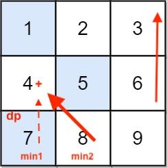

# ✅ optimised DP super fast solution in java | c | javascript | python | go | php | ruby | racket

**Author:** codeninja8
**Votes:** 0
**Link:** [https://leetcode.com/problems/minimum-falling-path-sum-ii/solutions/5076443/](https://leetcode.com/problems/minimum-falling-path-sum-ii/solutions/5076443/)

---

1. Take the last row of the `grid` as `dp` array
2. Iterate `grid` backward, staring from `n - 2` since we already have `dp` for the last row
3. In order to find the next `dp` we calculate the first minimum and the second minimum value in `dp`
4. Iterate over `dp`. We need to find a sum `dp[j] = grid[i][j] + min` so If `dp[j] == min1` that means that the minimum is on the same col with `grid[i][j]` and this is not good. We have to take the second minimum `min2`
5. At the end, we search for the minimum value in `dp` and this is what we need




# Code
``` java []
class Solution {
    public int minFallingPathSum(int[][] grid) {
        int n = grid.length;
        if (n == 1) return grid[0][0];
        int[] dp = grid[n-1];

        for (int i = n - 2; i >= 0; i--) {
            int min1 = Integer.MAX_VALUE;
            int min2 = Integer.MAX_VALUE;

            for (int j = 0; j < n; j++) {
                if (min1 >= dp[j]) {
                    min2 = min1;
                    min1 = dp[j];
                } else if (min2 >= dp[j]) {
                    min2 = dp[j];
                }
            }

            for (int j = 0; j < n; j++) {
                if (dp[j] == min1) {
                    dp[j] = grid[i][j] + min2;
                } else {
                    dp[j] = grid[i][j] + min1;
                }               
            }
        }

        int minSum = dp[0];
        for (int i = 0; i < n; i++) {
            minSum = Math.min(minSum, dp[i]);
        }

        return minSum;
    }
}
```
``` python []
class Solution(object):
    def minFallingPathSum(self, grid):
        n = len(grid)
        if n == 1: return grid[0][0]
        dp = grid[n-1]

        for i in reversed(range(n - 1)):
            min1 = min2 = sys.maxint

            for j in range(n):
                if dp[j] <= min1:
                    min2 = min1
                    min1 = dp[j]
                elif dp[j] <= min2:
                    min2 = dp[j]
            
            for j in range(n):
                if dp[j] == min1:
                    dp[j] = grid[i][j] + min2
                else:
                    dp[j] = grid[i][j] + min1
        return min(dp)
```
``` c []
int minFallingPathSum(int** grid, int gridSize, int* gridColSize) {
    if (gridSize == 1) return grid[0][0];
    int* dp = grid[gridSize - 1];

    for (int i = gridSize - 2; i >= 0; i--) {
        int min1 = INT_MAX;
        int min2 = INT_MAX;

        for (int j = 0; j < gridSize; j++) {
            if (min1 >= dp[j]) {
                min2 = min1;
                min1 = dp[j];
            } else if (min2 > dp[j]) {
                min2 = dp[j];
            }
        }

        for (int j = 0; j < gridSize; j++) {
            if (dp[j] == min1) {
                dp[j] = grid[i][j] + min2;
            } else {
                dp[j] = grid[i][j] + min1;
            }
        }
    }

    int minSum = INT_MAX;
    for (int i = 0; i < gridSize; i++) {
        if (dp[i] < minSum) {
            minSum = dp[i];
        }
    }

    return minSum;
}
```
``` javascript []
var minFallingPathSum = function (grid) {
    var n = grid.length;
    if (n == 1) return grid[0][0];
    var dp = grid[n - 1];

    for (var i = n - 2; i >= 0; i--) {
        var min1 = Number.MAX_VALUE;
        var min2 = Number.MAX_VALUE;
        for (var j = 0; j < n; j++) {
            if (min1 >= dp[j]) {
                min2 = min1;
                min1 = dp[j];
            } else if (min2 >= dp[j]) {
                min2 = dp[j];
            }
        }

        for (var j = 0; j < n; j++) {
            if (min1 == dp[j]) {
                dp[j] = grid[i][j] + min2;
            } else {
                dp[j] = grid[i][j] + min1;
            }
        }
    }

    return _.min(dp);
};
```
``` golang []
func minFallingPathSum(grid [][]int) int {
    n := len(grid)
    if n == 1 {
        return grid[0][0]
    }

    dp := grid[n - 1]

    for i := n - 2; i >= 0; i-- {
        min1 := math.MaxInt
        min2 := math.MaxInt

        for _, val := range dp {
            if min1 >= val {
                min2 = min1
                min1 = val
            } else if min2 >= val {
                min2 = val
            }
        }

        for j := 0; j < n; j++ {
            if dp[j] == min1 {
                dp[j] = grid[i][j] + min2
            } else {
                dp[j] = grid[i][j] + min1
            }
        }
    }

    minSum := math.MaxInt
    for _, val := range dp {
        if val < minSum {
            minSum = val
        }
    }

    return minSum
}
```
``` php []
class Solution {
    function minFallingPathSum($grid) {
        $n = count($grid);
        if ($n == 1) return $grid[0][0];

        $dp = $grid[$n - 1];
        for ($i = $n - 2; $i >= 0; $i--) {
            $min1 = PHP_INT_MAX;
            $min2 = PHP_INT_MAX;

            for ($j = 0; $j < $n; $j++) {
                if ($min1 >= $dp[$j]) {
                    $min2 = $min1;
                    $min1 = $dp[$j];
                } else if ($min2 > $dp[$j]) {
                    $min2 = $dp[$j];
                }
            }

            for ($j = 0; $j < $n; $j++) {
                if ($dp[$j] == $min1) {
                    $dp[$j] = $grid[$i][$j] + $min2;
                } else {
                    $dp[$j] = $grid[$i][$j] + $min1;
                }
            }
        }

        return min($dp);
    }
}
```
``` ruby []
def min_falling_path_sum(grid)
    n = grid.length
    return grid[0][0] if n == 1
    dp = grid[n-1]

    (n-2).downto(0) do |i|
        min1, min2 = dp.min(2)
        dp.each_index do |j|
            if dp[j] == min1
                dp[j] = grid[i][j] + min2
            else
                dp[j] = grid[i][j] + min1
            end
        end
    end

    return dp.min()
end
```
``` racket []
(define (doubleMin lst)
  (let loop ([min1 +inf.0]
             [min2 +inf.0]
             [lst lst])
    (cond [(null? lst) (cons min1 min2)]
          [(>= min1 (car lst)) (loop (car lst) min1 (cdr lst))]
          [(>= min2 (car lst)) (loop min1 (car lst) (cdr lst))]
          [else (loop min1 min2 (cdr lst))])))

(define (min-falling-path-sum grid)
  (let* ([rgrid (reverse grid)]
         [dp (car rgrid)]
         [rst (cdr rgrid)]
         [n (length grid)])
    (let loop ([grid rst]
               [dp dp])
      (if (null? grid)
          (apply min dp)
          (let* ([dmin (doubleMin dp)]
                 [min1 (car dmin)]
                 [min2 (cdr dmin)])
            (loop (cdr grid) (for/list ([g (car grid)]
                       [r dp])
              (if (eq? r min1)
                  (+ g min2)
                  (+ g min1)))))))))
```
