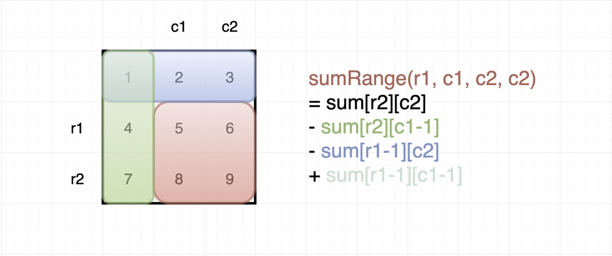

# [Python] Prefix Sum (Explanation with Diagram)

**Author:** wei_lun
**Votes:** 50
**Link:** [https://leetcode.com/problems/maximum-side-length-of-a-square-with-sum-less-than-or-equal-to-threshold/solutions/698422/](https://leetcode.com/problems/maximum-side-length-of-a-square-with-sum-less-than-or-equal-to-threshold/solutions/698422/)

---

1. The main idea here is to form the **largest possible square** whose **sum <= threshold**.

<br>

2. **1st Pass - O(MN) :** Create a **prefix sum matrix**. Note how we have **zero-padding** on the top row and left column after the conversion

```
					           0 0 0 0 
1 1 1                          0 1 2 3 
1 0 0            --->          0 2 3 4 
1 0 0                          0 3 4 5 
```

<br> 

2. **2nd Pass - O(MN) :** Update maximum length, starting from 0.

3. At each cell, we shall consider the following sums.

	* 	Top Rectangle (**Blue**)

	* 	Left Rectangle (**Green**)

	* 	Top-Left Rectangle (**Blue-Green Overlap**)



<br> 

3. The areas of the 3 rectangles are each given by a **single position** in the prefix-sum matrix (see code below)
<br>

```
class Solution:
    def maxSideLength(self, mat: List[List[int]], threshold: int) -> int:

        # GET DIMENSIONS
        nrows, ncols = len(mat), len(mat[0])

        # SETUP THE PREFIX SUM MATRIX
        prefix = [[0 for _ in range(ncols + 1)] for _ in range(nrows + 1)]
        
        # FILL THE CELLS - TOP RECT + LEFT RECT - TOP LEFT DOUBLE-COUNTED RECT
        for i in range(nrows):
            for j in range(ncols):
                prefix[i + 1][j + 1] = prefix[i][j + 1] + prefix[i + 1][j] - prefix[i][j] + mat[i][j]
        
        # for row in prefix:
        #     print(row)
            
        '''
        1. INITIALIZE MAX_SIDE = 0
        2. AT EACH CELL, WE'LL CHECK IF RECTANGLE (OR SQUARE) FROM [I - MAX, J - MAX] TO [I, J], BOTH INCLUSIVE, IS <= THRESHOLD
        '''
        
        # INITIALIZE MAX SIDE
        max_side = 0
        
        # CHECK IF RECTANGLE (OR SQUARE) FROM [I - MAX, J - MAX] TO [I, J] <= THRESHOLD
        for i in range(nrows):
            for j in range(ncols): 
                
                # CHECK IF WE CAN SUBTRACT MAX_SIDE
                if min(i, j) >= max_side:
                    curr = prefix[i + 1][j + 1]
                    top = prefix[i - max_side][j + 1]
                    left = prefix[i + 1][j - max_side]
                    topLeft = prefix[i - max_side][j - max_side]
                    total = curr - top - left + topLeft
                    
                    # print(f"CURR : {curr} | TOP : {top} | LEFT : {left} | TOP_LEFT : {topLeft}")
                    # print(f"TOTAL : {total}\
")
                    
                    # UPDATE MAX_SIDE IFF TOTAL <= THRESHOLD
                    if total <= threshold:
                        max_side += 1
                
        # RETURN MAX SIDE
        return max_side
```