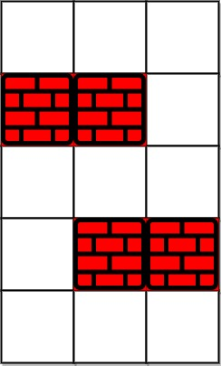
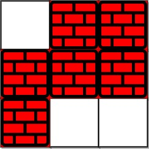

# [1293. Shortest Path in a Grid with Obstacles Elimination](https://leetcode.com/problems/shortest-path-in-a-grid-with-obstacles-elimination/)

| Category | Difficulty | Likes | Dislikes |
| :------: | :--------: | :---: | :------: |
| Algorithms | Hard | 4777 | 90 |

**Tags:** [`array`](https://leetcode.com/tag/array), [`breadth-first-search`](https://leetcode.com/tag/breadth-first-search), [`matrix`](https://leetcode.com/tag/matrix)

**Companies:** `facebook`, `google`, `amazon`, `adobe`, `tiktok`, `bloomberg`, `pinterest`, `snapchat`, `databricks`, `oracle`, `imc`, `nuro`

## Description

You are given an `m x n` integer matrix `grid` where each cell is either `0` (empty) or `1` (obstacle). You can move up, down, left, or right from and to an empty cell in **one step**.

Return *the minimum number of **steps** to walk from the upper left corner *`(0, 0)`* to the lower right corner *`(m - 1, n - 1)`* given that you can eliminate **at most** *`k`* obstacles*. If it is not possible to find such walk return `-1`.

 

**Example 1:**


```

Input: grid = [[0,0,0],[1,1,0],[0,0,0],[0,1,1],[0,0,0]], k = 1
Output: 6
Explanation: 
The shortest path without eliminating any obstacle is 10.
The shortest path with one obstacle elimination at position (3,2) is 6. Such path is (0,0) -&gt; (0,1) -&gt; (0,2) -&gt; (1,2) -&gt; (2,2) -&gt; (3,2) -&gt; (4,2).

```

**Example 2:**


```

Input: grid = [[0,1,1],[1,1,1],[1,0,0]], k = 1
Output: -1
Explanation: We need to eliminate at least two obstacles to find such a walk.

```

 

**Constraints:**

	- `m == grid.length`

	- `n == grid[i].length`

	- `1 <= m, n <= 40`

	- `1 <= k <= m * n`

	- `grid[i][j]` is either `0` **or** `1`.

	- `grid[0][0] == grid[m - 1][n - 1] == 0`

---

**Links:** [Submissions](https://leetcode.com/problems/shortest-path-in-a-grid-with-obstacles-elimination/) | [Solutions](https://leetcode.com/problems/shortest-path-in-a-grid-with-obstacles-elimination/)
