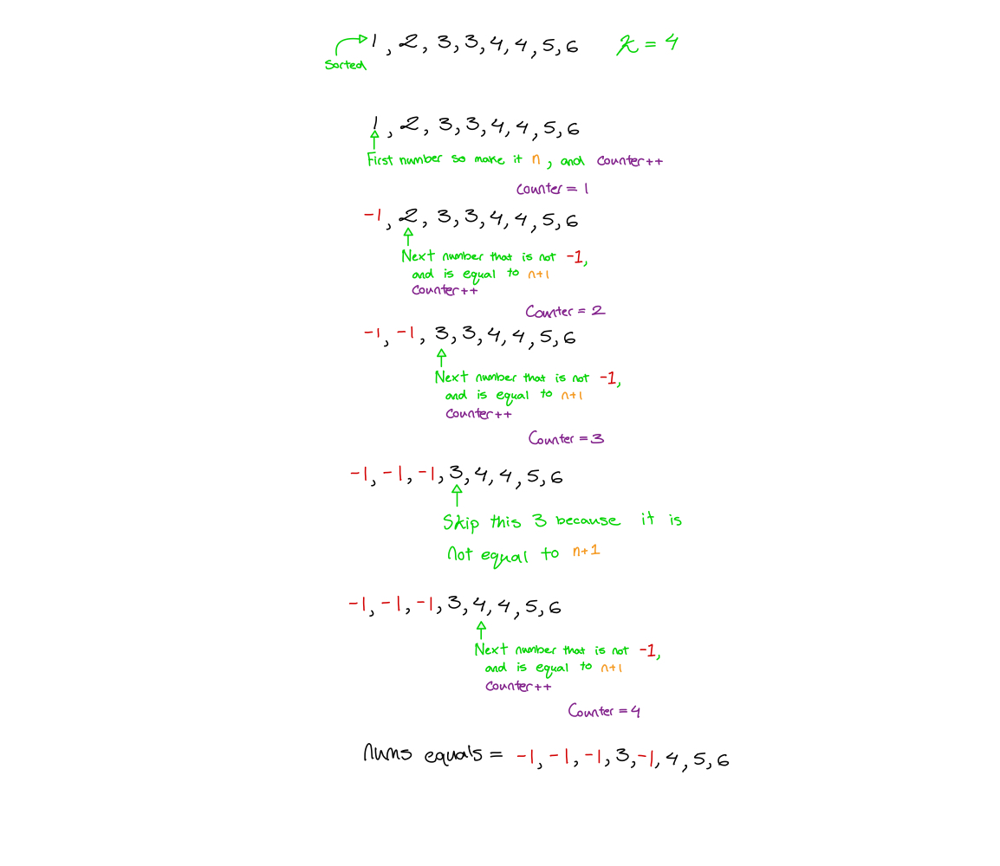
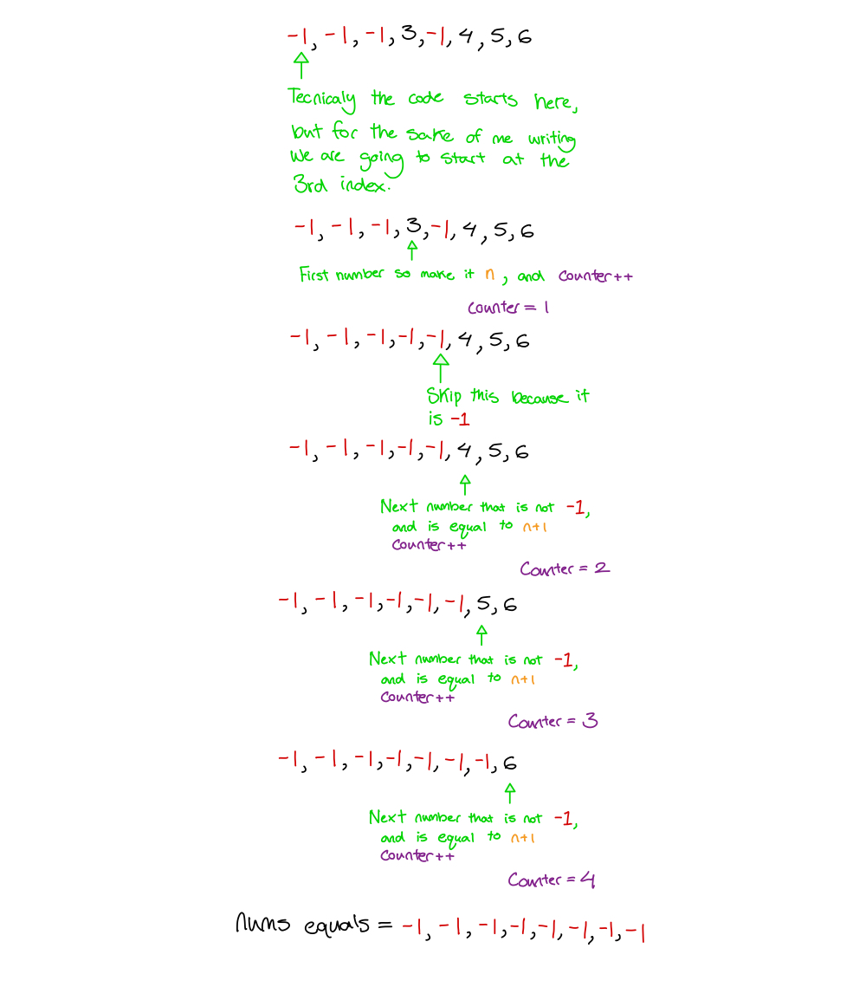

# Golang solution with explanation and images

**Author:** nathannaveen
**Votes:** 4
**Link:** [https://leetcode.com/problems/divide-array-in-sets-of-k-consecutive-numbers/solutions/1080969/](https://leetcode.com/problems/divide-array-in-sets-of-k-consecutive-numbers/solutions/1080969/)

---

**Code On the Bottom, and If This Helps Please Up Vote**
**Divide array in sets of k consecutive numbers**

	better space than 96.67%, O(1) without including input array


The idea of this solution is to loop over the `nums` array until all the values are `-1`. The reason they all will become negative one is, whenever a item is used the value will become `-1` so the code knows to not use that number again.


**If you didn't understand the explaination this can be shown using the code on the bottom, an example and some pictures:**
*By the way sorry if my handwriting is messy*
```
input = [1, 2, 4, 3, 4, 5, 6, 3], k = 4
expected output = true
```

This is for getting the first consecutive sequence:


And the second consecutive sequence:


Since we found two consecutive sequences we can return `true`.

* **

```
func isPossibleDivide(nums []int, k int) bool {
	if len(nums)%k != 0 {
		return false
	}
	sort.Ints(nums)
	onlyNegetiveOnes := false

	for !onlyNegetiveOnes {
		onlyNegetiveOnes = true
		n := -1
		counter := 0
		for i := 0; i < len(nums); i++ {
			if nums[i] != -1 {
				onlyNegetiveOnes = false
				if (n == -1) || (counter != k && nums[i] == n+1) {
					n = nums[i]
					nums[i] = -1
					counter++
				} else if counter == k {
					break
				}
			}
		}
		if counter != k && counter != 0 {
			return false
		}
	}
	return true
}
```