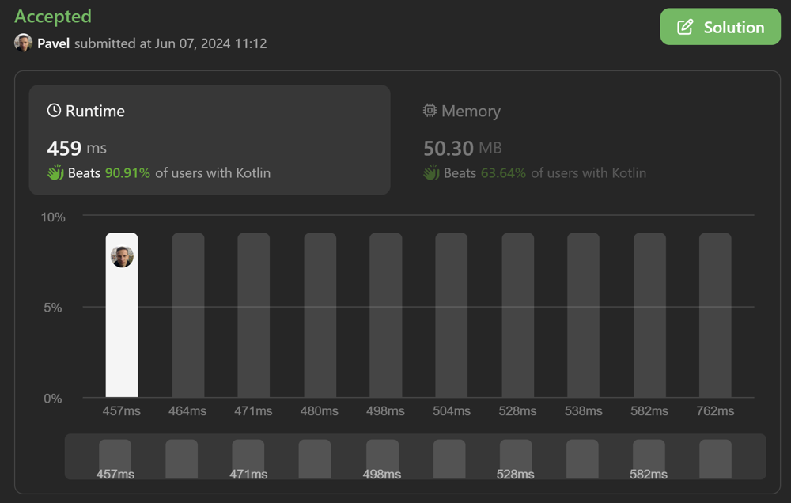

# 🔥90%🔥heap || priority queue || kotlin || no eye cancer ❌

**Author:** naXa777
**Votes:** 0
**Link:** [https://leetcode.com/problems/divide-array-in-sets-of-k-consecutive-numbers/solutions/5273727/](https://leetcode.com/problems/divide-array-in-sets-of-k-consecutive-numbers/solutions/5273727/)

---

# Intuition

This is a copy of my solution https://leetcode.com/problems/hand-of-straights/solutions/5271117/100-heap-priority-queue-kotlin-no-eye-cancer-fork/

# Complexity

- Time complexity: $$O(n^2)$$
- Space complexity: $$O(n)$$

# Code

```kt
class Solution {
    fun isPossibleDivide(nums: IntArray, k: Int): Boolean {
        if (nums.size % k > 0) return false
        if (k == 1) return true

        val deck = PriorityQueue<Int>(nums.size)
        for (card in nums) {
            deck.add(card)
        }

        while (deck.size > 0) {
            val card = deck.remove()
            for (i in 1 until k) {
                if (!deck.remove(card + i))
                    return false
            }
        }

        return true
    }
}
```

# Screenshot


