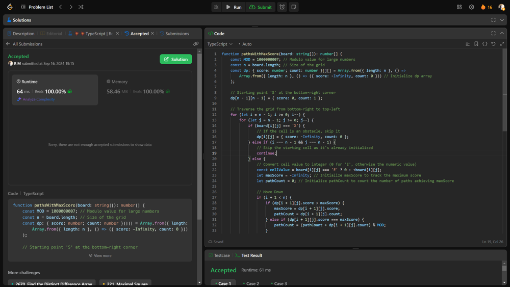

# 💥💥 Beats runtime AND memory 100% [EXPLAINED]

**Author:** r9n
**Votes:** 10
**Link:** [https://leetcode.com/problems/number-of-paths-with-max-score/solutions/5796765/](https://leetcode.com/problems/number-of-paths-with-max-score/solutions/5796765/)

---




# Intuition
To solve the problem, imagine you're navigating a grid where each cell has a score or is blocked by an obstacle. You start at the bottom-right and want to reach the top-left while collecting the maximum possible score. You can only move up, left, or diagonally up-left. The goal is to find the maximum score you can collect and count how many different paths give you that maximum score.

# Approach
Initialization:

Create a 2D array called dp where dp[r][c] will store two things:
The maximum score you can collect to reach cell (r, c).
The number of different ways to achieve that maximum score.

Processing Each Cell:

Start from the bottom-right corner of the grid and move towards the top-left.
For each cell, check the possible moves you can make:
Move Up: Check the cell directly above.
Move Left: Check the cell directly to the left.
Move Diagonally Up-Left: Check the cell diagonally up-left.
Update the current cell\u2019s maximum score and the number of ways to achieve that score based on the best possible moves from the neighboring cells.

Result:

Once you have processed all cells, the top-left cell of the dp array will give you the maximum score you can achieve and the number of ways to reach that score.

For example, if your grid looks like this:

E 1 1
X X X
1 1 S

1 - Initialize dp such that each cell starts with a score of 0 and a path count of 0.

2 - Process the grid from bottom-right to top-left:
 - For cell (2, 2), which is S, the score is 0 and there\u2019s 1 way to be there (start point).

 - Update the cells around it based on possible moves.
 
3 - Finally, dp[0][0] will have the maximum score and the count of paths to achieve that score.

# Complexity
- Time complexity:
O(n^2) because we visit each cell in the n x n grid once and update it based on its neighbors.

- Space complexity:
O(n^2) due to the dp table which stores information for every cell in the grid.

# Code
```typescript []
function pathsWithMaxScore(board: string[]): number[] {
    const MOD = 1000000007; // Modulo value for large numbers
    const n = board.length; // Size of the grid
    const dp: { score: number; count: number }[][] = Array.from({ length: n }, () =>
        Array.from({ length: n }, () => ({ score: -Infinity, count: 0 })) // Initialize dp array
    );

    // Starting point 'S' at the bottom-right corner
    dp[n - 1][n - 1] = { score: 0, count: 1 };

    // Traverse the grid from bottom-right to top-left
    for (let i = n - 1; i >= 0; i--) {
        for (let j = n - 1; j >= 0; j--) {
            if (board[i][j] === 'X') {
                // If the cell is an obstacle, skip it
                dp[i][j] = { score: -Infinity, count: 0 };
            } else if (i === n - 1 && j === n - 1) {
                // Skip the starting cell as it's already initialized
                continue;
            } else {
                // Convert cell value to integer (0 for 'E', otherwise the numeric value)
                const cellValue = board[i][j] === 'E' ? 0 : +board[i][j];
                let maxScore = -Infinity; // Initialize maxScore to track the maximum score
                let pathCount = 0; // Initialize pathCount to count the number of paths achieving maxScore

                // Move Down
                if (i + 1 < n) {
                    if (dp[i + 1][j].score > maxScore) {
                        maxScore = dp[i + 1][j].score;
                        pathCount = dp[i + 1][j].count;
                    } else if (dp[i + 1][j].score === maxScore) {
                        pathCount = (pathCount + dp[i + 1][j].count) % MOD;
                    }
                }

                // Move Right
                if (j + 1 < n) {
                    if (dp[i][j + 1].score > maxScore) {
                        maxScore = dp[i][j + 1].score;
                        pathCount = dp[i][j + 1].count;
                    } else if (dp[i][j + 1].score === maxScore) {
                        pathCount = (pathCount + dp[i][j + 1].count) % MOD;
                    }
                }

                // Move Diagonally (Up-Left)
                if (i + 1 < n && j + 1 < n) {
                    if (dp[i + 1][j + 1].score > maxScore) {
                        maxScore = dp[i + 1][j + 1].score;
                        pathCount = dp[i + 1][j + 1].count;
                    } else if (dp[i + 1][j + 1].score === maxScore) {
                        pathCount = (pathCount + dp[i + 1][j + 1].count) % MOD;
                    }
                }

                // Update dp for the current cell
                if (maxScore === -Infinity) {
                    dp[i][j] = { score: -Infinity, count: 0 };
                } else {
                    dp[i][j] = { score: maxScore + cellValue, count: pathCount };
                }
            }
        }
    }

    // Final result is in dp[0][0]
    const result = dp[0][0];
    return [result.score === -Infinity ? 0 : result.score, result.count];
}

```