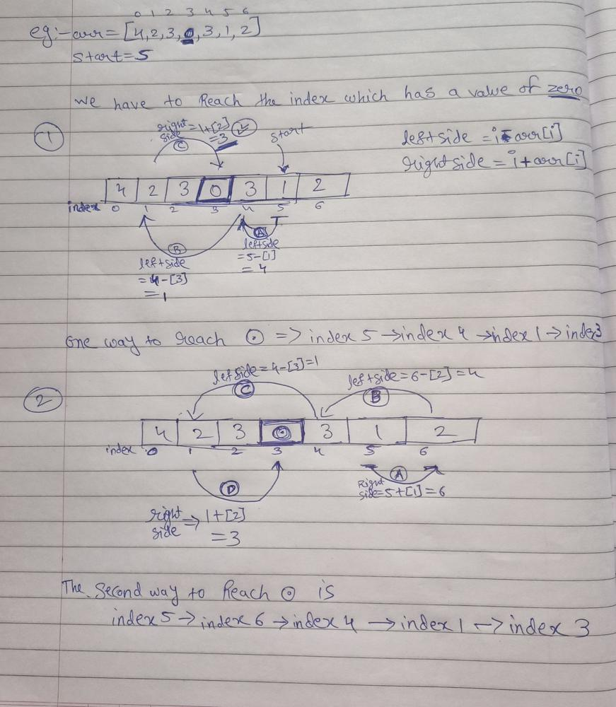

# C++ easy to solve solution || Beginner friendly algo with detailed explanation and a dry run

**Author:** Cosmic_Phantom
**Votes:** 93
**Link:** [https://leetcode.com/problems/jump-game-iii/solutions/1618994/](https://leetcode.com/problems/jump-game-iii/solutions/1618994/)

---

**Recursive Doge || Doge jumper Algorithm || DFS+Recursion logic**

**Intuition:)**
After reading the question we get the gist that we have to reach the index were value is 0 by jumping left and right ,so the best intuition we get is recursion. So now let's think of approach ;)

**Algorithm :**
1. First let's think of edge case when our starting location and destination are same. well this is the best case scenerio so we just return true.
2. From the intuition we know we have to jump left and right ,so before jumping we need to check if we have already been there or not . Thus to mark the visited locations we mark them as -1
3. arr[start] should be marked as visited yup, you guessed it correctly , since we start form arr[start] it should be marked as -1 ;]
4. Now if righside is less then arr.size() then do the rightside recursion  or if leftside is > 0 then we have to do leftside recursion .
5. Kaboom that's it  .

**Before starting with code let's take a dry run:**



**Code:-**
```
//Comment and Upvote :)

class Solution {
public:
    bool canReach(vector<int>& arr, int start) {
        //if we have already visited that value , we return false
        if(arr[start]== -1) return false;
        //best case scenerio will be if arr[start] is 0 so we return true
        if(!arr[start]) return true;
        //For leftside and rightside jumps       
        int leftside= start-arr[start] ,rightside = start+arr[start];
        //since we start from arr[start] it should be marked as visited
        arr[start] = -1;
        
        //Now the scenerio were arr[start] != 0 then we need to check if we can either jump to leftside or rightside i.e recursively 
        return rightside = (rightside < arr.size() && canReach(arr,rightside) ) || (leftside>=0 && canReach(arr,leftside) );
    }
};
```
**Time Complexity:** ***`O(n)`*** we are visiting an index only once, in worst can we have to visit all the index lets say we have [1, 1, 1, 1, 1, 1, 0] and start is index = 0
**Space Complexity:** ***`O(1)`*** we are not using any extra space (if we are not counting recursion stack ).

***


..... *Continuation from the previous posts,
A mysterious call came to one of the archelogist who were inspecting the ruins of Dr Cheems Doge's lab. The mysterious caller told that do not make mistake of opening the ancient ruins of Dr.Cheems if that opens many things will rise from the ground and shake the entire reality of  earth. After giving that warning the mysterious man disconnected. The archealogist argues about the authenticity of that call .[While in background one of the caged door was vibrating* ...]  *To be continued in the next post*......... 

