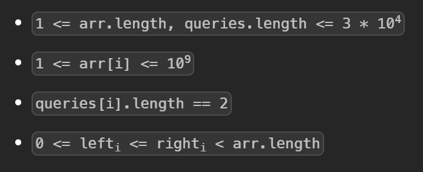
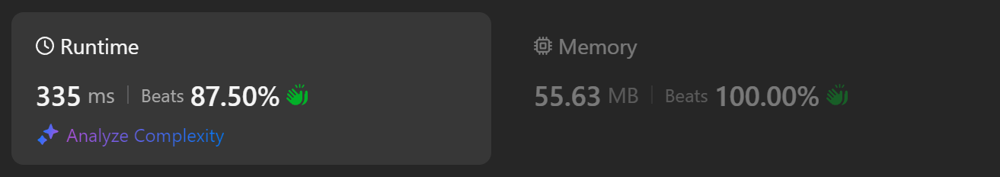
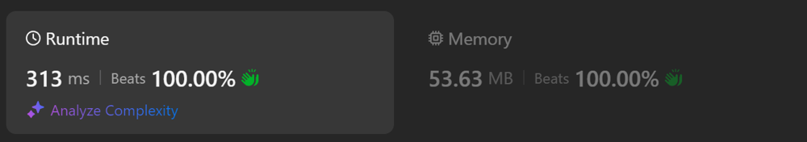

# Kotlin. Beats 100% (313 ms). Prefix table solution.

**Author:** mobdev778
**Votes:** 1
**Link:** [https://leetcode.com/problems/xor-queries-of-a-subarray/solutions/5780071/](https://leetcode.com/problems/xor-queries-of-a-subarray/solutions/5780071/)

---


# Code
```kotlin []
class Solution {
    fun xorQueries(arr: IntArray, queries: Array<IntArray>): IntArray {
        val prefixXor = prefixTable(arr)

        return IntArray(queries.size) {
            val (start, end) = queries[it]
            prefixXor[end] xor if (start > 0) prefixXor[start - 1] else 0
        }
    }

    inline fun prefixTable(arr: IntArray): IntArray {
        var xored = 0
        return IntArray(arr.size) {
            xored = xored xor arr[it]
            xored
        }
    }
}
```

# Approach



It is easy to see from the problem statement that when calculating XOR we will have to go through the same values \u200B\u200Boften.

For such cases, it is better to save time and use a pre-calculated prefix table, in which each "i" element will contain XOR-ed values from arr from 0 to "i".

At the moment when we need to calculate arr[2] xor arr[3], we first take the value of prefixXor[3].
```
prefixXor[3] = arr[0] xor arr[1] xor arr[2] xor arr[3].
```

From this list, we need to take only arr[2] xor arr[3].
How can this be done? To do this, we can make a xor of this value with the first 2 elements:
```
arr[2] xor arr[3] = (arr[0] xor arr[1] xor arr[2] xor 
arr[3]) xor arr[0] xor arr[1]
```
```
arr[0] xor arr[1] xor arr[2] xor arr[3] = prefixXor[3]
arr[0] xor arr[1] = prefixXor[1]
arr[2] xor arr[3] = prefixXor[3] xor prefixXor[1]
```

Here, it is probably appropriate to recall 2 important rules for xor:
```
a xor a = 0
b xor 0 = b
```

# Alternative approaches

A small attempt to get rid of the "if" inside the loop:



```
class Solution {
    fun xorQueries(arr: IntArray, queries: Array<IntArray>): IntArray {
        val prefixXor = prefixTable(arr)

        return IntArray(queries.size) {
            val (start, end) = queries[it]
            prefixXor[end + 1] xor prefixXor[start]
        }
    }

    inline fun prefixTable(arr: IntArray): IntArray {
        val result = IntArray(arr.size + 1)
        for (i in 0 until arr.size) {
            result[i + 1] = result[i] xor arr[i]
        }
        return result
    }
}
```

One more attempt:



```
class Solution {
    fun xorQueries(arr: IntArray, queries: Array<IntArray>): IntArray {
        val prefixXor = prefixTable(arr)

        return IntArray(queries.size) {
            prefixXor[queries[it][0]] xor prefixXor[queries[it][1] + 1]
        }
    }

    fun prefixTable(arr: IntArray): IntArray {
        val result = IntArray(arr.size + 1)
        for (i in 0 until arr.size) {
            result[i + 1] = result[i] xor arr[i]
        }
        return result
    }
}
```
