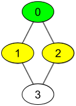
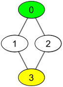

# [1311. Get Watched Videos by Your Friends](https://leetcode.com/problems/get-watched-videos-by-your-friends/)

| Category | Difficulty | Likes | Dislikes |
| :------: | :--------: | :---: | :------: |
| Algorithms | Medium | 474 | 446 |

**Tags:** [`array`](https://leetcode.com/tag/array), [`hash-table`](https://leetcode.com/tag/hash-table), [`breadth-first-search`](https://leetcode.com/tag/breadth-first-search), [`graph`](https://leetcode.com/tag/graph), [`sorting`](https://leetcode.com/tag/sorting)

**Companies:** `amazon`

## Description

There are `n` people, each person has a unique *id* between `0` and `n-1`. Given the arrays `watchedVideos` and `friends`, where `watchedVideos[i]` and `friends[i]` contain the list of watched videos and the list of friends respectively for the person with `id = i`.

Level **1** of videos are all watched videos by your friends, level **2** of videos are all watched videos by the friends of your friends and so on. In general, the level `k` of videos are all watched videos by people with the shortest path **exactly** equal to `k` with you. Given your `id` and the `level` of videos, return the list of videos ordered by their frequencies (increasing). For videos with the same frequency order them alphabetically from least to greatest. 

 

**Example 1:**

****

```

Input: watchedVideos = [[&quot;A&quot;,&quot;B&quot;],[&quot;C&quot;],[&quot;B&quot;,&quot;C&quot;],[&quot;D&quot;]], friends = [[1,2],[0,3],[0,3],[1,2]], id = 0, level = 1
Output: [&quot;B&quot;,&quot;C&quot;] 
Explanation: 
You have id = 0 (green color in the figure) and your friends are (yellow color in the figure):
Person with id = 1 -&gt; watchedVideos = [&quot;C&quot;]&nbsp;
Person with id = 2 -&gt; watchedVideos = [&quot;B&quot;,&quot;C&quot;]&nbsp;
The frequencies of watchedVideos by your friends are:&nbsp;
B -&gt; 1&nbsp;
C -&gt; 2

```

**Example 2:**

****

```

Input: watchedVideos = [[&quot;A&quot;,&quot;B&quot;],[&quot;C&quot;],[&quot;B&quot;,&quot;C&quot;],[&quot;D&quot;]], friends = [[1,2],[0,3],[0,3],[1,2]], id = 0, level = 2
Output: [&quot;D&quot;]
Explanation: 
You have id = 0 (green color in the figure) and the only friend of your friends is the person with id = 3 (yellow color in the figure).

```

 

**Constraints:**

	- `n == watchedVideos.length == friends.length`

	- `2 <= n <= 100`

	- `1 <= watchedVideos[i].length <= 100`

	- `1 <= watchedVideos[i][j].length <= 8`

	- `0 <= friends[i].length < n`

	- `0 <= friends[i][j] < n`

	- `0 <= id < n`

	- `1 <= level < n`

	- if `friends[i]` contains `j`, then `friends[j]` contains `i`

---

**Links:** [Submissions](https://leetcode.com/problems/get-watched-videos-by-your-friends/) | [Solutions](https://leetcode.com/problems/get-watched-videos-by-your-friends/)
