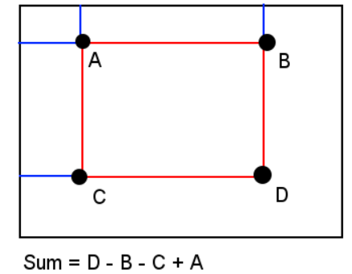
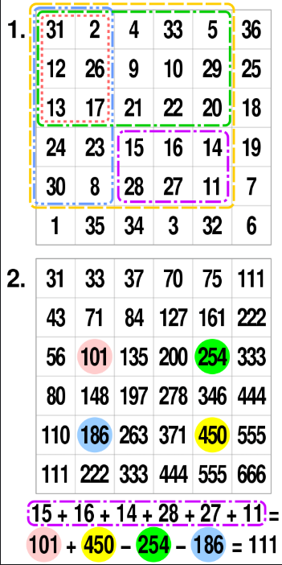

# Python/JS/Go/C++ O( m*n ) Integral Image // DP [ w/ Explanation ]

**Author:** brianchiang_tw
**Votes:** 171
**Link:** [https://leetcode.com/problems/matrix-block-sum/solutions/482730/](https://leetcode.com/problems/matrix-block-sum/solutions/482730/)

---

O( m*n ) sol. based on integral image technique ( 2D DP ).

---

**Explanation on integral image**:

Here we use the technique of **integral image**, which is introduced to **speed up block computation**.

Also, this technique is practical and common in the field of matrix operation and image processing such as [filtering](https://docs.opencv.org/master/d4/d86/group__imgproc__filter.html#gad533230ebf2d42509547d514f7d3fbc3) and feature extraction.

Block sum formula on integral image.
 **Block-sum** of **red rectangle** = **block-sum of D - block-sum of B - block-sum of C + block-sum of A**


---

**Example** of integral image ( focus on the purple block ).





---

**Implementation**:

**Python**:

```
class Solution:
    def matrixBlockSum(self, mat: List[List[int]], K: int) -> List[List[int]]:
            
        h, w = len(mat), len( mat[0])
        integral_image = [ [ 0 for y in range(w) ] for x in range(h) ]
        

        # building integral image to speed up block sum computation
        for y in range(0, h):
            summation = 0
            
            for x in range(0, w):
                summation += mat[y][x]
                integral_image[y][x] = summation
                
                if y > 0:
                    integral_image[y][x] += integral_image[y-1][x]
        
        
        
        # compute block sum by looking-up integral image
        output_image = [ [ 0 for y in range(w) ] for x in range(h) ]
        
        for y in range(h):
            for x in range(w):
                
                min_row, max_row = max( 0, y-K), min( h-1, y+K)
                min_col, max_col = max( 0, x-K), min( w-1, x+K)
                
                output_image[y][x] = integral_image[max_row][max_col]
                
                if min_row > 0:
                    output_image[y][x] -= integral_image[min_row-1][max_col]
                
                if min_col > 0:
                    output_image[y][x] -= integral_image[max_row][min_col-1]
                    
                if min_col > 0 and min_row > 0:
                    output_image[y][x] += integral_image[min_row-1][min_col-1]
                
        return output_image
```

---

**Javascript**:

```
var matrixBlockSum = function(mat, k) {
    
    let [h, w] = [ mat.length, mat[0].length ];
    
    let integralImg = new Array(h).fill(0).map( () => new Array(w).fill(0) );
    let outputImg = new Array(h).fill(0).map( () => new Array(w).fill(0) );
    
    
    // building integral image to speed up block sum computation
    for( let y = 0 ; y < h ; y++){
        let pixelSum = 0;
        
        for( let x = 0 ; x < w ;x++){
            pixelSum += mat[y][x];
            integralImg[y][x] = pixelSum;
            
            if( y > 0 ){ 
                integralImg[y][x] += integralImg[y-1][x];
            }
        }
    }
    
    
    // compute block sum by looking-up integral image
    for( let y = 0 ; y < h ; y++){
        
        let [minRow, maxRow] = [ Math.max(0, y-k), Math.min(h-1, y+k)];
        
        for( let x = 0 ; x < w ;x++){
            
            let [minCol, maxCol] = [ Math.max(0, x-k), Math.min(w-1, x+k)];
            
            outputImg[y][x] = integralImg[maxRow][maxCol];
            
            if( minRow > 0 ){
                outputImg[y][x] -= integralImg[minRow-1][maxCol];
            }
            
            if( minCol > 0 ){
                outputImg[y][x] -= integralImg[maxRow][minCol-1];
            }
            
            if( (minRow > 0) && (minCol > 0) ){
                outputImg[y][x] += integralImg[minRow-1][minCol-1];
            }
            
            
        }
    }
        
    return outputImg;
    
    
};
```

---

**C++**

```
class Solution {
public:
    vector<vector<int>> matrixBlockSum(vector<vector<int>>& mat, int k) {

    const int h = mat.size(), w = mat[0].size();
    
    vector< vector<int> > integralImg = vector< vector<int> >(h, vector< int >(w, 0) );
    vector< vector<int> > outputImg = vector< vector<int> >(h, vector< int >(w, 0) );
    
    
    // building integral image to speed up block sum computation
    for( int y = 0 ; y < h ; y++){
        int pixelSum = 0;
        
        for( int x = 0 ; x < w ;x++){
            pixelSum += mat[y][x];
            integralImg[y][x] = pixelSum;
            
            if( y > 0 ){ 
                integralImg[y][x] += integralImg[y-1][x];
            }
        }
    }
    
    
    // compute block sum by looking-up integral image
    for( int y = 0 ; y < h ; y++){
        
        const int minRow = max(0, y-k), maxRow = min(h-1, y+k);
        
        for( int x = 0 ; x < w ;x++){
            
            const int minCol = max(0, x-k), maxCol = min(w-1, x+k);
            
            outputImg[y][x] = integralImg[maxRow][maxCol];
            
            if( minRow > 0 ){
                outputImg[y][x] -= integralImg[minRow-1][maxCol];
            }
            
            if( minCol > 0 ){
                outputImg[y][x] -= integralImg[maxRow][minCol-1];
            }
            
            if( (minRow > 0) && (minCol > 0) ){
                outputImg[y][x] += integralImg[minRow-1][minCol-1];
            }
        }
    }
        
    return outputImg;        
    }
};
```

---

**Go**:

```
func create2DArray( h, w int) [][]int{
    
    matrix  := make( [][]int, h )
    row := make( []int, h * w)
    
    for y := 0 ; y < h ; y++{
        matrix[ y ] = row[ y*w : (y+1)*w ] 
    }
    
    return matrix
}


func max(x, y int) int {
    if x > y {
        return x
    }else{
        return y
    }
}

func min(x, y int) int {
    if x < y {
        return x
    }else{
        return y
    }
}


func matrixBlockSum(mat [][]int, k int) [][]int {
    
    h, w := len(mat), len(mat[0])
    
    integralImg  := create2DArray(h, w)
    outputImg := create2DArray(h, w)
    
    
    
    // building integral image to speed up block sum computation
    for y := 0 ; y < h ; y++{
        pixelSum := 0;
        
        for  x := 0 ; x < w ;x++{
            pixelSum += mat[y][x];
            integralImg[y][x] = pixelSum;
            
            if y > 0 { 
                integralImg[y][x] += integralImg[y-1][x];
            }
        }
    }
    
    
    // compute block sum by looking-up integral image
    for y := 0 ; y < h ; y++{
        
        minRow := max(0, y-k)
        maxRow := min(h-1, y+k)
        
        for x := 0 ; x < w ;x++ {
            
            minCol := max(0, x-k)
            maxCol := min(w-1, x+k)
            
            outputImg[y][x] = integralImg[maxRow][maxCol];
            
            if( minRow > 0 ){
                outputImg[y][x] -= integralImg[minRow-1][maxCol];
            }
            
            if( minCol > 0 ){
                outputImg[y][x] -= integralImg[maxRow][minCol-1];
            }
            
            if( (minRow > 0) && (minCol > 0) ){
                outputImg[y][x] += integralImg[minRow-1][minCol-1];
            }
        }
    }
        
    return outputImg;        
    

}
```

---

Share another implementation with update function in bottom-up

<details>
	<summary> Click to show source code</summary>

```
class Solution:
    def matrixBlockSum(self, mat: List[List[int]], K: int) -> List[List[int]]:
            
        h, w = len(mat), len( mat[0])
        integral_image = [ [ 0 for y in range(w) ] for x in range(h) ]
        
        #-----------------------------------------
        def update(x, y):
            
            # add current pixel
            result = mat[y][x]
            
            if x:
                # add integral image of left pixel
                result += integral_image[y][x-1]
            
            if y:
                # add integral image of top pixel
                result +=  integral_image[y-1][x]

            if x and y:
                # remove repeated part of top-left pixel
                result -=  integral_image[y-1][x-1]
            
            return result
        
        # ----------------------------------------
        # building integral image to speed up block sum computation
        for y in range(0, h):
            for x in range(0, w):
                integral_image[y][x] = update(x, y)
                
                
        
        # compute block sum by looking-up integral image
        output_image = [ [ 0 for y in range(w) ] for x in range(h) ]
        
        for y in range(h):
            for x in range(w):
                
                min_row, max_row = max( 0, y-K), min( h-1, y+K)
                min_col, max_col = max( 0, x-K), min( w-1, x+K)
                
                output_image[y][x] = integral_image[max_row][max_col]
                
                if min_row > 0:
                    output_image[y][x] -= integral_image[min_row-1][max_col]
                
                if min_col > 0:
                    output_image[y][x] -= integral_image[max_row][min_col-1]
                    
                if min_col > 0 and min_row > 0:
                    output_image[y][x] += integral_image[min_row-1][min_col-1]
                
        return output_image
```

</details>

---

**Implentation** with integral image building in top-down DP 

<details>
	<summary> Click to show source code</summary>
	
```
class Solution:
    def matrixBlockSum(self, mat: List[List[int]], K: int) -> List[List[int]]:
            
        h, w = len(mat), len( mat[0])
        integral_image = [ [ 0 for y in range(w) ] for x in range(h) ]
        
        #-----------------------------------------
        def build_integral_image(x, y):
            
            if (x < 0) or (y < 0):
                
                ## base case:
                # zero for those pixels out of valid boundary
                return 0
            
            if integral_image[y][x]:
                ## base case:
                # direcly look-up table
                return integral_image[y][x]
            
            ## general cases
            # comptue and update integral image at (x, y)
            
            integral_image[y][x] = mat[y][x] + build_integral_image(x, y-1) + build_integral_image(x-1, y) - build_integral_image(x-1, y-1)
            
            return integral_image[y][x]
        
        # ----------------------------------------
        # building integral image to speed up block sum computation
        build_integral_image(w-1, h-1)
                
        
        # compute block sum by looking-up integral image
        output_image = [ [ 0 for y in range(w) ] for x in range(h) ]
        
        for y in range(h):
            for x in range(w):
                
                min_row, max_row = max( 0, y-K), min( h-1, y+K)
                min_col, max_col = max( 0, x-K), min( w-1, x+K)
                
                output_image[y][x] = integral_image[max_row][max_col]
                
                if min_row > 0:
                    output_image[y][x] -= integral_image[min_row-1][max_col]
                
                if min_col > 0:
                    output_image[y][x] -= integral_image[max_row][min_col-1]
                    
                if min_col > 0 and min_row > 0:
                    output_image[y][x] += integral_image[min_row-1][min_col-1]
                
        return output_image
```

</details>

---

Related leetcode challenge:
[Leetcode #304 Range Sum Query 2D - Immutable](https://leetcode.com/problems/range-sum-query-2d-immutable/)

[Leetcode #303 Range Sum Query - Immutable](https://leetcode.com/problems/range-sum-query-immutable/)

---

Reference:
[Integral Image in wikipedia](https://en.wikipedia.org/wiki/Summed-area_table)

---

Further reading:
[1] [Integral Image in OpenCV API](https://docs.opencv.org/master/d5/de6/group__cudaarithm__reduce.html#ga07e5104eba4bf45212ac9dbc5bf72ba6)

[2] [ImageJ: Integral Image Filter](https://imagej.net/Integral_Image_Filters)

---

Thanks for your reading.

Wish you have a nice day.

Meow~\uD83D\uDE3A