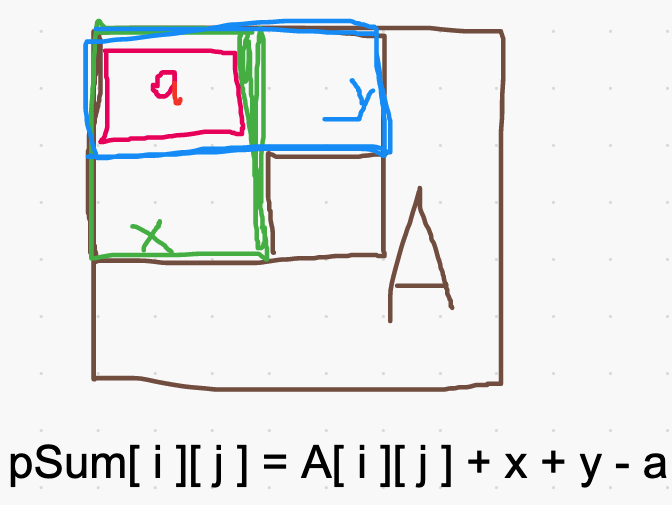
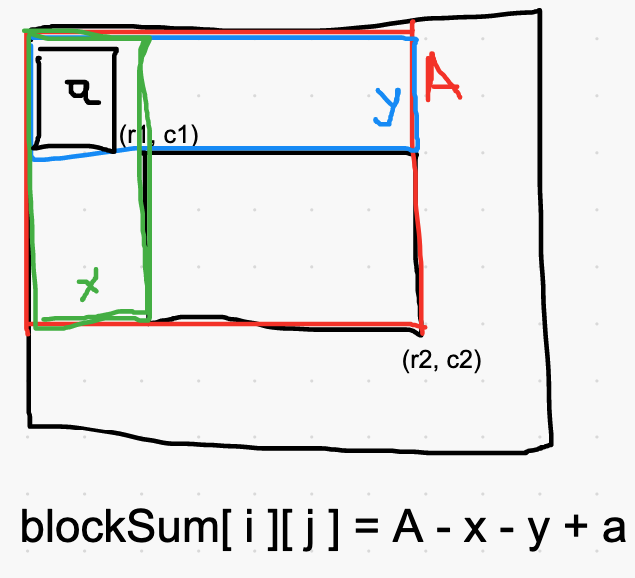

# Kotlin - handling boundary cases with same dimens

**Author:** 2pac_shakur
**Votes:** 1
**Link:** [https://leetcode.com/problems/matrix-block-sum/solutions/962862/](https://leetcode.com/problems/matrix-block-sum/solutions/962862/)

---

Why same dimens? It's easy to code this up in an interview. Just draw a picture and you are done!.

**Step1: Populating prefix-sum**


--------------------------------


**Step2: Block sum calculation**



```
    fun matrixBlockSum(A: Array<IntArray>, k: Int): Array<IntArray> {
        val R = A.size
        val C = A[0].size
        val pSum = Array(R) { IntArray(C) }
        val ans = Array(R) { IntArray(C) }
		// Step1: Populating prefix-sum
        for (i in 0 until R) {
            for (j in 0 until C) {
                val a = if (i - 1 >= 0 && j - 1 >= 0) pSum[i - 1][j - 1] else 0
                val x = if (j - 1 >= 0) pSum[i][j - 1] else 0
                val y = if (i - 1 >= 0) pSum[i - 1][j] else 0
                pSum[i][j] = A[i][j] + x + y - a
            }
        }
		// Step2: Block sum calculation
        for (i in 0 until R) {
            for (j in 0 until C) {
                val (r1, c1) = maxOf(0, i - k) to maxOf(0, j - k)
                val (r2, c2) = minOf(R - 1, i + k) to minOf(C - 1, j + k)
                val A = pSum[r2][c2]
                val a = if (r1 - 1 >= 0 && c1 - 1 >= 0) pSum[r1 - 1][c1 - 1] else 0
                val x = if (c1 - 1 >= 0) pSum[r2][c1 - 1] else 0
                val y = if (r1 - 1 >= 0) pSum[r1 - 1][c2] else 0
                ans[i][j] = A - x - y + a
            }
        }
        return ans
    }
```