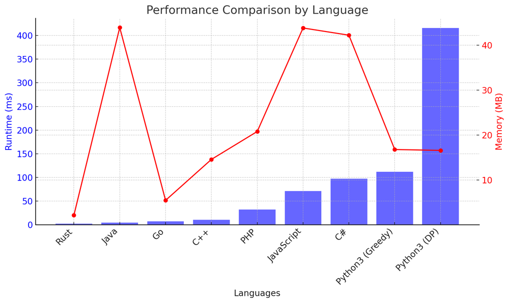

# ✅ 99.5% Greedy with Dynamic + DP

**Author:** vanAmsen
**Votes:** 96
**Link:** [https://leetcode.com/problems/minimum-number-of-taps-to-open-to-water-a-garden/solutions/3982461/](https://leetcode.com/problems/minimum-number-of-taps-to-open-to-water-a-garden/solutions/3982461/)

---

# Interview Guide - Minimum Number of Taps to Open to Water a Garden

## Problem Understanding

### Description
At its core, this problem is a fascinating blend of interval merging and greedy optimization. You are provided with a one-dimensional garden and the ability to water certain intervals of it by opening taps located at different points. The goal is to water the entire garden with the minimum number of taps opened.

---

## Key Points to Consider

### 1. Understand the Constraints
- Garden Length: $$ 1 \\leq n \\leq 10^4 $$
- Number of Taps: $$ n + 1 $$
- Watering Range: $$ 0 \\leq \	ext{ranges}[i] \\leq 100 $$

### 2. Unveil the Significance of Intervals
The problem can be visualized as merging intervals. The operation to open a tap can be thought of as covering an interval within the garden. The challenge is to cover the entire garden with the least number of intervals. This applies to both the greedy and dynamic programming approaches.

### 3. Algorithmic Approaches
This problem can be tackled using two different approaches: the Greedy Approach and the Dynamic Programming (DP) Approach.

#### Greedy Approach in Context
In the greedy approach, the algorithm makes the best local choice at each decision point with the aim of finding a global optimum. In this problem, each tap you decide to open becomes a commitment to water a specific range in the garden. The greedy strategy here involves always picking the tap that extends your reach as far as possible. This approach is optimized for speed, aiming to solve the problem in the least amount of time.

#### Dynamic Programming in Context
Dynamic Programming, on the other hand, builds the solution step by step. It uses an array to keep track of the minimum number of taps needed to water the garden up to each point. The DP approach is generally more flexible and can handle more complicated scenarios at the cost of potentially slower runtime for larger problem sizes.

### 4. Key Concepts in Each Approach

#### The Magic of "Farthest Reach" (Greedy)
In the greedy approach, the concept of "farthest reach" is crucial. As you move from the first to the last tap, this variable adapts dynamically, reflecting the furthest point that can be watered by any tap that intersects with the currently watered range. This dynamic updating is vital for deciding whether or not a new tap needs to be opened.

#### The Power of Incremental Build-up (DP)
In the DP approach, the array essentially serves as a memoization table. Each element in the DP array signifies the minimum number of taps required to water the garden up to that point. This array gets updated iteratively as we consider each tap, forming the basis for the final solution.

### 5. Importance of Ordered Intervals (Greedy)
For the greedy algorithm, it's beneficial to consider the taps in an ordered sequence, sorted by their starting points. This ordering helps make the local choices more straightforward and effective, thereby aiding in the search for a global optimum.

### 6. Explain Your Thought Process
Regardless of the approach, clear thinking and explanation are crucial. For the greedy approach, maintaining and updating the variable `far_can_reach` is key. In the DP approach, the DP array holds the minimum number of taps needed to water each point, and it's updated as we go through each tap.

---

# Live Coding & More
https://youtu.be/UQ__VyptWPQ?si=NrC2tEc2X24SSCpZ

---

# Approach: Greedy Algorithm with Dynamic "Farthest Reach" Adjustment

## Intuition and Logic Behind the Solution
The problem challenges us to water an entire one-dimensional garden using the fewest number of taps. Each tap has a range that it can water. The crux of our solution is to always choose the tap that allows us to water the farthest point in the garden that hasn't been watered yet.

## Why Greedy?
The greedy approach works well in this situation because it aims to make the best local choices in the hope of reaching an optimal global solution. In this context, each local choice is to open a tap that extends our watering range as far as possible. By doing so, we minimize the total number of taps that need to be opened.

## Step-by-step Explanation
- **Initialization**: We initialize `end = 0`, `far_can_reach = 0`, and `cnt = 0`. Here, `end` represents the last point that can be watered by the previously considered taps, `far_can_reach` is the farthest point that can be watered by any tap considered so far, and `cnt` keeps track of the number of taps opened.
  
- **Prepare the Ranges**: We prepare an array `arr` where the index represents the starting point, and the value at that index represents the farthest point that can be watered from that starting point.
  
- **Main Algorithm**: We iterate through the array `arr`. If the current index `i` is greater than `end`, we update `end` to `far_can_reach` and increment `cnt` by 1. This is because we need to open a new tap to extend our reach.
  
- **Check for Gaps**: If at any point we find that we can't extend our reach (`far_can_reach <= end`), we return -1.
  
- **Count Taps**: `cnt` keeps track of the minimum number of taps we need to open.

## Wrap-up
The function returns the minimum number of taps needed to water the entire garden. If it's not possible to water the whole garden, the function returns -1.

## Complexity Analysis
- **Time Complexity**: The algorithm runs in $$O(n)$$ time because it only needs to traverse the array `arr` once.
  
- **Space Complexity**: The space complexity is $$O(n)$$ due to the additional array `arr`.

---

# Approach: Dynamic Programming with Local Optimization

## Intuition and Logic Behind the Solution
The problem asks us to water the entire garden by opening the minimum number of taps. Unlike the greedy approach, which focuses on extending the range to be watered as far as possible, the dynamic programming approach calculates the minimum number of taps needed to water each point in the garden.

## Why Dynamic Programming?
Dynamic programming (DP) is effective here because it allows us to build up a solution incrementally, using previously calculated results to inform future calculations. Each element in the DP array represents the minimum number of taps needed to water up to that point, which we update as we consider each tap in the garden. The DP approach is particularly useful when we need to make decisions that depend on previous choices, as is the case here.

## Step-by-step Explanation
- **Initialization**: Initialize an array `dp` of size `n+1` with `float('inf')`, except for `dp[0]`, which is set to 0. This array will store the minimum number of taps needed to water up to each point.
- **Iterate through Ranges**: Loop through the array `ranges`, which contains the range each tap can cover.
  - **Calculate Start and End**: For each tap at index `i`, calculate the start and end of the interval it can water.
  - **Update DP Array**: For each point `j` in the interval, update `dp[j]` to be the minimum of its current value and $$dp[\	ext{start}] + 1$$.
  
- **Check Feasibility**: If `dp[-1]` remains `float('inf')`, then the garden can't be fully watered, and the function returns -1.

## Wrap-up
The function returns `dp[-1]`, which holds the minimum number of taps needed to water the entire garden, or -1 if it's not possible to water the whole garden.

## Complexity Analysis
- **Time Complexity**: $$O(n^2)$$ due to the nested loop structure. For each tap, we potentially update $$O(n)$$ elements in the DP array.
- **Space Complexity**: $$O(n)$$ for storing the DP array.

This DP approach provides an exact solution but may be slower than the greedy approach for large problem sizes. However, it is conceptually straightforward and builds a solid foundation for understanding more complex DP problems.

---

# Performance

| Language   | Approach | Runtime (ms) | Memory (MB) |
|------------|----------|--------------|-------------|
| Rust       | Greedy   | 2            | 2.2         |
| Java       | Greedy   | 4            | 43.9        |
| Go         | Greedy   | 7            | 5.5         |
| C++        | Greedy   | 10           | 14.6        |
| PHP        | Greedy   | 32           | 20.8        |
| JavaScript | Greedy   | 71           | 43.8        |
| C#         | Greedy   | 97           | 42.2        |
| Python3    | Greedy   | 112          | 16.8        |
| Python3    | DP       | 416          | 16.6        |



# Code Greedy
``` Python []
class Solution:
    def minTaps(self, n: int, ranges: List[int]) -> int:
        arr = [0] * (n + 1)
        for i, r in enumerate(ranges):
            if r == 0:
                continue
            left = max(0, i - r)
            arr[left] = max(arr[left], i + r)

        end, far_can_reach, cnt = 0, 0, 0
        
        for i, reach in enumerate(arr):
            if i > end:
                if far_can_reach <= end:
                    return -1
                end, cnt = far_can_reach, cnt + 1
            far_can_reach = max(far_can_reach, reach)

        return cnt + (end < n)

```
``` C++ []
class Solution {
public:
    int minTaps(int n, vector<int>& ranges) {
        vector<int> arr(n + 1, 0);
        for(int i = 0; i < ranges.size(); ++i) {
            if(ranges[i] == 0) continue;
            int left = max(0, i - ranges[i]);
            arr[left] = max(arr[left], i + ranges[i]);
        }
        
        int end = 0, far_can_reach = 0, cnt = 0;
        for(int i = 0; i <= n; ++i) {
            if(i > end) {
                if(far_can_reach <= end) return -1;
                end = far_can_reach;
                ++cnt;
            }
            far_can_reach = max(far_can_reach, arr[i]);
        }
        
        return cnt + (end < n);
    }
};
```
``` Rust []
impl Solution {
    pub fn min_taps(n: i32, ranges: Vec<i32>) -> i32 {
        let mut arr = vec![0; (n + 1) as usize];
        
        for i in 0..ranges.len() {
            if ranges[i] == 0 { continue; }
            let left = std::cmp::max(0, i as i32 - ranges[i]) as usize;
            arr[left] = std::cmp::max(arr[left], (i as i32 + ranges[i]) as usize);
        }
        
        let (mut end, mut far_can_reach, mut cnt) = (0, 0, 0);
        for i in 0..=n as usize {
            if i > end {
                if far_can_reach <= end { return -1; }
                end = far_can_reach;
                cnt += 1;
            }
            far_can_reach = std::cmp::max(far_can_reach, arr[i]);
        }
        
        cnt + if end < n as usize { 1 } else { 0 }
    }
}
```
``` Go []
func minTaps(n int, ranges []int) int {
    arr := make([]int, n+1)
    
    for i, r := range ranges {
        if r == 0 {
            continue
        }
        left := max(0, i - r)
        arr[left] = max(arr[left], i + r)
    }
    
    end, far_can_reach, cnt := 0, 0, 0
    for i := 0; i <= n; i++ {
        if i > end {
            if far_can_reach <= end {
                return -1
            }
            end = far_can_reach
            cnt++
        }
        far_can_reach = max(far_can_reach, arr[i])
    }
    
    if end < n {
        cnt++
    }
    return cnt
}

func max(a, b int) int {
    if a > b {
        return a
    }
    return b
}
```
``` Java []
public class Solution {
    public int minTaps(int n, int[] ranges) {
        int[] arr = new int[n + 1];
        Arrays.fill(arr, 0);
        
        for(int i = 0; i < ranges.length; i++) {
            if(ranges[i] == 0) continue;
            int left = Math.max(0, i - ranges[i]);
            arr[left] = Math.max(arr[left], i + ranges[i]);
        }
        
        int end = 0, far_can_reach = 0, cnt = 0;
        for(int i = 0; i <= n; i++) {
            if(i > end) {
                if(far_can_reach <= end) return -1;
                end = far_can_reach;
                cnt++;
            }
            far_can_reach = Math.max(far_can_reach, arr[i]);
        }
        
        return cnt + (end < n ? 1 : 0);
    }
}
```
``` C# []
public class Solution {
    public int MinTaps(int n, int[] ranges) {
        int[] arr = new int[n + 1];
        Array.Fill(arr, 0);
        
        for(int i = 0; i < ranges.Length; i++) {
            if(ranges[i] == 0) continue;
            int left = Math.Max(0, i - ranges[i]);
            arr[left] = Math.Max(arr[left], i + ranges[i]);
        }
        
        int end = 0, far_can_reach = 0, cnt = 0;
        for(int i = 0; i <= n; i++) {
            if(i > end) {
                if(far_can_reach <= end) return -1;
                end = far_can_reach;
                cnt++;
            }
            far_can_reach = Math.Max(far_can_reach, arr[i]);
        }
        
        return cnt + (end < n ? 1 : 0);
    }
}
```
``` JavaScript []
/**
 * @param {number} n
 * @param {number[]} ranges
 * @return {number}
 */
var minTaps = function(n, ranges) {
    const arr = new Array(n + 1).fill(0);
    
    for(let i = 0; i < ranges.length; i++) {
        if(ranges[i] === 0) continue;
        const left = Math.max(0, i - ranges[i]);
        arr[left] = Math.max(arr[left], i + ranges[i]);
    }
    
    let end = 0, far_can_reach = 0, cnt = 0;
    for(let i = 0; i <= n; i++) {
        if(i > end) {
            if(far_can_reach <= end) return -1;
            end = far_can_reach;
            cnt++;
        }
        far_can_reach = Math.max(far_can_reach, arr[i]);
    }
    
    return cnt + (end < n ? 1 : 0);
}
```
``` PHP []
class Solution {

    /**
     * @param Integer $n
     * @param Integer[] $ranges
     * @return Integer
     */
    function minTaps($n, $ranges) {
        $arr = array_fill(0, $n + 1, 0);
        
        foreach($ranges as $i => $r) {
            if($r === 0) continue;
            $left = max(0, $i - $r);
            $arr[$left] = max($arr[$left], $i + $r);
        }
        
        $end = 0; $far_can_reach = 0; $cnt = 0;
        for($i = 0; $i <= $n; $i++) {
            if($i > $end) {
                if($far_can_reach <= $end) return -1;
                $end = $far_can_reach;
                $cnt++;
            }
            $far_can_reach = max($far_can_reach, $arr[$i]);
        }
        
        return $cnt + ($end < $n ? 1 : 0);
    }
}
```

# Code DP 
``` Python []
class Solution:
    def minTaps(self, n: int, ranges: List[int]) -> int:
        dp = [float('inf')] * (n + 1)
        dp[0] = 0
        
        for i, r in enumerate(ranges):
            start, end = max(0, i - r), min(n, i + r)
            for j in range(start + 1, end + 1):
                dp[j] = min(dp[j], dp[start] + 1)
                
        return dp[-1] if dp[-1] != float('inf') else -1
```

Every problem presents a new challenge and an opportunity to learn. Whether you're a beginner or an expert, each problem has something new to offer. So dive in, explore, and share your insights. Happy Coding! \uD83D\uDE80\uD83D\uDCA1\uD83C\uDF1F