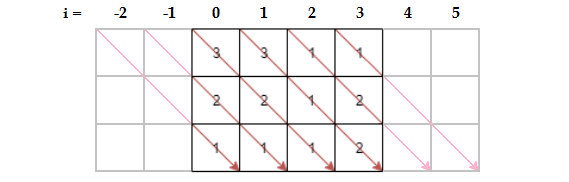

# Sort the Matrix Diagonally | Simple Solution w/ Explanation

**Author:** sgallivan
**Votes:** 16
**Link:** [https://leetcode.com/problems/sort-the-matrix-diagonally/solutions/1030741/](https://leetcode.com/problems/sort-the-matrix-diagonally/solutions/1030741/)

---

***Idea:***

The easy solution here is to read each diagonal row, then sort it, then write it back again. To read the diagonal line, it can be best to think of the rows as extending out to the left and right.



For a matrix (**M**) of height **y** and width **x**, in order to get all the diagonal rows, we would need to extend out the **i** values to the left by **y - 1**. But in this case, we can ignore the first and last diagonal rows, as they only contain one cell each and thus don't need to be sorted. That means that the range of **i** should be **0 - (y - 2) <= i <= x - 1**, or **2 - y <= i <= x - 1**.

Then we can just iterate through these diagonals and store the valid cell values in an array (**diag**). After sorting **diag**, we can then iterate back through the diagonal and replace the valid cells with the appropriate sorted value.

` `
***Javascript Code:***
```
var diagonalSort = function(M) {
    let y = M.length, x = M[0].length - 1
	for (let i = 2 - y; i < x; i++) {              // Start far enough to the left to get
        let diag = new Array(y), k = 0             // all non-singleton diagonals
        for (let j = 0; j < y; j++)
            if (M[j][i+j]) diag[k++] = M[j][i+j]   // Only store valid cell values in the array
        diag.sort((a,b) => a - b), k = 0           // Sort the diagonal and reset its index
        for (let j = 0; j < y; j++)
            if (M[j][i+j]) M[j][i+j] = diag[k++]   // Replace the diagonal cells in sorted order
    }
    return M
};

```
***Python Code:***
```
class Solution(object):
    def diagonalSort(self, M):
        y, x = len(M), len(M[0])
        for i in range(2-y, x-1):
            valid = range(max(0,0-i), min(y,x-i))
            diag = sorted([M[j][i+j] for j in valid])
            for k in valid:
                M[k][i+k] = diag.pop(0)
        return M
```