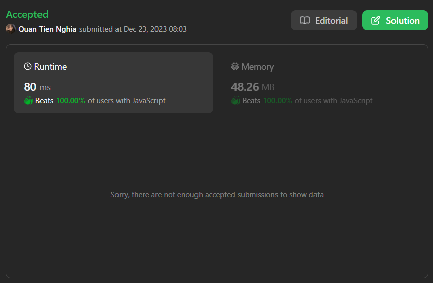

# JS Solution - O(n)

**Author:** CuteTN
**Votes:** 0
**Link:** [https://leetcode.com/problems/reverse-subarray-to-maximize-array-value/solutions/4443683/](https://leetcode.com/problems/reverse-subarray-to-maximize-array-value/solutions/4443683/)

---



"Sorry, there are not enough accepted submissions to show data."

# Complexity
- Time complexity: $$O(n)$$
- Space complexity: $$O(1)$$

# Code
```js
let { abs, max, min } = Math;

/**
 * @param {number[]} nums
 * @return {number}
 */
var maxValueAfterReverse = function (nums) {
  let n = nums.length;
  let incMax1st;
  let incMin2nd;
  let decMin1st;
  let decMax2nd;

  let sum = 0;
  let best = 0;

  function getDelta(i, j) {
    return (
      abs(nums[i] - nums[j]) +
      abs(nums[i + 1] - nums[j + 1]) -
      abs(nums[i] - nums[i + 1]) -
      abs(nums[j] - nums[j + 1])
    );
  }

  let first = nums[0];
  let last = nums[--n];
  for (let i = 0; i < n; ++i) {
    sum += abs(nums[i] - nums[i + 1]);
    best = max(
      best,
      max(abs(last - nums[i]), abs(first - nums[i + 1])) -
        abs(nums[i + 1] - nums[i])
    );

    if (incMax1st != null) best = max(best, getDelta(incMax1st, i));
    if (incMin2nd != null) best = max(best, getDelta(incMin2nd, i));
    if (decMin1st != null) best = max(best, getDelta(decMin1st, i));
    if (decMax2nd != null) best = max(best, getDelta(decMax2nd, i));

    if (nums[i] <= nums[i+1]) {
      if (incMax1st == null || nums[incMax1st] < nums[i]) incMax1st = i;
      if (incMin2nd == null || nums[incMin2nd+1] > nums[i+1]) incMin2nd = i;
    }
    if (nums[i] >= nums[i+1]) {
      if (decMin1st == null || nums[decMin1st] > nums[i]) decMin1st = i;
      if (decMax2nd == null || nums[decMax2nd+1] < nums[i+1]) decMax2nd = i;
    }
  }

  return sum + best;
};
```