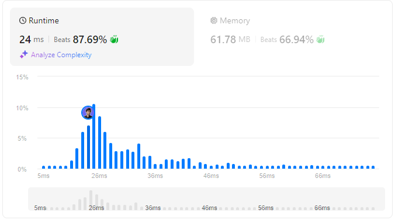

# 🌟 Step-by-Step Guide to Ranking Arrays Efficiently in Multiple Languages 🔥💯

**Author:** withaarzoo
**Votes:** 5
**Link:** [https://leetcode.com/problems/rank-transform-of-an-array/solutions/5858156/](https://leetcode.com/problems/rank-transform-of-an-array/solutions/5858156/)

---


Explore a collection of solutions to LeetCode problems in multiple programming languages. Each solution includes a detailed explanation and step-by-step approach to solving the problem efficiently. Whether you're a beginner looking to learn or an experienced coder seeking optimized solutions, this repository aims to provide clear and insightful approaches to tackling challenging LeetCode problems.

### **Access daily LeetCode Solutions Repo :** [click here](https://github.com/withaarzoo/LeetCode-Solutions)

---



---

# Intuition
The problem asks us to assign a rank to each element of the array based on its value. Larger elements get larger ranks, and elements with the same value get the same rank. 

The key idea is to use sorting to determine the rank efficiently. Instead of comparing every element to all others (which would be inefficient), we can:
- Sort the array.
- Assign ranks to the sorted array.
- Use a dictionary to map original elements to their ranks, ensuring equal values get the same rank.

---

# Approach
1. **Sort the array:** First, create a sorted copy of the array. Sorting will allow us to rank the elements from the smallest to the largest.
2. **Assign ranks:** Traverse the sorted array and assign ranks starting from 1. If an element appears multiple times, give it the same rank.
3. **Map ranks to original array:** Create a dictionary (or map) that stores the rank for each element. Then, traverse the original array and replace each element with its rank using this dictionary.

---

# Complexity
- **Time complexity:**  
  Sorting the array takes \\(O(n \\log n)\\), where \\(n\\) is the length of the array. Traversing the sorted array to assign ranks and then replacing elements in the original array both take \\(O(n)\\). Hence, the total time complexity is:
  $$O(n \\log n)$$
  
- **Space complexity:**  
  We need extra space for the sorted array and the dictionary that stores ranks. Thus, the space complexity is:
  $$O(n)$$

---

# Code
```C++ []
class Solution {
public:
    vector<int> arrayRankTransform(vector<int>& arr) {
        if (arr.empty()) return {};
        
        // Step 1: Copy and sort the array
        vector<int> sorted_arr = arr;
        sort(sorted_arr.begin(), sorted_arr.end());
        
        // Step 2: Create a map to assign ranks
        unordered_map<int, int> rank_map;
        int rank = 1;
        
        // Step 3: Assign ranks to sorted elements
        for (int num : sorted_arr) {
            if (rank_map.find(num) == rank_map.end()) {
                rank_map[num] = rank++;
            }
        }
        
        // Step 4: Replace each element in the original array with its rank
        for (int i = 0; i < arr.size(); ++i) {
            arr[i] = rank_map[arr[i]];
        }
        
        return arr;
    }
};

```
```Java []
import java.util.*;

class Solution {
    public int[] arrayRankTransform(int[] arr) {
        if (arr.length == 0) return new int[0];
        
        // Step 1: Create a sorted copy of the array
        int[] sortedArr = arr.clone();
        Arrays.sort(sortedArr);
        
        // Step 2: Create a map to store the rank of each element
        Map<Integer, Integer> rankMap = new HashMap<>();
        int rank = 1;
        
        // Step 3: Assign ranks to sorted elements
        for (int num : sortedArr) {
            if (!rankMap.containsKey(num)) {
                rankMap.put(num, rank++);
            }
        }
        
        // Step 4: Replace each element in the original array with its rank
        for (int i = 0; i < arr.length; i++) {
            arr[i] = rankMap.get(arr[i]);
        }
        
        return arr;
    }
}

```
```JavaScript []
/**
 * @param {number[]} arr
 * @return {number[]}
 */
var arrayRankTransform = function(arr) {
    if (arr.length === 0) return [];
    
    // Step 1: Create a sorted copy of the array
    let sortedArr = [...arr];
    sortedArr.sort((a, b) => a - b);
    
    // Step 2: Create a map to store the rank of each element
    let rankMap = new Map();
    let rank = 1;
    
    // Step 3: Assign ranks to sorted elements
    for (let num of sortedArr) {
        if (!rankMap.has(num)) {
            rankMap.set(num, rank++);
        }
    }
    
    // Step 4: Replace each element in the original array with its rank
    for (let i = 0; i < arr.length; i++) {
        arr[i] = rankMap.get(arr[i]);
    }
    
    return arr;
};

```
```Python []
class Solution:
    def arrayRankTransform(self, arr: List[int]) -> List[int]:
        if not arr:
            return []
        
        # Step 1: Create a sorted copy of the array
        sorted_arr = sorted(arr)
        
        # Step 2: Create a dictionary to assign ranks
        rank_map = {}
        rank = 1
        
        # Step 3: Assign ranks to sorted elements
        for num in sorted_arr:
            if num not in rank_map:
                rank_map[num] = rank
                rank += 1
        
        # Step 4: Replace each element in the original array with its rank
        return [rank_map[num] for num in arr]

```
```Go []
import "sort"

func arrayRankTransform(arr []int) []int {
    if len(arr) == 0 {
        return []int{}
    }
    
    // Step 1: Create a sorted copy of the array
    sortedArr := make([]int, len(arr))
    copy(sortedArr, arr)
    sort.Ints(sortedArr)
    
    // Step 2: Create a map to assign ranks
    rankMap := make(map[int]int)
    rank := 1
    
    // Step 3: Assign ranks to sorted elements
    for _, num := range sortedArr {
        if _, exists := rankMap[num]; !exists {
            rankMap[num] = rank
            rank++
        }
    }
    
    // Step 4: Replace each element in the original array with its rank
    for i, num := range arr {
        arr[i] = rankMap[num]
    }
    
    return arr
}

```

---

# Step-by-Step Detailed Explanation

1. **Step 1: Copy and Sort the Array**
   - We first create a sorted copy of the array, as sorting helps us assign ranks to the elements. Sorting is done in \\(O(n \\log n)\\) time.

2. **Step 2: Create a Map/Dictionary for Ranks**
   - A dictionary (or map) is used to store the ranks of each element. While iterating through the sorted array, we assign ranks to elements starting from 1.
   - If an element has already been assigned a rank (for duplicates), we skip assigning a new rank.

3. **Step 3: Replace Elements with Their Ranks**
   - After assigning ranks, we replace each element in the original array with the corresponding rank from the dictionary.

---

# Visualization

Let's visualize the problem-solving process step by step using an example:

**Example Input:**  
`arr = [40, 10, 20, 30]`

**Step 1: Original Array**  
```
Original Array: [40, 10, 20, 30]
```

**Step 2: Sorting the Array**  
We create a sorted copy of the array to rank the elements. The sorted array looks like:
```
Sorted Array: [10, 20, 30, 40]
```

**Step 3: Assigning Ranks**  
Now we traverse through the sorted array and assign ranks:
- `10` gets rank 1.
- `20` gets rank 2.
- `30` gets rank 3.
- `40` gets rank 4.

**Rank Map:**  
```
{
  10: 1,
  20: 2,
  30: 3,
  40: 4
}
```

**Step 4: Mapping Ranks Back to the Original Array**  
Now, we replace each element of the original array with its corresponding rank:
```
arr[0] = 40  --> rank = 4
arr[1] = 10  --> rank = 1
arr[2] = 20  --> rank = 2
arr[3] = 30  --> rank = 3
```

**Final Array with Ranks:**  
```
Final Output: [4, 1, 2, 3]
```

### Visualization with Example 2:

**Example Input:**  
`arr = [100, 100, 100]`

**Step 1: Original Array**  
```
Original Array: [100, 100, 100]
```

**Step 2: Sorting the Array**  
Sorted array:
```
Sorted Array: [100, 100, 100]
```

**Step 3: Assigning Ranks**  
Since all elements are equal, they all get the same rank:
- `100` gets rank 1.

**Rank Map:**  
```
{
  100: 1
}
```

**Step 4: Mapping Ranks Back to the Original Array**  
Replace each element with its rank:
```
arr[0] = 100  --> rank = 1
arr[1] = 100  --> rank = 1
arr[2] = 100  --> rank = 1
```

**Final Array with Ranks:**  
```
Final Output: [1, 1, 1]
```

### Visualization with Example 3:

**Example Input:**  
`arr = [37, 12, 28, 9, 100, 56, 80, 5, 12]`

**Step 1: Original Array**  
```
Original Array: [37, 12, 28, 9, 100, 56, 80, 5, 12]
```

**Step 2: Sorting the Array**  
Sorted array:
```
Sorted Array: [5, 9, 12, 12, 28, 37, 56, 80, 100]
```

**Step 3: Assigning Ranks**  
- `5` gets rank 1.
- `9` gets rank 2.
- `12` gets rank 3 (same for both occurrences).
- `28` gets rank 4.
- `37` gets rank 5.
- `56` gets rank 6.
- `80` gets rank 7.
- `100` gets rank 8.

**Rank Map:**  
```
{
  5: 1,
  9: 2,
  12: 3,
  28: 4,
  37: 5,
  56: 6,
  80: 7,
  100: 8
}
```

**Step 4: Mapping Ranks Back to the Original Array**  
Replace each element with its rank:
```
arr[0] = 37  --> rank = 5
arr[1] = 12  --> rank = 3
arr[2] = 28  --> rank = 4
arr[3] = 9   --> rank = 2
arr[4] = 100 --> rank = 8
arr[5] = 56  --> rank = 6
arr[6] = 80  --> rank = 7
arr[7] = 5   --> rank = 1
arr[8] = 12  --> rank = 3
```

**Final Array with Ranks:**  
```
Final Output: [5, 3, 4, 2, 8, 6, 7, 1, 3]
```

---


