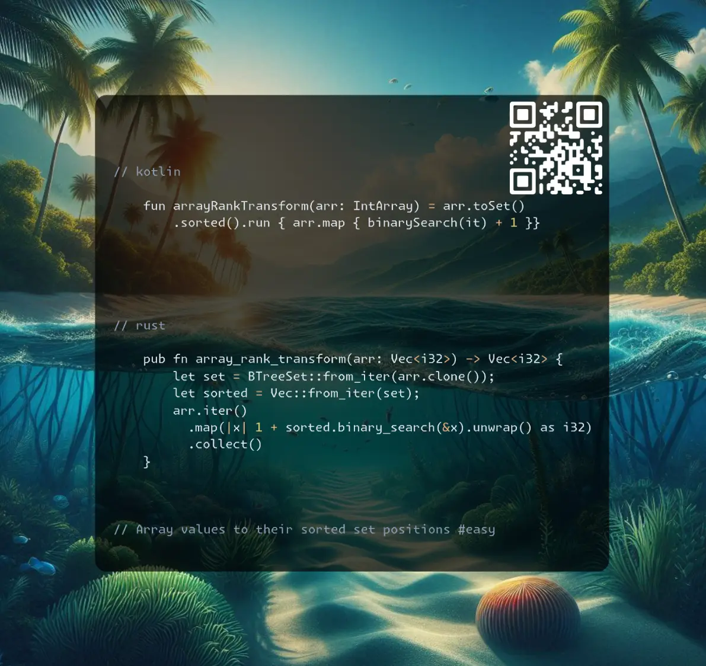

# Kotlin | Rust

**Author:** SamoylenkoDmitry
**Votes:** 2
**Link:** [https://leetcode.com/problems/rank-transform-of-an-array/solutions/5859606/](https://leetcode.com/problems/rank-transform-of-an-array/solutions/5859606/)

---



https://youtu.be/3Ofm_5xSukc

#### Join me on Telegram

https://t.me/leetcode_daily_unstoppable/754

#### Problem TLDR

Array values to their sorted set positions #easy

#### Intuition

We need a sorted order, and then we need to manually increment the `rank` or somehow maintain an association between the sorted order set position and the value. 

#### Approach

* `binarySearch` will not change the time complexity

#### Complexity

- Time complexity:
$$O(nlog(n))$$

- Space complexity:
$$O(n)$$

#### Code

```kotlin []

    fun arrayRankTransform(arr: IntArray) = arr.toSet()
        .sorted().run { arr.map { binarySearch(it) + 1 }}

```
```rust []

    pub fn array_rank_transform(arr: Vec<i32>) -> Vec<i32> {
        let set = BTreeSet::from_iter(arr.clone());
        let sorted = Vec::from_iter(set);
        arr.iter()
          .map(|x| 1 + sorted.binary_search(&x).unwrap() as i32)
          .collect()
    }

```
```c++ []

    vector<int> arrayRankTransform(vector<int>& arr) {
        vector<pair<int, int>> inds(arr.size());
        for (int i = 0; int x: arr) inds[i++] = {x, i};
        sort(inds.begin(), inds.end());
        int prev = INT_MIN; int rank = 0;
        for (auto& [x, i]: inds) {
            if (x > prev) rank++;
            prev = x; arr[i] = rank;
        }
        return arr;
    }

```