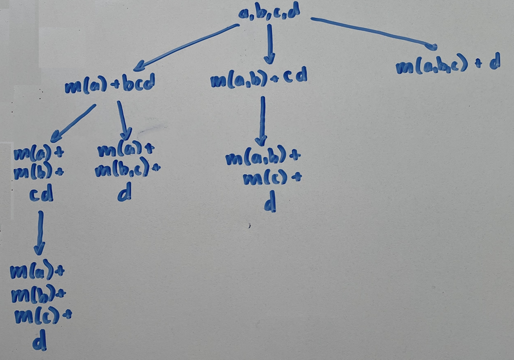
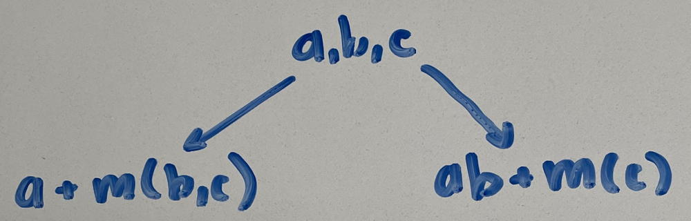
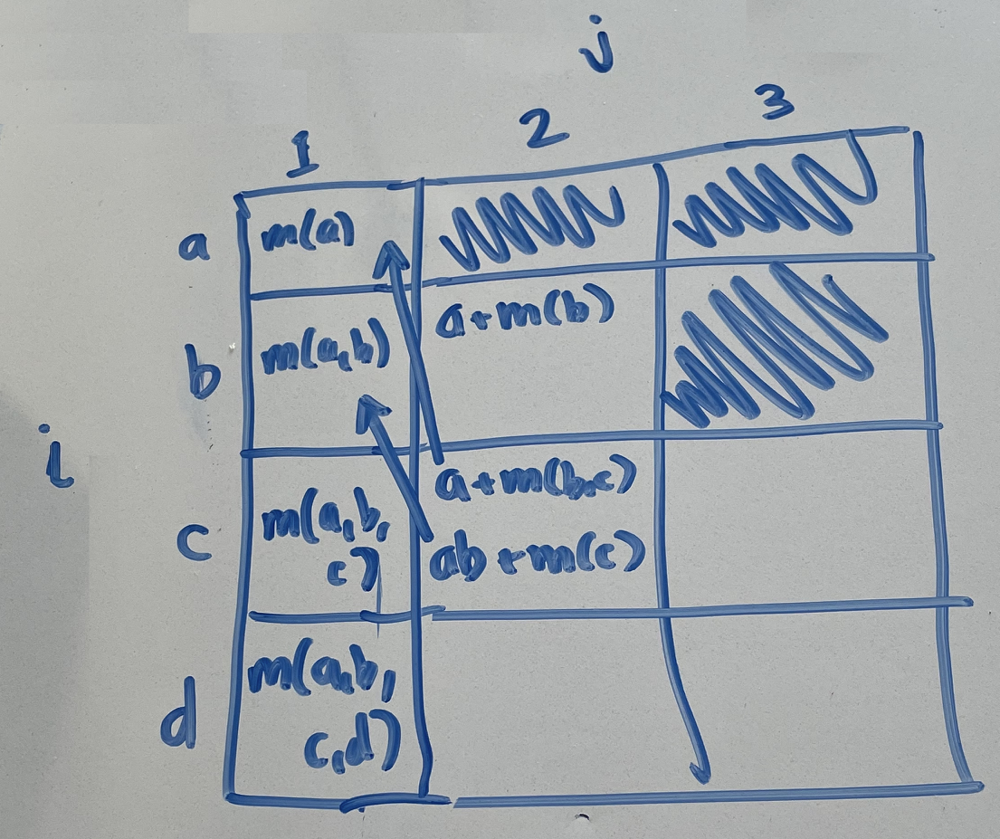

# DFS -> DP Progression with Explanation [O(n^3d)/O(nd)]

**Author:** hansberryjam
**Votes:** 214
**Link:** [https://leetcode.com/problems/minimum-difficulty-of-a-job-schedule/solutions/924611/](https://leetcode.com/problems/minimum-difficulty-of-a-job-schedule/solutions/924611/)

---

This problem is almost identical to [`813. Largest Sum of Averages`](https://leetcode.com/problems/largest-sum-of-averages/) (my solution [here](https://leetcode.com/problems/largest-sum-of-averages/discuss/916679/DFS-greater-DP-Progression-With-Explanation-O(kn2)O(kn))).  We are tasked to break up a list into `d` segments such that the sum of the max number in each segment is minimized.  One way to solve this is to then look through all combinations of segments, and return the combination that minimizes the sum of the max of each segment.  DFS is a great tool to use to visualize this, as we can imagine an instance of the function as the current state, and the recursive calls as possible actions you can take to get to another state.  Let's take a look at the DFS tree, where `m(...)` signifies the max of those elements.

Each step down the tree partitions one of the segments into two.  In code, this would look like
```
def dfs(jobs, d):
	if d == 1:
		return max(jobs)
	minDiff = float("inf")
	for i in range(1, len(jobs)):
		curr = max(jobs[:i]) + dfs(jobs[i:], d - 1)
		minDiff = min(minDiff, curr)
	return minDiff
return dfs(jobDifficulty, d)
```
This is a standard tree traversal, where at each node, we acquire some cost `m(...)`, and then continue down the tree until we hit the base case `(if d == 1: return max(jobs))`.  Therefore, we are looking for the minimum cost root -> leaf path of length `d`.  This DFS approach solves the problem, however for larger inputs it takes far too long and times out.  Why is that?  Notice in the DFS tree, we have the two recursive calls
```
m(a) + m(b) + dfs(cd)
m(a, b) + dfs(cd)
```
We encounter `dfs(cd)` twice.  The solution to both of these recursive calls will always return the same solution, and thus we are wasting time recalculating it.  This issue becomes exponentially worse as the the inputs become larger and the DFS tree grows taller.  This is where the DP solution comes in.
In the DFS approach, we are calculating the solution from the top down, meaning we need to recurse all the way down the tree to have any understanding of how much a path costs.  Instead, let's build the solution from the ground up, saving the solution to a given subproblem at each step.  Our recursion relation will be the same, except now we are going to traverse backwards through `jobs`.

For the right branch, we would have already calculated the solution to `dfs(a, b)`, so all we need to do is reference it and add `m(c)`.  In DP terms, the subproblem we are solving is `Let A[i][d] = the minimum difficulty schedule including jobs {1...i } partitioned into d days`.  Thus, we have
```
def dp(jobs, d):
	A = [[float("inf")] * d for i in range(len(jobs))]
	A[0][0] = jobs[0]
	for i in range(1, len(jobs)):
		A[i][0] = max(A[i - 1][0], jobs[i])

	for i in range(1, len(jobs)):
		for j in range(1, min(i + 1, d)):
			for k in range(i):
				A[i][j] = min(A[i][j], A[k][j - 1] + max(jobs[k + 1:i + 1]))

	return A[-1][-1]
return dp(jobDifficulty, d)
```
If you are confused, try drawing out the 2D array and walking through the function on a basic input (such as `[1,2,3,4], 3`.  Notice that the recursion relation is almost exactly same as in the DFS approach (we could have coded the DFS approach the same way).  This is because we are using the same method of solving the problem, but with DP we have the additional benefit of only calculating a certain function call once.

Here is a quick peek at the 2D array

Notice the blacked out boxes.  These are in place because we can not partition a list into more segments than the length of that list.  For instance, we can not partition `[1,2,3]` into 4 segments.  Also, we do not need to partition a list more than `d` times, and this is why we have `for j in range(1, min(i + 1, d)`.  

P.S. Be sure to include `if d > len(jobDifficulty): return -1` before either approach as there is no schedule for this input.