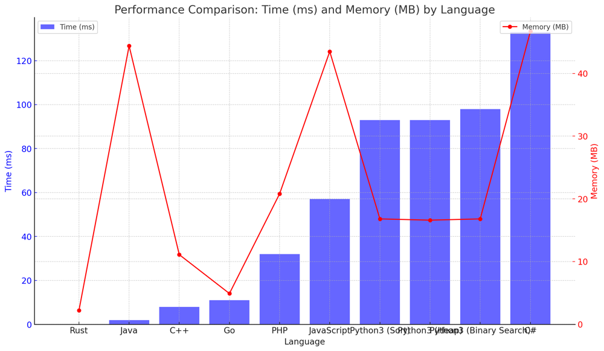

# ✅ 98.41% Sorting &  Min-Heap & Binary Search

**Author:** vanAmsen
**Votes:** 84
**Link:** [https://leetcode.com/problems/the-k-weakest-rows-in-a-matrix/solutions/4057683/](https://leetcode.com/problems/the-k-weakest-rows-in-a-matrix/solutions/4057683/)

---

# Comprehensive Guide to Solving "The K Weakest Rows in a Matrix"

## Introduction & Problem Statement

In today's journey through the realm of matrices, we aim to identify the k weakest rows based on the number of soldiers. Each row in the matrix represents a combination of soldiers (1's) and civilians (0's). The soldiers always appear to the left of civilians, making it a unique and intriguing challenge. Our mission is to order the rows from weakest (least number of soldiers) to strongest and return the indices of the first k rows.

## Key Concepts and Constraints

### What Makes This Problem Unique?

1. **Matrix Representation**:
   The given matrix is binary, consisting only of 0's and 1's. Each row represents soldiers followed by civilians.

2. **Row Weakness Definition**:
   A row is considered weaker than another based on two conditions:
   - The number of soldiers in the row.
   - The index of the row (in case of a tie in the number of soldiers).

3. **Constraints**: 
   - Matrix dimensions: $$ 2 \\leq n, m \\leq 100 $$
   - $$ 1 \\leq k \\leq m $$

### Strategies to Tackle the Problem

Three main strategies can be employed to solve this problem:

1. **Sorting**: Count the soldiers in each row and then sort rows based on the count and index.
2. **Min-Heap**: Use a heap to keep track of the k weakest rows as we traverse through the matrix.
3. **Binary Search**: Since each row is sorted (all 1's followed by all 0's), we can use binary search to efficiently count the soldiers in each row.

---

## Live Coding 3 Approaches
https://youtu.be/Ha4_QWrnGw8?si=Q14r0QrKO7gBGP-S

## Delving Deeper into the Strategies

### 1. Sorting Approach

**Logic**:
- Traverse through the matrix and calculate the strength of each row (number of soldiers).
- Pair each strength with its row index.
- Sort the pairs based on strength and index.
- Return the indices of the first k pairs.

**Pros**:
- Simple and straightforward.
- Directly uses Python's built-in sorting for efficiency.

**Cons**:
- Iterates through the entire matrix even if $$ k $$ is very small.

# Code #1 Sorting
``` Python []
class Solution:
    def kWeakestRows(self, mat: List[List[int]], k: int) -> List[int]:
        row_strength = [(sum(row), i) for i, row in enumerate(mat)]
        row_strength.sort(key=lambda x: (x[0], x[1]))
        return [row[1] for row in row_strength[:k]]
```
``` Go []
func kWeakestRows(mat [][]int, k int) []int {
    type RowStrength struct {
        strength, index int
    }
    
    rowStrengths := make([]RowStrength, len(mat))
    
    for i, row := range mat {
        strength := 0
        for _, val := range row {
            strength += val
        }
        rowStrengths[i] = RowStrength{strength, i}
    }
    
    sort.Slice(rowStrengths, func(i, j int) bool {
        if rowStrengths[i].strength == rowStrengths[j].strength {
            return rowStrengths[i].index < rowStrengths[j].index
        }
        return rowStrengths[i].strength < rowStrengths[j].strength
    })
    
    result := make([]int, k)
    for i := 0; i < k; i++ {
        result[i] = rowStrengths[i].index
    }
    
    return result
}
```
``` Rust []
use std::cmp::Ordering;

impl Solution {
    pub fn k_weakest_rows(mat: Vec<Vec<i32>>, k: i32) -> Vec<i32> {
        let mut row_strengths: Vec<(i32, i32)> = mat.iter().enumerate().map(|(i, row)| {
            (row.iter().sum(), i as i32)
        }).collect();
        
        row_strengths.sort_by(|a, b| {
            match a.0.cmp(&b.0) {
                Ordering::Equal => a.1.cmp(&b.1),
                other => other,
            }
        });
        
        row_strengths.into_iter().map(|(_, i)| i).take(k as usize).collect()
    }
}
```
``` C++ []
class Solution {
public:
    vector<int> kWeakestRows(vector<vector<int>>& mat, int k) {
        vector<pair<int, int>> rowStrengths;
        for (int i = 0; i < mat.size(); ++i) {
            int strength = accumulate(mat[i].begin(), mat[i].end(), 0);
            rowStrengths.push_back({strength, i});
        }
        
        sort(rowStrengths.begin(), rowStrengths.end());
        
        vector<int> result;
        for (int i = 0; i < k; ++i) {
            result.push_back(rowStrengths[i].second);
        }
        
        return result;
    }
};
```
``` Java []
public class Solution {
    public int[] kWeakestRows(int[][] mat, int k) {
        int[][] rowStrengths = new int[mat.length][2];
        
        for (int i = 0; i < mat.length; ++i) {
            int strength = 0;
            for (int val : mat[i]) {
                strength += val;
            }
            rowStrengths[i][0] = strength;
            rowStrengths[i][1] = i;
        }
        
        Arrays.sort(rowStrengths, (a, b) -> a[0] == b[0] ? a[1] - b[1] : a[0] - b[0]);
        
        int[] result = new int[k];
        for (int i = 0; i < k; ++i) {
            result[i] = rowStrengths[i][1];
        }
        
        return result;
    }
}
```
``` C# []
public class Solution {
    public int[] KWeakestRows(int[][] mat, int k) {
        var rowStrengths = mat.Select((row, i) => new { Strength = row.Sum(), Index = i })
                               .OrderBy(x => x.Strength)
                               .ThenBy(x => x.Index)
                               .Take(k)
                               .Select(x => x.Index)
                               .ToArray();
        return rowStrengths;
    }
}
```
``` JavaScript []
var kWeakestRows = function(mat, k) {
    let rowStrengths = mat.map((row, i) => [row.reduce((a, b) => a + b, 0), i]);
    rowStrengths.sort((a, b) => a[0] === b[0] ? a[1] - b[1] : a[0] - b[0]);
    return rowStrengths.slice(0, k).map(([_, i]) => i);
};
```
``` PHP []
class Solution {

    function kWeakestRows($mat, $k) {
        $rowStrengths = [];
        foreach ($mat as $i => $row) {
            $strength = array_sum($row);
            $rowStrengths[] = [$strength, $i];
        }
        
        usort($rowStrengths, function($a, $b) {
            return $a[0] <=> $b[0] ?: $a[1] <=> $b[1];
        });
        
        return array_slice(array_column($rowStrengths, 1), 0, $k);
    }
}
```

### 2. Min-Heap Approach

**Logic**:
- Utilize a min-heap to maintain the `k` weakest rows while iterating through the matrix.
- For each row, calculate its strength (the sum of its elements, representing the number of soldiers) and push this value into the heap.
- Whenever the heap size grows beyond $$ k $$, remove the strongest row from the heap.
- At the end of the traversal, the heap will contain the `k` weakest rows, which can then be extracted and returned.

**Pros**:
- This approach is particularly efficient when dealing with large matrices, especially when $$ k $$ is small relative to the number of rows.
- Makes optimal use of Python's `heapq` library for efficient heap operations, ensuring that both `heap.push()` and `heap.pop()` operations are fast.

**Cons**:
- The heap-based approach adds a bit more complexity to the code compared to a straightforward sorting method, but it generally offers better performance for this problem.

# Code #2 Min-Heap
``` Python []
class Solution:
    def kWeakestRows(self, mat: List[List[int]], k: int) -> List[int]:
        heap = []
        for i, row in enumerate(mat):
            strength = sum(row)
            heapq.heappush(heap, (-strength, -i))
            if len(heap) > k:
                heapq.heappop(heap)
        return [-i for _, i in sorted(heap, reverse=True)]
```

### 3. Binary Search and Heap Approach

**Logic**:
- Each row in the matrix is sorted such that all 1's appear to the left of all 0's. This allows us to use binary search to quickly find the number of soldiers (1's) in each row.
- We use a heap data structure to efficiently find the weakest rows. For each row, we calculate its strength (number of soldiers) using binary search and then push this information into a min-heap. 
- Finally, we extract the `k` smallest elements from the heap, which correspond to the `k` weakest rows.

**Pros**:
- The binary search allows for efficient computation of the strength of each row, which is particularly useful when the number of soldiers varies significantly across rows.
- The heap data structure ensures that we can efficiently find the `k` weakest rows without sorting the entire array, thus saving computational resources.

**Cons**:
- Although the binary search optimizes the row strength calculation, the overall time complexity can still be influenced by the time it takes to build and manipulate the heap. However, this is generally more efficient than sorting the entire array.
  
# Code #3 Binary Search + Heap Approach
``` Python []
class Solution:
    def kWeakestRows(self, mat: List[List[int]], k: int) -> List[int]:
        def binarySearch(arr):
            left, right = 0, len(arr) - 1
            while left <= right:
                mid = (left + right) // 2
                if arr[mid] == 1:
                    left = mid + 1
                else:
                    right = mid - 1
            return left

        queue = [(binarySearch(row), idx) for idx, row in enumerate(mat)]
        heapq.heapify(queue)

        return [idx for _, idx in heapq.nsmallest(k, queue)]
```


## Time and Space Complexity

### 1. Sorting Approach:
- **Time Complexity**: $$O(m \\log m)$$
  - Here, `m` is the number of rows. Sorting an array of length `m` will take $$O(m \\log m)$$ time.
- **Space Complexity**: $$O(m)$$
  - We need additional space for storing the strengths and indices, which will be of length `m`.

### 2. Min-Heap Approach:
- **Time Complexity**: $$O(m \\log k)$$
  - Pushing an element into a heap of size `k` takes $$O(\\log k)$$ time. We do this `m` times, so the total time is $$O(m \\log k)$$.
- **Space Complexity**: $$O(k)$$
  - The heap will store `k` elements at most, so the space complexity is $$O(k)$$.

### 3. Binary Search and Heap Approach:
- **Time Complexity**: $$O(m \\log n + m \\log m)$$
  - Binary search on each row to find the number of soldiers will take $$O(\\log n)$$ time for each row, resulting in $$O(m \\log n)$$ for all rows. Building and manipulating the heap will take $$O(m \\log m)$$ time.
- **Space Complexity**: $$O(m)$$
  - We need additional space for the heap to store the strengths and indices, which will be of length `m`.

## Performance

| Language    | Time (ms) | Memory (MB) | Version            |
|-------------|-----------|-------------|--------------------|
| Rust        | 0         | 2.2         | Sort           |
| Java        | 2         | 44.4        | Sort           |
| C++         | 8         | 11.1        | Sort           |
| Go          | 11        | 4.9         | Sort           |
| PHP         | 32        | 20.8        | Sort           |
| JavaScript  | 57        | 43.5        | Sort           |
| Python3     | 93        | 16.8        | Sort               |
| Python3     | 93        | 16.6        | Heap               |
| Python3     | 98        | 16.8        | Binary Search      |
| C#          | 133       | 46.7        | Sort           |




## Conclusion

Each of the strategies presented has its own merits. Depending on the specific requirements and constraints of the application, one approach might be preferred over the others. Whether you're a beginner or an expert, understanding these strategies will surely enhance your problem-solving skills. Happy coding!


