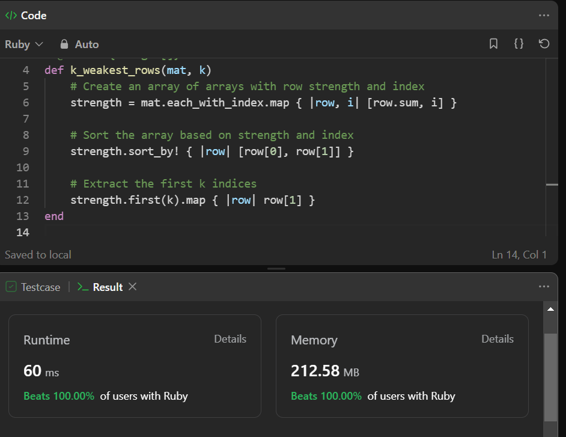

# Easy 4 Line Code || Line By Line Explanation || Beats 99%+ || Python || C++ || Ruby || Java

**Author:** Pratikk_Rathod
**Votes:** 39
**Link:** [https://leetcode.com/problems/the-k-weakest-rows-in-a-matrix/solutions/4058396/](https://leetcode.com/problems/the-k-weakest-rows-in-a-matrix/solutions/4058396/)

---

# Intuition
To solve this problem, we need to find the k weakest rows in the binary matrix based on the criteria given in the problem statement. We can calculate the strength of each row and then select the k weakest rows. The strength of a row is determined by the number of soldiers in that row.

# Please Upvote if u like 
# Approach
1. We can start by defining a custom key function that will be used to determine the strength of each row. According to the problem statement, we should prioritize rows with fewer soldiers. If two rows have the same number of soldiers, we should prioritize the row with the smaller index.

2. We can use Python's `enumerate` function to create an iterable of tuples where each tuple contains the index of the row and the row itself.

3. We can then use the `heapq.nlargest` function to find the k weakest rows based on the custom key function. This function will return the k largest elements from the iterable of rows, which effectively gives us the k weakest rows.

4. Finally, we can extract the row indices from the result and return them as a list.

# Complexity
- Time complexity: $$O(m * n + k * log(m))$$, where m is the number of rows and n is the number of columns in the matrix. Calculating the strength of each row takes $$O(m * n)$$ time, and finding the k weakest rows using `heapq.nlargest` takes $$O(k * log(m))$$ time.
- Space complexity: $$O(m)$$, as we create an iterable of enumerated rows.

# Python Code
```
# Import the necessary functions from modules
from operator import itemgetter
from heapq import nlargest

class Solution:
    def kWeakestRows(self, mat: List[List[int]], k: int) -> List[int]:
        # Define a function to extract the index from a tuple
        index_getter = itemgetter(0)
        
        # Define a custom key function to determine row strength
        key_func = lambda t: (-sum(t[1]), -t[0])
        
        # Use enumerate to create an iterable of tuples (index, row)
        enumerated_rows = enumerate(mat)
        
        # Use nlargest to find the k weakest rows based on the custom key function
        weakest_rows = nlargest(k, enumerated_rows, key=key_func)
        
        # Map the index_getter function to extract row indices and convert the result to a list
        result = list(map(index_getter, weakest_rows))
        
        return result
```
# Ruby
# Beats 100%


```
# @param {Integer[][]} mat
# @param {Integer} k
# @return {Integer[]}
def k_weakest_rows(mat, k)
    # Create an array of arrays with row strength and index
    strength = mat.each_with_index.map { |row, i| [row.sum, i] }
    
    # Sort the array based on strength and index
    strength.sort_by! { |row| [row[0], row[1]] }
    
    # Extract the first k indices
    strength.first(k).map { |row| row[1] }
end
```

# Java 
```
import java.util.*;

class Solution {
    public int[] kWeakestRows(int[][] mat, int k) {
        int m = mat.length;
        int n = mat[0].length;
        
        // Create an array to store the strength of each row
        int[] strength = new int[m];
        
        // Calculate the strength of each row
        for (int i = 0; i < m; i++) {
            for (int j = 0; j < n; j++) {
                if (mat[i][j] == 1) {
                    strength[i]++;
                } else {
                    break;
                }
            }
        }
        
        // Create a list of row indices and sort it based on strength
        List<Integer> rowIndices = new ArrayList<>();
        for (int i = 0; i < m; i++) {
            rowIndices.add(i);
        }
        Collections.sort(rowIndices, (a, b) -> {
            if (strength[a] == strength[b]) {
                return a - b;
            }
            return strength[a] - strength[b];
        });
        
        // Get the first k elements from the sorted list
        int[] result = new int[k];
        for (int i = 0; i < k; i++) {
            result[i] = rowIndices.get(i);
        }
        
        return result;
    }
}

```

# C++
```
class Solution {
public:
    vector<int> kWeakestRows(vector<vector<int>>& mat, int k) {
        int m = mat.size();
        int n = mat[0].size();
        
        // Create a vector of pairs to store row strength and index
        vector<pair<int, int>> strength;
        
        // Calculate the strength of each row and store it with its index
        for (int i = 0; i < m; i++) {
            int sum = accumulate(mat[i].begin(), mat[i].end(), 0);
            strength.push_back({sum, i});
        }
        
        // Sort the vector based on strength and index
        sort(strength.begin(), strength.end());
        
        // Extract the first k indices
        vector<int> result;
        for (int i = 0; i < k; i++) {
            result.push_back(strength[i].second);
        }
        
        return result;
    }
};


```

# Javascript
```
var kWeakestRows = function(mat, k) {
    // Calculate row strength as the sum of elements
    const strength = mat.map((row, index) => [row.reduce((a, b) => a + b), index]);
    
    // Sort based on strength and index
    strength.sort(([aSum, aIndex], [bSum, bIndex]) => aSum - bSum || aIndex - bIndex);
    
    // Extract the first k indices
    return strength.slice(0, k).map(([_, index]) => index);
};

```
