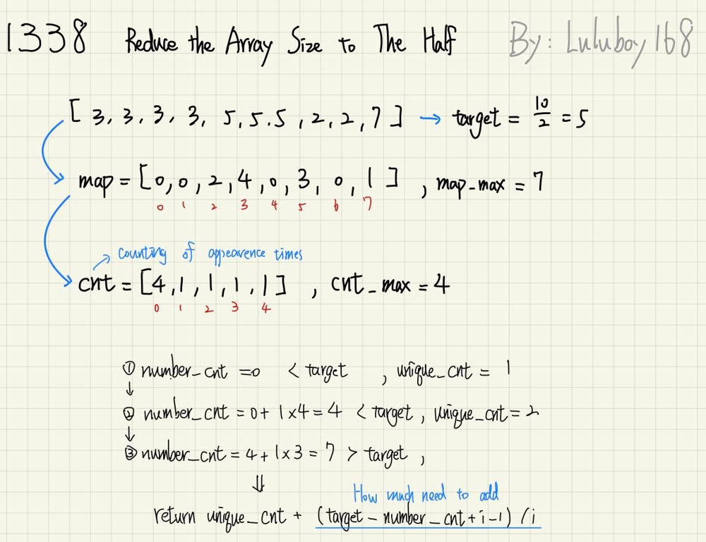

# ✔️PYTHON & C🔥T/M:100%/100%✅Detailed explantion | Beginner-friendly | simple counting | Easy

**Author:** luluboy168
**Votes:** 31
**Link:** [https://leetcode.com/problems/reduce-array-size-to-the-half/solutions/2443528/](https://leetcode.com/problems/reduce-array-size-to-the-half/solutions/2443528/)

---


**Pleaes UPVOTE if you LIKE !!** 

**C solution**
`map[]` is the counting of original numbers.
`cnt[]` is the counting of map[], meaning counting of apearence times.

Ex: `arr = [3, 3, 3, 3, 5, 5, 5, 2, 2, 7], arrSize = 10`
*   Here's how the code works:


```
#define max(X, Y) ((X) > (Y) ? (X) : (Y)) 

int minSetSize(int* arr, int arrSize){
    int i, number_cnt = 0, unique_cnt = 0, target = arrSize / 2;
    int map_max = 0, cnt_max = 0;
    int map[100001] = {0};
    int cnt[50000] = {0};
    
    // map[] is the counting of original numbers.
    // cnt[] is the counting of map[], meaning counting of apearence times.
    for (i=0; i < arrSize; i++){
        map[arr[i]]++;
        if (map[arr[i]] >= target) return 1;
        map_max = max(map_max, arr[i]);
    }
    
    for (i = map_max; i > 0; i--){
        cnt[map[i]]++;
        cnt_max = max(cnt_max, map[i]);
    }
    
    for (i = cnt_max; i > 0; i--){
        if (number_cnt + (i * cnt[i]) > target){
            return unique_cnt + (target - number_cnt + i - 1) / i;
        }
        number_cnt += i * cnt[i];
        unique_cnt += cnt[i];
    }
    
    return 0;
}
```

**Python solution**
It's almost the same logic, but using `Count()` and `sort`
* Here's the code:
```
class Solution:
    def minSetSize(self, arr: List[int]) -> int:
        
        cnt = Counter(arr)      # Use Counter() to get numbers and their frequency
        num_freq = sorted(cnt.values(), reverse=True)  # Sort dictionary by their frequency (descending order)
        
        half_size = len(arr) // 2
        ans = 0
        
        while half_size > 0:
            half_size -= num_freq[ans]
            ans += 1
        
        return ans
```


**Please UPVOTE if you LIKE!!**
