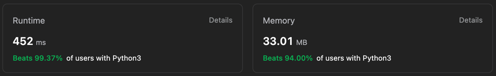

# ✅ Beats 99.37%🔥 and 94%🔥 ||  Easiest Approach - Hash Map || Beginner Friendly Solution ||

**Author:** Gourav-2002
**Votes:** 0
**Link:** [https://leetcode.com/problems/reduce-array-size-to-the-half/solutions/4192776/](https://leetcode.com/problems/reduce-array-size-to-the-half/solutions/4192776/)

---



# Intuition
We need to remove the most frequent elements first. So we use a counter to count the frequency of each element. Then we sort the frequency in descending order. We keep removing the most frequent element until the remaining elements are less than or equal to half of the original length of the array. Then we return the number of elements we removed.

# Approach : Hashmap + Sorting
1. Count the frequency of each element in the array.
2. Sort the frequency in descending order.
3. Remove the most frequent element until the remaining elements are less than or equal to half of the original length of the array.
4. Return the number of elements we removed.
<!-- Describe your approach to solving the problem. -->

# Complexity
- Time complexity : O(nlogn), *where n is the length of the array. We need O(n) time to count the frequency of each element and O(nlogn) time to sort the frequency array.*
<!-- Add your time complexity here, e.g. $$O(n)$$ -->

- Space complexity :  O(n), *where n is the length of the array. We need O(n) space to store the frequency of each element.*
<!-- Add your space complexity here, e.g. $$O(n)$$ -->

# Code
``` Python []
from collections import Counter
class Solution:
    def minSetSize(self, arr: List[int]) -> int:
        a=Counter(arr)

        n=len(arr)

        target=n//2

        count=0

        for i in sorted(a.values(),reverse=True):
            n-=i
            count+=1
            if n<=target:
                break
        return count
```
``` C++ []
class Solution {
public:
    int minSetSize(vector<int>& arr) {
        unordered_map<int, int> a;
        for (int num : arr) {
            a[num]++;
        }

        int n = arr.size();
        int target = n / 2;
        int count = 0;

        vector<int> values;
        for (const auto& entry : a) {
            values.push_back(entry.second);
        }

        sort(values.rbegin(), values.rend());

        for (int value : values) {
            n -= value;
            count++;
            if (n <= target) {
                break;
            }
        }

        return count;
    }
};
```
``` Java []
class Solution {
    public int minSetSize(int[] arr) {
        Map<Integer, Integer> a = new HashMap<>();
        for (int num : arr) {
            a.put(num, a.getOrDefault(num, 0) + 1);
        }

        int n = arr.length;
        int target = n / 2;
        int count = 0;

        List<Integer> values = new ArrayList<>(a.values());
        Collections.sort(values, Collections.reverseOrder());

        for (int value : values) {
            n -= value;
            count++;
            if (n <= target) {
                break;
            }
        }

        return count;
    }
}
```
```C# []
public class Solution {
    public int MinSetSize(int[] arr) {
        Dictionary<int, int> a = new Dictionary<int, int>();
        foreach (int num in arr) {
            if (!a.ContainsKey(num)) {
                a[num] = 0;
            }
            a[num]++;
        }

        int n = arr.Length;
        int target = n / 2;
        int count = 0;

        List<int> values = a.Values.ToList();
        values.Sort((a, b) => b - a);

        foreach (int value in values) {
            n -= value;
            count++;
            if (n <= target) {
                break;
            }
        }

        return count;
    }
}
```
``` JavaScript []
/**
 * @param {number[]} arr
 * @return {number}
 */
var minSetSize = function(arr) {
    const a = new Map();
        for (const num of arr) {
            a.set(num, (a.get(num) || 0) + 1);
        }

        let n = arr.length;
        const target = Math.floor(n / 2);
        let count = 0;

        const values = [...a.values()].sort((a, b) => b - a);

        for (const value of values) {
            n -= value;
            count++;
            if (n <= target) {
                break;
            }
        }

        return count;
};
```
``` TypeScript []
function minSetSize(arr: number[]): number {
const a = new Map<number, number>();
        arr.forEach(num => {
            a.set(num, (a.get(num) || 0) + 1);
        });

        let n = arr.length;
        const target = Math.floor(n / 2);
        let count = 0;

        const values = [...a.values()].sort((a, b) => b - a);

        for (const value of values) {
            n -= value;
            count++;
            if (n <= target) {
                break;
            }
        }

        return count;
};
```
``` PHP []
class Solution {

    /**
     * @param Integer[] $arr
     * @return Integer
     */
    function minSetSize($arr) {
        $a = array_count_values($arr);
        $n = count($arr);
        $target = $n / 2;
        $count = 0;

        arsort($a);

        foreach ($a as $value) {
            $n -= $value;
            $count++;
            if ($n <= $target) {
                break;
            }
        }

        return $count;
    }
}
```
``` Ruby []
# @param {Integer[]} arr
# @return {Integer}
def min_set_size(arr)
    a = arr.group_by(&:itself).transform_values(&:count)

        n = arr.length
        target = n / 2
        count = 0

        a.values.sort { |a, b| b <=> a }.each do |value|
            n -= value
            count += 1
            break if n <= target
        end

        count
end
```