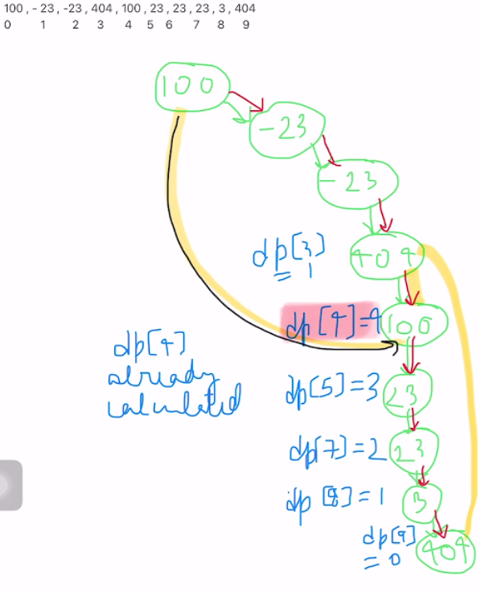

# Jump Game iv | Why DFS will not work - Explained

**Author:** richacode
**Votes:** 173
**Link:** [https://leetcode.com/problems/jump-game-iv/solutions/1316467/](https://leetcode.com/problems/jump-game-iv/solutions/1316467/)

---

This problem has same issue using on using dfs as in problem [Open the Lock](https://leetcode.com/problems/open-the-lock/) 
You may find its editorial [here](https://leetcode.com/problems/open-the-lock/discuss/1253043/open-the-lock-why-dfs-or-recursion-traversal-will-not-work-explainition)

### **Explanation** :

As asked in ques , we try to use recursion and travel all possible direction (i+1, i-1, a[i]==a[j] & i != j)

Recursion :
We start with simple recursion. And it goes like this:
```
unordered_map<int, vector<int>> mp;
    vector<bool> visit;
    int rec(vector<int>& arr, int start, vector<bool>& visit){
        if(start <0 || start > arr.size()-1) return 1000000; //out of range 
        if(visit[start]==true) return 1000000; //already wisited in a node
        if(start == arr.size()-1) return 0; //base case when we reach the last index
        int step = 1000000; 
        visit[start]=true; //marking as visited 
        step = min(step, 1+rec(arr, start+1, visit));  //recurse on i+1
        step = min(step, 1+rec(arr, start-1, visit));  //recurse on i-1
        for(int i =0;i<mp[arr[start]].size(); i++){   //recurse on a[i]==a[j] & i!=j
          if(mp[arr[start]][i] != start)  step = min(step, 1+ rec(arr, mp[arr[start]][i], visit));   
        }
        visit[start] = false;  //unmarking as visited when done
        return step; 
     }
    
    int minJumps(vector<int>& arr) {
        visit.resize(arr.size(), false);
        for(int i =0; i<arr.size(); i++){
            mp[arr[i]].push_back(i);  //use array to store a[i]==a[j]
        }
        return rec(arr, 0, visit);
        
    }
```

1. Brute-force : So here we try all nodes that are possible to be jumped. Also, we are using visited array but we are unmarking the node as unvisited after it has been traverse in a path. This is done so that if we we dont unmark it, and we traverse a longer path before, then on traversing a relatively shorter path having any common node , will break the dfs traversal. This is called backtracking. Where we are undoing what was done.

This solves our one problem of not marking any node which as visited if it could be used in any other path too. **When a node is common in multiple paths, we mark and then unmark it visited.**

2. Using DP : Next, this solution give us correct answer, but computes path which are common in various paths. There re-computation is involved. To solve this, we can think of memoization (dp), to store the computed paths.

Although, this seems at first like it would work, but think of the where we traversed a path via  node x. Lets, dp[x] will store the min path from x to last index. Then when we are done with this path, we backtrack and release node x. Then, we might have some path via node x, which follows another path form node x to last index and is actually shorter, but because we have already stored some value in dp[x], we get wrong value.

Explained in below fig:
[100,-23,-23,404,100,23,23,23,3,404]




Yellow path -> correct ans
Red path -> path 1 , that we traversed first
black path -> path 2 , traversed next
Here, we traversed node node 4 (arr[4] = 100) in red path first, and we get the value of path from node 4 to last node 9 as dp[4] = 4. (From node 4 , node 3 is already marked visited, so node 4 has just this path of length 4 )
Next we traversed path black, and node 4 has already value stored dp[4] = 4 , so our min path is not correctly calculated.
Therefore, there are multiple paths to reach last index from node 4, and also to reach node 4 , therefore, the dp[4] may not be the minimum value;


### **Conclusion** :

So, we tried solving below problems:
1.) **Multiple paths with common node** : Used backtracking to mark and unmark the node.
		Its a bruteforce, will give TLE.
2.) **Multiple paths from node x to last index** : Used dp[x] to store computed value for a node x in a path. Will not work, as stored value may not be the min value. WA

Hence, Dfs will not work. as we have end up tracking multiple paths from that stop and considering the minimum. As commented by [@iamninja in solution comments section](https://leetcode.com/problems/jump-game-iv/solution/765888) : 
**Due to duplicates relation problem becomes a graph with cycles and you needs to find a shortest path.**


