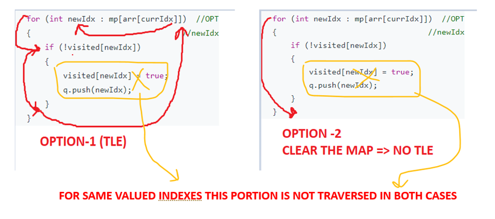

# C++ || Simple BFS || Reason to clear the map explained with image

**Author:** MohakHarjani
**Votes:** 90
**Link:** [https://leetcode.com/problems/jump-game-iv/solutions/3257792/](https://leetcode.com/problems/jump-game-iv/solutions/3257792/)

---

```
class Solution {
public:
    int minJumps(vector<int>& arr) 
    {
        int n = arr.size();
        unordered_map<int, vector<int>>mp;
        for (int i = 0; i < n; i++) mp[arr[i]].push_back(i);
        
        queue<int>q;
        vector<bool>visited(n, false);
        q.push(0);
        int steps = 0;
        while(!q.empty())
        {
            int size = q.size();
            while(size--)
            {
                int currIdx = q.front();
                q.pop();
                if (currIdx == n - 1) return steps;
                //================================================================
                //EXPLORE ALL POSSIBLE OPTIONS
                if (currIdx + 1 < n && !visited[currIdx + 1])  //OPTION-1 (Move Forward)
                {
                    visited[currIdx + 1] = true;
                    q.push(currIdx + 1);
                }
                if (currIdx - 1 >= 0 && !visited[currIdx - 1]) //OPTION-2 (Move Backward)
                {
                    visited[currIdx - 1] = true;
                    q.push(currIdx - 1);
                }
                for (int newIdx : mp[arr[currIdx]])  //OPTION-3 (Move to same valued idx)
                {                                 //newIdx coud be before currIdx or after currIdx
                    if (!visited[newIdx]) 
                    {
                        visited[newIdx] = true;
                        q.push(newIdx);
                    }
                }
                //===================================================================
                mp[arr[currIdx]].clear();    //EXPLAINED BELOW :)
            }
            steps++;
        }
        return -1;
    }
};
```
**Why to clear the map when you already marked "visited = true"?????**
#**"Visited = true", will work completely fine** to prevent visiting any index that is 
 (already explored) or (waiting in the queue to be explored)
#So whenever we iterate the "map" of similar valued indexes we can check whether the 
 index is visited. If visited it will not consider that path.

//========================================================================
#**But there is one problem of time constraint** with the traditional approach
#**There could be a large number of indexes with same value**
#So after the first index for a value is encountered we add all the occurances of that value in the queue
**and mark those indexes as visited**
#When we encounter that similar valued index (after popping from queue) then we
 again iterate over all those redundant indexes and 
 **every time the condition "visited = true" becomes true** and we just iterate those 
 large number of indexes for no reason 
#So we can prevent this redundant iteration just by "**CLEARING THE MAP FOR ALREADY VISITED VALUES**"

So 
**OPTION-1 => Iterate all already visited indexes, visited becomes true, exit the loop, no harm done
OPTION-2 => Clear the map -> Don't even iterate the already visited indexes, no harm done :)  <== USE THIS ONE**



