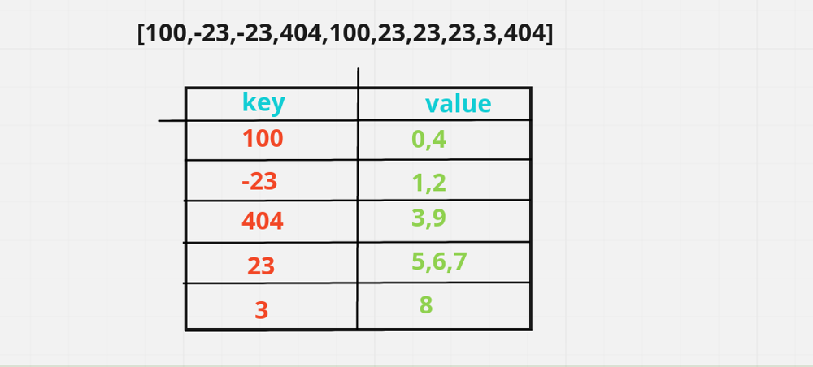
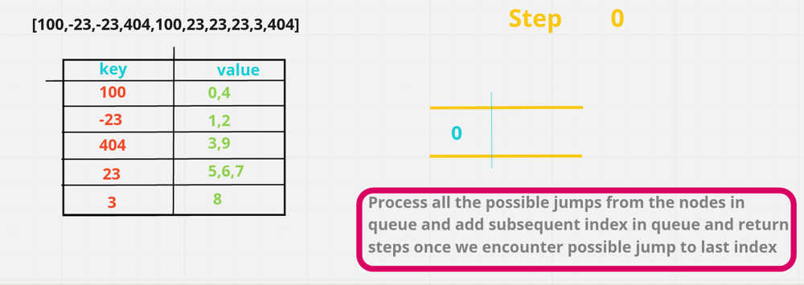
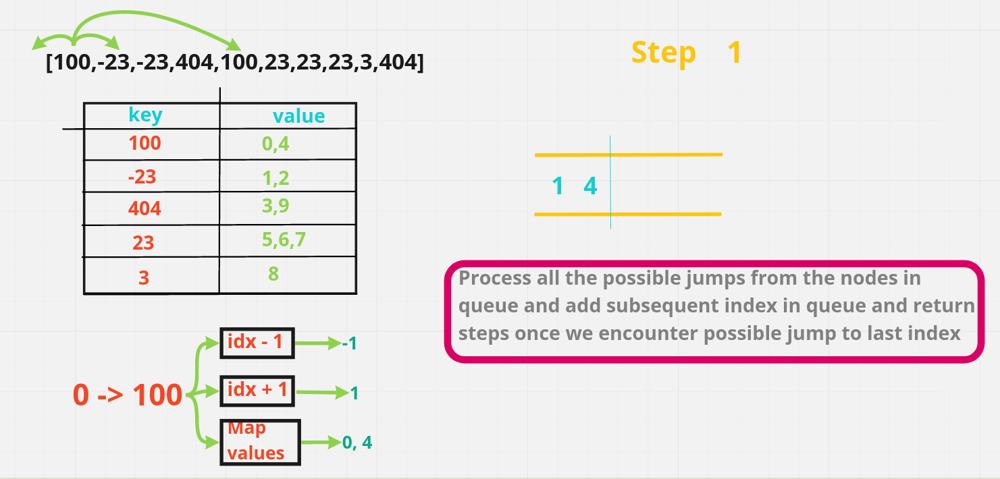
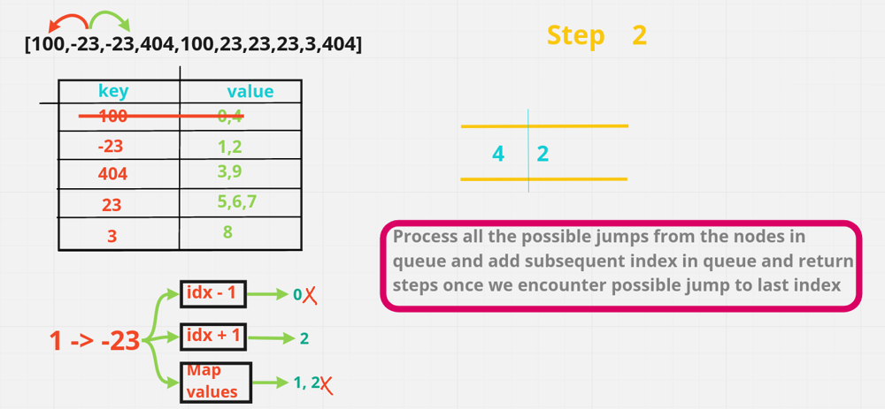
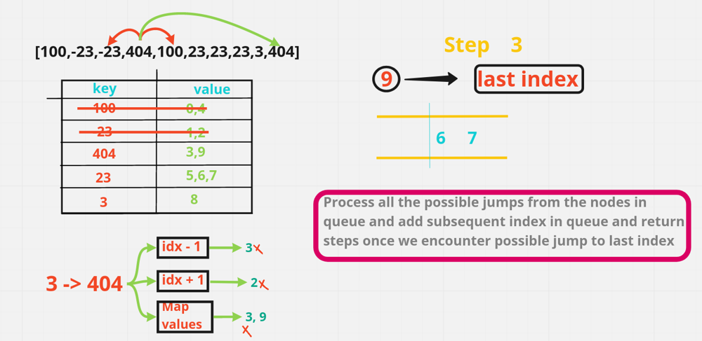

# Best explanation EVER possible for this question

**Author:** hi-malik
**Votes:** 414
**Link:** [https://leetcode.com/problems/jump-game-iv/solutions/1690813/](https://leetcode.com/problems/jump-game-iv/solutions/1690813/)

---

Guy's if you find this solution helpful \uD83D\uDE0A, PLEASE do UPVOTE. By doing that it motivate's me to create more better post like this \u270D\uFE0F

**So Ladies n Gentlemen without any further due let's start,**
```
Let's understood with an example - [100,-23,-23,404,100,23,23,23,3,404] and using this example we create a map. 
Where Key is the number present and the value as an the index in which it is present. 
So, we would get something like this:
```



As we see the key is **100** and value part **0,4** which would give us the **indexes** where this **value** is found. So, that whenever we want to jump we can found at **4 index** also we have **100** we can **jump directly** on that apart from going to **i + 1, i - 1**. So, now with that will take a **queue**, where we will going to store the element that we are going to process at each step. 
Since we are **positioned at index 0** will **add 0** in the **queue** and the steps would be **0** as we have not taken any of these steps till now. Now from here we can go to different places.



To state all the possible jumps at each step. I had **marked a vertical line** in the **queue**. So, **starting is 0** from here we can jump to some other steps. 
So, now in the first step we can jump to `idx - 1, idx + 1 or values in map`. Which gives us **-1, 1** & the value in map **0, 4**. In this one **0** is **current index** and **4th** one is this **100**.



From these **-1 & 0** are not reachable & we can just reach to **1 & 4**. We put these in the **queue**. And that line mark the end of the position we can reach in **1st step**. Now we had already process the **100** we will **removing** from the **map**. So, that we do not process this again, there will be cases where we can get a **tle** if we keep the processes index in map for **example** if all these are **100**. We'll keep on processing the **i - 1 i + 1 i - 1 i + 1** and every other index **multiple** no of times and we'll get a **tle**. So, for that reason we are just **removing** from our **map**.

Now, in this we know that in the first step we can reach to **1 & 4**. So, in the **next step** where can we reach. So we will be **popping** the element out of **queue and calculating jumps** from that particular index.
So, for that since we are calculating **2nd step**. We do `step = step + 1` and we find the step from the 1st index which is **-23** : **we can go to 0 or 2 or 1 but 0 & 1 are not reachable**. So, we will add **2** in the **queue**.




Now we will again **remove -23 from our Map**.
Next we will go to **4th index**. So, from **4th index** we can go to **-1, +1** & we could have also gone to **index 0** but since **100** is not **present** in **map**. We couldn't be going to 100 or 0 sice it is already remove from the map. So here will add **5 & 3 in our queue**. Now we have already got places where we can jump in **2**. We are finding where will be ending up in **step 3**. Will do a `step++` and start processing our indexes.

**From 2 we can reach to 3**. So, we **add 3**. But from **5 we can reach to 6 & 7** so we add these two. And from **3 we can reach to 9**. Now here we can see **9 is indeed our last index**. So, here we will be `returning 3`.
Which is minimum step we would be needed to reach the index 9 or last index. So, we return 3.



**Now let's code it up** 

*code each line explained*

* Step 1 :
```
{
        // creating variable
        int n = arr.length;
        if(n == 1) return 0; // base case
        
        // craeted map holding integer & list
        Map<Integer, List<Integer>> map = new HashMap<>();
        int step = 0; // intial step is 0
        
        // Our 1st job is "fill the map"
        for(int i = 0; i < n; i++){
            // so, using this function it will check is arr[i] is present or not, if it's not present it would create a new arraylist
            // and if it's already present we will add index in it
            map.computeIfAbsent(arr[i], v -> new ArrayList()).add(i);
        }
```

* Step 2 :
```
// next we need a queue.
        Queue<Integer> q = new LinkedList<>();
        q.offer(0);// in queue we will add our 1st index which is 0;
        
        while(!q.isEmpty()){ // looping until queue is not empty
            step++; // incrementing our step
            int size = q.size(); // taking queue size
            for(int i = 0; i < size; i++){ // now for each element in this queue for this particulart size running a loop
                // so, here we will perform 3 steps
                int j = q.poll(); // getting element from queue
                
                // Jump to j - 1
                if(j - 1 >= 0 && map.containsKey(arr[j - 1])){
                    q.offer(j - 1);
                }
                
                // Jump to j + 1
                if(j + 1 < n && map.containsKey(arr[j + 1])){
                    // there could be 2 conditions
                    if(j + 1 == n - 1) return step; // if j+1 is equals to last element
                    q.offer(j + 1); // otherwise add in queue
                }
                
                // Jump to k --> arr[j] == arr[k]
                if(map.containsKey(arr[j])){ // if this particular element hasn't processed
                    for(int k : map.get(arr[j])){ // so, we will iterate over each k
                        if(k != j){ // in this we first check if they are not equal, positions are not same
                            if(k == n - 1) return step;
                            q.offer(k);
                        }
                    }
                }
                map.remove(arr[j]); // removing from map
            }
        }
```

* Final Step :
```
return step;
```

**Java**
```
class Solution {
    public int minJumps(int[] arr) {
        int n = arr.length;
        
        if(n == 1) return 0;
        Map<Integer, List<Integer>> map = new HashMap<>();
        int step = 0;
        
        // fill the map
        for(int i = 0; i < n; i++){
            map.computeIfAbsent(arr[i], v -> new ArrayList()).add(i);
        }
        Queue<Integer> q = new LinkedList<>();
        q.offer(0);
        
        while(!q.isEmpty()){
            step++;
            int size = q.size();
            for(int i = 0; i < size; i++){
                int j = q.poll();
            
                if(j - 1 >= 0 && map.containsKey(arr[j - 1])){
                    q.offer(j - 1);
                }

                if(j + 1 < n && map.containsKey(arr[j + 1])){
                    if(j + 1 == n - 1) return step;
                    q.offer(j + 1);
                }

                if(map.containsKey(arr[j])){
                    for(int k : map.get(arr[j])){
                        if(k != j){
                            if(k == n - 1) return step;
                            q.offer(k);
                        }
                    }
                }
                map.remove(arr[j]);
            }
        }
        
        return step;
    }
}
```

ANALYSIS :-
* **Time Complexity :-** BigO(N)

* **Space Complexity :-** BigO(N)

If you have some \uD83E\uDD14 doubts feel free to bug me anytime or If you understood than don't forget to upvote \uD83D\uDC4D