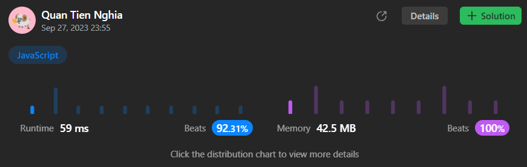

# Efficient JS solution (beat 92% time and 100% memory)

**Author:** CuteTN
**Votes:** 1
**Link:** [https://leetcode.com/problems/maximum-students-taking-exam/solutions/4097145/](https://leetcode.com/problems/maximum-students-taking-exam/solutions/4097145/)

---



# Complexity
- Time complexity: $$O(m * 2^n)$$
- Space complexity: $$O(2^n)$$

# Code
```
/**
 * @param {number} mask
 * @returns {number}
 */
function count1s(mask) {
  let res = 0;
  while (mask) {
    res++;
    mask -= mask & -mask;
  }
  return res;
}

/**
 * @param {string[]} seatRow
 * @returns {number}
 */
function convertToBannedState(seatRow) {
  let state = 0;
  for (let i = 0; i < seatRow.length; i++)
    state = (state << 1) | (seatRow[i] == "#" ? 1 : 0);
  return state;
}

let pre = new Uint8Array(256);
let cur = new Uint8Array(256);

/**
 * @param {character[][]} seats
 * @return {number}
 */
var maxStudents = function (seats) {
  const m = seats.length;
  const n = seats[0].length;
  const fullMask = (1 << n) - 1;

  const bannedSeats = seats.map((s) => convertToBannedState(s));
  pre.fill(0, 0, 1 << n);
  let res = 0;

  for (let i = m - 1; i >= 0; i--) {
    for (let curState = 0; curState <= fullMask; curState++) {
      if (curState & bannedSeats[i] || curState & (curState >> 1)) {
        cur[curState] = 0;
        continue;
      }

      const t = count1s(curState);
      cur[curState] = 0;
      for (let preState = 0; preState <= fullMask; preState++) {
        if (pre[preState] <= cur[curState]) continue;
        if ((preState << 1) & curState) continue;
        if ((preState >> 1) & curState) continue;
        cur[curState] = pre[preState];
      }
      cur[curState] += t;
      res = Math.max(res, cur[curState]);
    }
    let tem = pre;
    pre = cur;
    cur = tem;
  }

  return res;
};
```