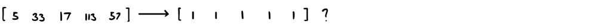
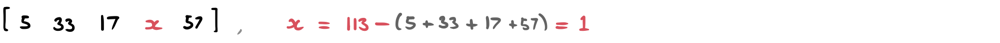
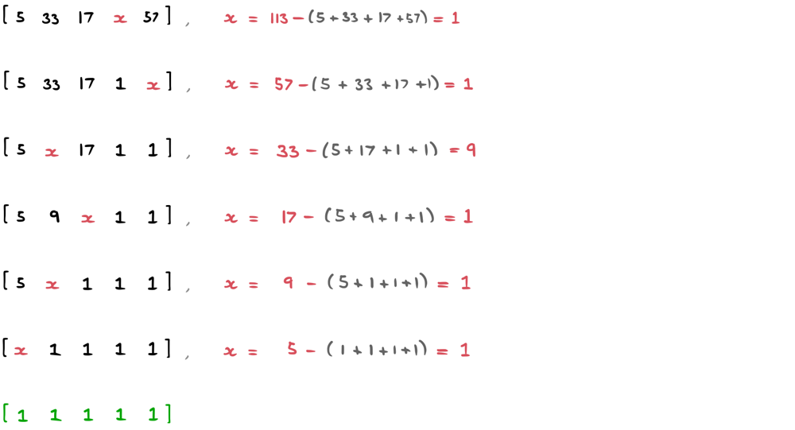
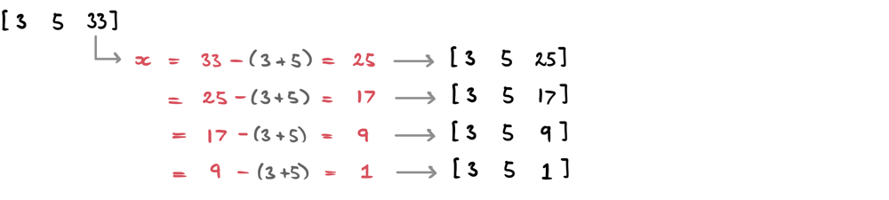
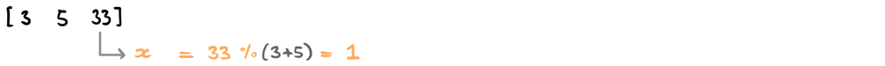

# Visual Explanation | JAVA Max-Heap

**Author:** ciote
**Votes:** 346
**Link:** [https://leetcode.com/problems/construct-target-array-with-multiple-sums/solutions/2189445/](https://leetcode.com/problems/construct-target-array-with-multiple-sums/solutions/2189445/)

---

### Introduction:
The best approach to this question can be obtained by realising that it's quite time-consuming to start with our ones array to try and get to the `target` array. This is because there are just too many possibilities that we could branch into since it isn't clear what indexes need to be replaced.

Therefore, since we're already given the final result after each operation, we can just start with that and see if it's possible to reach our ones array going <ins>backwards</ins>.

___
### Logic:
So, where should we start? Well, we know that each new number is going to be larger than the previous. Therefore, we will start with the largest number and try and find what *used to be there* before adding it.

Let `x` represent the number that got removed before the new sum was placed. We know we can retrieve `x` since we know what the previous sum must have been: 113; We were only able to add 113 because that was the previous sum. Therefore `x = prevSum - (everything else)`. 

Let's continue this frame of thought with the rest of the array, picking the largest number each time: 


Awesome! That's basically how our algorithm will work. 
> If we are never able to reach a row of ones, we return false.

___
### Major optimisation:
The above procedure works quite well but is inefficient in a particular situation. Imagine if we had an array where one number is much larger than the others. That implies that the same sum has been added to that number multiple times. Observe the following example:


As you can see, we continuously subtract `(3+5)` from our largest number. The way we avoid all this repetitive work is by simply taking the modulus:

If we keep subtracting the same value from our number, we're effectively finding what the remainder would be once it's no longer the largest number.

___
### How would this work in code?
It's actually quite simple! We need the largest number each time, so we can just put all our numbers in a **max-heap**. In the below, assume `curr` represents the current largest number.

* To get `x`, we can simply do `x = curr % (sum - curr)` since `sum - curr` represents the sum of all numbers in the array except the current max.
* Once we have `x`, we'll update `sum` to `sum - curr + x` to get our new sum.
* Before adding `x` to the priority queue, we need to check a couple of things:
	* If `x == 0`, that implies it was impossible to get to this point with an array of ones. We return false.
	* If `x == curr`, that implies our modulus operator did not change our value. We return false.
* We return true once our priority queue only has 1s in it.

We also need to account for a couple special cases:
* If `n == 1`, we can return true if `target[0] == 1`. Otherwise, return false.
* In our while-loop, we return true if `sum - curr == 1`.
	*  This is an edge-case that occurs when the sum of values except curr is 1. <ins>Any number % 1 == 0</ins>, which is something we want to avoid in this case. 
	*  This will only happen when `n == 2` (since it's not mathematically possible to happen if `n > 2` due to the presence of other positive numbers).
	* Imagine the following example: `[1,4]` where `sum = 5` and `curr = 4`.
		We know that 4 can be reduced down to 1, In fact, any number in this situation can reduce to 1 just by subtracting 1 some number of times. Therefore, we return true. 

Alright, now we have everything we need to start coding!
___
### Code:
If you have any questions, suggestions or improvements, feel free to let me know. Thanks for reading!
```java
public boolean isPossible(int[] target) {
	if (target.length == 1) return target[0] == 1;

	PriorityQueue<Integer> pq = new PriorityQueue<>(Collections.reverseOrder());
	int sum = 0;
	for (int t: target) {
		pq.add(t);
		sum += t;
	}

	while (pq.peek() != 1) {
		int curr = pq.poll();
		if (sum - curr == 1) return true;

		int x = curr % (sum - curr);
		sum = sum - curr + x;

		if (x == 0 || x == curr) return false;
		else pq.add(x);
	}

	return true;
}
```
**Time complexity:** `O(nlogn)` due to the priority queue.
**Space complexity:** `O(n)`