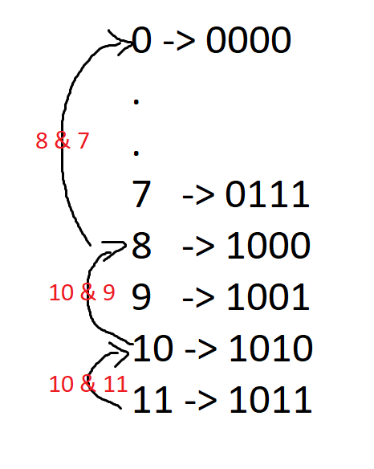

# 🚀 96.58% || Built-in Functions & Brian Kerninghan's Algorithm || Explained Intuition 🚀

**Author:** MohamedMamdouh20
**Votes:** 120
**Link:** [https://leetcode.com/problems/sort-integers-by-the-number-of-1-bits/solutions/4224485/](https://leetcode.com/problems/sort-integers-by-the-number-of-1-bits/solutions/4224485/)

---

# Problem Description

Given an integer array, **arrange** the integers in **ascending** order based on the **count** of `1s` in their **binary** representation. 
In case of a **tie** (two or more integers with the **same** number of 1s), sort them in `ascending numerical order`. Return the **sorted** array.

- Constraints:
    - `1 <= arr.length <= 500`
    - `0 <= arr[i] <= 10e4`

---


# Intuition

Hi there,\uD83D\uDE00

Let's take a look\uD83D\uDC40 on our today's problem.

- We are required today to sort a list of integers based on some rules:
    - **Ascending** order based on the **count** of `1s` in their **binary** representation. 
    - If there's a tie, sort in `ascending numerical order`.

Seems easy !\uD83D\uDE80
Easiest solution to do here is to use **built-in sorting** funtion in the language that you use **instead** of implementing sorting algorithm from the scratch, then we will use a **comparator** to specify the **rules** of the sorting that we want.

Great now we are on a solid ground.\uD83E\uDDCD\u200D\u2642\uFE0F\uD83E\uDDCD\u200D\u2640\uFE0F
- How we **specify** the comparator ?\uD83E\uDD14
    - Make **comparator** class or function based on your language.
    - **Count** number of one bits when comparing two integers. 
    - **Compare** them based on **number** of ones bits
    - If number of one bits is **equal** then compare them based on **numerical** order.

This was straight forward !\uD83D\uDCAA
Now, how to count number of one bits in any integer ?\uD83E\uDD14
This is the neat part.\uD83E\uDD2F

There are many ways to do that but we will discuss two interesting approaches which are using **Built-in Functions** based on the language you are using or using **Brian Kerninghan's Algorithm**.

- For using **Built-in Functions**, Many languages have their own functions to count the number of one bits in the binary representation in any integer:
    - For **C++**, It uses `__builtin_popcount()` the great part here that it is not a built-in function in **C++** itself\uD83E\uDD28 but it is built-in function in **GCC** compiler of **C++**. It tries to use CPU `specific instructions` to count number of one bits since modern CPUs can count it in **one cycle**.\uD83E\uDD2F
    - For **Java**, It uses `Integer.bitCount()` which does some operations internally to calculate the number of one bits.
    - For **Python**, It uses `bin()` which loops over all bits of the integer and count its `1's`.
    - Unfortunately, **C** does not have built-in function.\uD83D\uDE14


Is there another way than using built-in functions?\uD83E\uDD14
Actually there are. There are many algorithms one of them is **Brian Kerninghan's Algorithm**.\uD83E\uDD29
What does this algorithm do?
It only loops over the one's in the binary representation of an integer not over all the bits.\u2753
```
EX: Integer = 9
Binary Representation = 1001
It will only loop for two iterations.
``` 

How does it work?\uD83E\uDD14
For eavery **two consecutive** numbers, we are sure that there are `(n - 1)` `1's` which are **common** between the two numbers where `n` is the total number of `1's` in the **larger** number.
Let's see this example for number `11`.


The algorithm utilizes this observation and loop according to it.

### Note about space complexity.

- The **space complexity** depends on the **implementation** of the Sorting algorithm in each language:
    - Within the realm of **Java**, `Arrays.sort()` using variant of quick sort called `Dual-Pivot Quicksort`, featuring a space complexity denoted as `O(log(N))`.
    - In the domain of **C++**, the `sort()` function within the Standard Template Library (STL) blends Quick Sort, Heap Sort, and Insertion Sort Called `Intro Sort` exhibiting a space complexity of `O(log(N))`.
    - In **Python**, the `sort()` function using the `Timsort algorithm`, and its space complexity in the worst-case scenario is `O(N)`.
    - In **C**, `qsort()` function uses internally `Quick Sort` algorithm, and its space complexity is `O(log(N))` since it is calling `O(log(N))` stack frames.


And this is the solution for our today'S problem I hope that you understood it\uD83D\uDE80\uD83D\uDE80

---


# Approach
## 1. Built-in Functions
1. Define a custom comparison function `compare` that takes two integers, `a` and `b`.
2. Inside the `compare` function, count the number of set bits (1s) in the binary representations of `a` and `b` using the build-in function - `__builtin_popcount` in case if C++ -:
    - If the number of set bits is the **same** for `a` and `b`, compare them numerically by checking if `a` is **less** than `b`.
    - If the set bit counts are different, sort the integers in **ascending** order based on the number of set bits.
3. **Sort** the elements of the array using the `compare` function and return the sorted vector.

## Complexity
- **Time complexity:** $O(N * log(N))$
The sorting algotirhm takes it self $O(N * log(N))$ and to compute its complexuty using custom comparator it should be `N * log(N) * comparator_time` but since the comparator is counting bits in numbers that have fixed number of bits which is `31` bits -since there's reserverd bit for the sign- then we can consider it as a constant. So total complexity is $O(N * log(N))$.
Where `N` is number of elements in the vector to be sorted.
- **Space complexity:** $O(N) or O(log(N))$
The space complexity depends on the implementation of the sorting algorithm in each programming language.


---

## 2. Brian Kerninghan's Algorithm
1. Implement a function `countBits` that calculates the **number** of set bits (1s) in the binary representation of a number using **Brian Kerninghan's Algorithm**.
2. Inside the `compare` function, count the number of set bits (1s) in the binary representations of `a` and `b` using `countBits` function :
    - If the number of set bits is the **same** for `a` and `b`, compare them numerically by checking if `a` is **less** than `b`.
    - If the set bit counts are different, sort the integers in **ascending** order based on the number of set bits.
3. **Sort** the elements of the array using the `compare` function and return the sorted vector.


## Complexity
- **Time complexity:** $O(N * log(N))$
The sorting algotirhm takes it self $O(N * log(N))$ and to compute its complexuty using custom comparator it should be `N * log(N) * comparator_time` but since the comparator is counting bits in numbers that have fixed number of bits which is `31` bits -since there's reserverd bit for the sign- then we can consider it as a constant. So total complexity is $O(N * log(N))$.
Where `N` is number of elements in the vector to be sorted.
- **Space complexity:** $O(N) or O(log(N))$
The space complexity depends on the implementation of the sorting algorithm in each programming language.

---


# Code
## 1. Built-in Functions
```C++ []
class Solution {
public:
    static bool compare(int a, int b) {
        // Calculate the number of set bits (1s) in the binary representation of a and b
        int bitCountA = __builtin_popcount(a);
        int bitCountB = __builtin_popcount(b);

        // If the number of set bits is the same for a and b, compare them numerically
        if (bitCountA == bitCountB) {
            return a < b;
        }
        
        // Sort by the number of set bits in ascending order
        return bitCountA < bitCountB;
    }
    
    vector<int> sortByBits(vector<int>& arr) {
        // Use the compare function to sort the vector
        sort(arr.begin(), arr.end(), compare);
        
        // Return the sorted vector
        return arr;
    }
};
```
```Java []
class Solution {
    public int[] sortByBits(int[] arr) {
        // Convert the input integer array to Integer objects for sorting
        Integer[] integerArr = Arrays.stream(arr).boxed().toArray(Integer[]::new);

        // Create a custom comparator to sort by bit count and then numerically
        Comparator<Integer> comparator = new BitCountComparator();

        // Sort the array using the custom comparator
        Arrays.sort(integerArr, comparator);

        // Convert the sorted array back to primitive integers
        int[] sortedArr = Arrays.stream(integerArr).mapToInt(Integer::intValue).toArray();

        return sortedArr;
    }
}

class BitCountComparator implements Comparator<Integer> {
    @Override
    public int compare(Integer a, Integer b) {
        // Compare based on the count of set bits (1s) in the binary representation
        int bitCountA = Integer.bitCount(a);
        int bitCountB = Integer.bitCount(b);

        if (bitCountA == bitCountB) {
            // If bit counts are the same, compare numerically
            return a - b;
        } else {
            // Sort by the number of set bits in ascending order
            return bitCountA - bitCountB;
        }
    }
}
```
```Python []
class Solution:
    def sortByBits(self, arr: List[int]) -> List[int]:
        # Define a custom comparison key function for sorting
        def custom_sort_key(num):
            # Calculate the number of set bits (1s) in the binary representation of num
            bit_count = bin(num).count('1')
            return (bit_count, num)

        # Sort the input list using the custom comparison key function
        arr.sort(key=custom_sort_key)

        # Return the sorted list
        return arr
```

---

## 2. Brian Kerninghan's Algorithm
```C++ []
class Solution {
public:
    // Count the number of set bits (1s) in the binary representation of a number.
    static int countBits(int num) {
        int count = 0;
        
        while (num > 0) {
            count++;
            num &= (num - 1);  // Clear the least significant set bit.
        }
        
        return count;
    }
    
    static bool compare(int a, int b) {
        int bitCountA = countBits(a);
        int bitCountB = countBits(b);
        
        if (bitCountA == bitCountB) {
            return a < b;  // If set bit counts are equal, compare numerically.
        }
        
        return bitCountA < bitCountB;  // Sort by the set bit count in ascending order.
    }
    
    vector<int> sortByBits(vector<int>& arr) {
        sort(arr.begin(), arr.end(), compare);
        return arr;
    }
};
```
```Java []
class Solution {
    public int[] sortByBits(int[] arr) {
        // Convert the input array to an array of Integer objects for sorting
        Integer[] nums = Arrays.stream(arr).boxed().toArray(Integer[]::new);

        // Create a custom comparator for sorting based on bit counts and numerical values
        Comparator<Integer> comparator = new BitCountComparator();

        // Sort the array using the custom comparator
        Arrays.sort(nums, comparator);

        // Convert the sorted Integer array back to a primitive int array
        return Arrays.stream(nums).mapToInt(Integer::intValue).toArray();
    }
}

class BitCountComparator implements Comparator<Integer> {
    private int findBitCount(int num) {
        // Count the number of set bits (1s) in the binary representation of num
        int count  = 0;

        while (num > 0) {
            count ++;
            num &= (num - 1);
        }

        return count ;
    }

    @Override
    public int compare(Integer a, Integer b) {
        int bitCountA = findBitCount(a);
        int bitCountB = findBitCount(b);

        if (bitCountA == bitCountB) {
            return a - b; // If bit counts are the same, compare numerically.
        }

        return bitCountA - bitCountB; // Sort by the bit count in ascending order.
    }
}
```
```Python []
class Solution:
    def countBits(num):
        count = 0
        
        while num > 0:
            count += 1
            num &= (num - 1)  # Clear the least significant set bit.
        
        return count

    def sortByBits(self, arr):
        arr.sort(key = lambda num: (Solution.countBits(num), num))
        return arr
```
```C []
int countBits(int num) {
    int count = 0;

    while (num > 0) {
        count++;
        num &= (num - 1);  // Clear the least significant set bit.
    }

    return count;
}

// Custom comparison function for sorting.
int compare(const void *a, const void *b) {
    int intA = *((int *)a);
    int intB = *((int *)b);
    
    int bitCountA = countBits(intA);
    int bitCountB = countBits(intB);

    if (bitCountA == bitCountB) {
        return intA - intB;  // If set bit counts are equal, compare numerically.
    }

    return bitCountA - bitCountB;  // Sort by the set bit count in ascending order.
}

int* sortByBits(int* arr, int arrSize, int* returnSize) {
    // Allocate memory for the sorted array
    int* sortedArr = (int*)malloc(arrSize * sizeof(int));

    if (sortedArr == NULL) {
        // Memory allocation failed
        *returnSize = 0; // Set the size to 0 to indicate an error
        return NULL;
    }

    // Copy the original array to the new one
    for (int i = 0; i < arrSize; i++) {
        sortedArr[i] = arr[i];
    }

    // Sort the array using the custom comparator
    qsort(sortedArr, arrSize, sizeof(int), compare);

    *returnSize = arrSize; // Set the return size

    return sortedArr;
}

```


