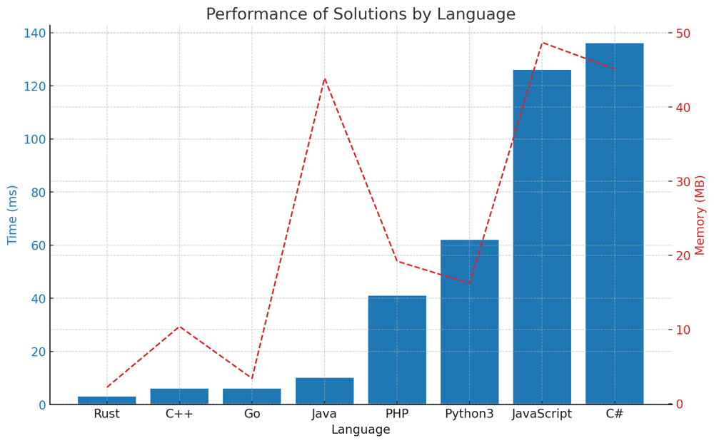

# ✅ 89.93% Sort Bit

**Author:** vanAmsen
**Votes:** 43
**Link:** [https://leetcode.com/problems/sort-integers-by-the-number-of-1-bits/solutions/4224341/](https://leetcode.com/problems/sort-integers-by-the-number-of-1-bits/solutions/4224341/)

---

# Intuition
Upon reading the problem, our first observation is that the sorting criteria is twofold:
1. First, by the count of 1's in the binary representation.
2. If there's a tie, by the actual integer value.

Given this, we can leverage Python's built-in sorting mechanism which supports multi-criteria sorting using a tuple as the key.

# Live Coding 
https://youtu.be/GQ0vpiPA2Cg?si=1CsU0oMNHyatlK59

# Approach
Our approach is straightforward:
1. Convert each number into its binary representation using the `bin()` function.
2. Count the number of 1's using the `count('1')` method.
3. Sort the numbers first by the count of 1's and then by the number itself.

Python's `sorted` function will use the first element of the tuple for sorting and if there's a tie, it'll use the second element.

# Complexity
- **Time complexity:** The time complexity of the `sorted` function is $$O(n \\log n)$$, where $n$ is the length of the array. Counting the 1's in the binary representation of each number can be done in $O(m)$ time, where $m$ is the maximum number of bits needed to represent any number in the list. Thus, the overall time complexity is $O(n \\log n \	imes m)$.
  
- **Space complexity:** The space complexity of the `sorted` function is $O(n)$, as it returns a new sorted list.

# Code
```Python []
class Solution:
    def sortByBits(self, arr: List[int]) -> List[int]:
        return sorted(arr, key=lambda x: (bin(x).count('1'), x))
```
``` Rust []
impl Solution {
    pub fn sort_by_bits(mut arr: Vec<i32>) -> Vec<i32> {
        arr.sort_by_key(|&x| (x.count_ones(), x));
        arr
    }
}
```
``` Go []
import (
	"sort"
	"math/bits"
)

func sortByBits(arr []int) []int {
	sort.Slice(arr, func(i, j int) bool {
		countI := bits.OnesCount(uint(arr[i]))
		countJ := bits.OnesCount(uint(arr[j]))
		return countI < countJ || (countI == countJ && arr[i] < arr[j])
	})
	return arr
}
```
``` C++ []
class Solution {
public:
    vector<int> sortByBits(vector<int>& arr) {
        sort(arr.begin(), arr.end(), [](int a, int b) {
            int countA = __builtin_popcount(a);
            int countB = __builtin_popcount(b);
            return (countA == countB) ? a < b : countA < countB;
        });
        return arr;
    }
};
```
``` Java []
public class Solution {
    public int[] sortByBits(int[] arr) {
        Integer[] boxedArray = Arrays.stream(arr).boxed().toArray(Integer[]::new);
        Arrays.sort(boxedArray, (a, b) -> {
            int countA = Integer.bitCount(a);
            int countB = Integer.bitCount(b);
            return countA == countB ? a - b : countA - countB;
        });
        return Arrays.stream(boxedArray).mapToInt(Integer::intValue).toArray();
    }
}
```
``` PHP []
class Solution {

    function sortByBits($arr) {
        usort($arr, function($a, $b) {
            $countA = substr_count(decbin($a), '1');
            $countB = substr_count(decbin($b), '1');
            return $countA == $countB ? $a - $b : $countA - $countB;
        });
        return $arr;
    }
}
```
``` JavaScript []
var sortByBits = function(arr) {
    return arr.sort((a, b) => {
        let countA = a.toString(2).split('').filter(bit => bit === '1').length;
        let countB = b.toString(2).split('').filter(bit => bit === '1').length;
        return countA - countB || a - b;
    });
};
```
``` C# []
public class Solution {
    public int[] SortByBits(int[] arr) {
        return arr.OrderBy(x => CountOnes(x)).ThenBy(x => x).ToArray();
    }

    private int CountOnes(int x) {
        int count = 0;
        while (x != 0) {
            count += x & 1;
            x >>= 1;
        }
        return count;
    }
}
```

# Performance

| Language   | Time (ms) | Memory (MB) |
|------------|-----------|-------------|
| Rust       | 3         | 2.2         |
| C++        | 6         | 10.4        |
| Go         | 6         | 3.4         |
| Java       | 10        | 43.9        |
| PHP        | 41        | 19.2        |
| Python3    | 62        | 16.2        |
| JavaScript | 126       | 48.7        |
| C#         | 136       | 45.1        |


