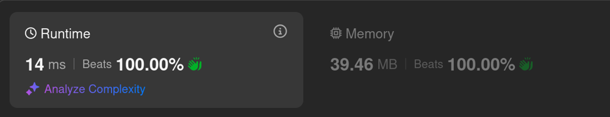

# Kotlin. Beats 100% (14 ms). In-place solution (bitwise math)

**Author:** mobdev778
**Votes:** 4
**Link:** [https://leetcode.com/problems/sort-integers-by-the-number-of-1-bits/solutions/4225833/](https://leetcode.com/problems/sort-integers-by-the-number-of-1-bits/solutions/4225833/)

---



# Code
```
class Solution {

    fun sortByBits(arr: IntArray): IntArray {
        for (i in 0 until arr.size) {
            arr[i] = arr[i] or (Integer.bitCount(arr[i]) shl 16)
        }
        arr.sort()
        for (i in 0 until arr.size) {
            arr[i] = arr[i] and 0xFFFF
        }
        return arr
    }
}
```

# Intuition
The main idea is that the range of numbers that we compare is limited to 10,000. This is the most important clue to the solution.

# Approach

The maximum number does not exceed 10000. This means that the next number during sorting will not go beyond the value 65535 (0xFFFF), i.e. to encode it, the lower 16 bits are sufficient.

We can encode any positive "Int" number with 31 bits (the most significant bit is signed). It important to note that of 31 bits we only use the lowest 16 bits.

```
[ 0, 1, 2, 3, 4, 5, 6, 7, 8 ]
```

What does this give us? In the space between the 16th and 24th bits we can write the number of bits of our number:

```
[ 0x00000 | 0, 0x10000 | 1, 0x10000 | 2, 0x20000 | 3 ...]
```

or

```
[ 0x00000, 0x10001, 0x10002, 0x20003, 0x10004, 0x10005, 0x20006, 0x30007, 0x10008 ]
```

If we convert all the original numbers using this operation and sort the array, then the new numbers will be in the correct order:

```
[ 0x00000, 0x10001, 0x10002, 0x10004, 0x10008, 0x20003, 0x20006, 0x30007]
```

But we cannot return such an array as a solution, because extra information is added to each number, starting from the 16th bit - the number of bits inside this number.
Therefore, after sorting, we perform the reverse operation - we apply an 0x**00**FFFF mask to each element to clear the upper 16 bits of the number and get the original array element:

```
[ 0x0000, 0x0001, 0x0002, 0x0004, 0x0008, 0x0003, 0x0006, 0x0007]
```
or
```
[ 0, 1, 2, 4, 8, 3, 6, 7]
```

This solution allows us not to create additional lists or arrays and limit ourselves to only using the original array.

# Complexity
- Time complexity: O(n log n)
- Space complexity: O(1)
