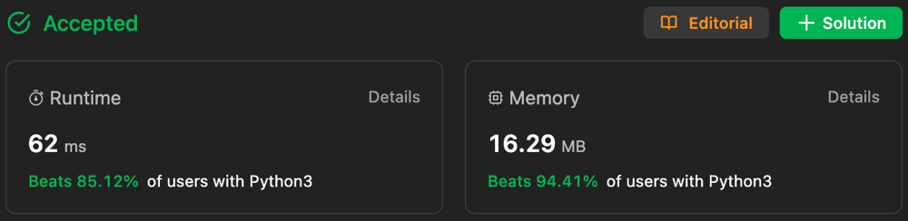

# ✅ Beats 94.41 %🔥 || within 4 Lines of Code || Hash Table 🚀 ||

**Author:** Gourav-2002
**Votes:** 13
**Link:** [https://leetcode.com/problems/sort-integers-by-the-number-of-1-bits/solutions/4224597/](https://leetcode.com/problems/sort-integers-by-the-number-of-1-bits/solutions/4224597/)

---



# Intuition:
**Here we use a dictionary to store the number of 1's in the binary representation of each number in the array. Then we sort the keys of the dictionary and for each key we sort the values in the dictionary. Finally we return the sorted values.**

# Algorithm: Hash Table
1. Create a dictionary "D" with keys as the number of 1's in the binary representation of each number in the array and values as the numbers in the array.
2. Sort the keys of the dictionary.
3. For each key in the sorted keys of the dictionary, sort the values of the dictionary.
4. Return the sorted values of the dictionary.

# Complexity Analysis:
- Time Complexity: **O(NlogN)** where N is the length of the array.
- Space Complexity: **O(N)** where N is the length of the array.

### Please UpVote\u2B06\uFE0F if this helps you:)

# Code
``` Python []
from collections import defaultdict
class Solution:
    def sortByBits(self, arr: List[int]) -> List[int]:
        D=defaultdict(list)

        for i in arr:
            D[bin(i).count('1')].append(i)

        return [i for k in sorted(D.keys()) for i in sorted(D[k])]
```
``` C++ []
#include <vector>
#include <bitset>
#include <unordered_map>
#include <algorithm>

class Solution {
public:
    std::vector<int> sortByBits(std::vector<int>& arr) {
        std::unordered_map<int, std::vector<int>> D;

        for (int i : arr) {
            D[std::bitset<32>(i).count()].push_back(i);
        }

        std::vector<int> result;
        for (int k = 0; k <= 31; ++k) {
            if (D.find(k) != D.end()) {
                std::sort(D[k].begin(), D[k].end());
                result.insert(result.end(), D[k].begin(), D[k].end());
            }
        }

        return result;
    }
};

```
``` Java []
import java.util.*;

class Solution {
    public int[] sortByBits(int[] arr) {
        Map<Integer, List<Integer>> D = new HashMap<>();

        for (int i : arr) {
            int count = Integer.bitCount(i);
            D.putIfAbsent(count, new ArrayList<>());
            D.get(count).add(i);
        }

        List<Integer> result = new ArrayList<>();
        List<Integer> sortedKeys = new ArrayList<>(D.keySet());
        Collections.sort(sortedKeys);

        for (int k : sortedKeys) {
            List<Integer> sortedValues = D.get(k);
            Collections.sort(sortedValues);
            result.addAll(sortedValues);
        }

        return result.stream().mapToInt(Integer::intValue).toArray();
    }
}
```
``` C# []
public class Solution {
    public int[] SortByBits(int[] arr) {
        Dictionary<int, List<int>> D = new Dictionary<int, List<int>>();

        foreach (int i in arr) {
            int count = Convert.ToString(i, 2).Count(c => c == '1');
            if (!D.ContainsKey(count)) {
                D[count] = new List<int>();
            }
            D[count].Add(i);
        }

        List<int> result = new List<int>();
        foreach (var key in D.Keys.OrderBy(k => k)) {
            D[key].Sort();
            result.AddRange(D[key]);
        }

        return result.ToArray();
    }
}

```
``` JavaScript []
/**
 * @param {number[]} arr
 * @return {number[]}
 */
var sortByBits = function(arr) {
    const D = new Map();

        for (let i of arr) {
            const count = i.toString(2).split('1').length - 1;
            if (!D.has(count)) {
                D.set(count, []);
            }
            D.get(count).push(i);
        }

        const result = [];
        for (let k of [...D.keys()].sort((a, b) => a - b)) {
            D.get(k).sort((a, b) => a - b);
            result.push(...D.get(k));
        }

        return result;
};
```
``` TypeScript []
function sortByBits(arr: number[]): number[] {
const D = new Map();

        for (let i of arr) {
            const count = i.toString(2).split('1').length - 1;
            if (!D.has(count)) {
                D.set(count, []);
            }
            D.get(count).push(i);
        }

        const result = [];
        for (let k of [...D.keys()].sort((a, b) => a - b)) {
            D.get(k).sort((a, b) => a - b);
            result.push(...D.get(k));
        }

        return result;
};
```
``` PHP []
class Solution {

    /**
     * @param Integer[] $arr
     * @return Integer[]
     */
    function sortByBits($arr) {
        $D = [];

        foreach ($arr as $i) {
            $count = substr_count(decbin($i), '1');
            if (!isset($D[$count])) {
                $D[$count] = [];
            }
            $D[$count][] = $i;
        }

        $result = [];
        ksort($D);

        foreach ($D as $values) {
            sort($values);
            $result = array_merge($result, $values);
        }

        return $result;
    }
}
```

