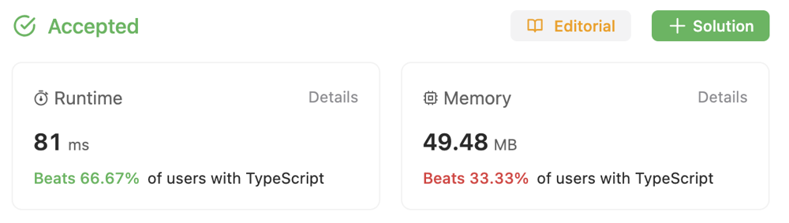

# for-loop + while-loop + sort()

**Author:** morris367
**Votes:** 0
**Link:** [https://leetcode.com/problems/largest-multiple-of-three/solutions/4436024/](https://leetcode.com/problems/largest-multiple-of-three/solutions/4436024/)

---

# Intuition
The characteristics of the number 3 are that the sum of its digits is divisible by 3, and if a number has this property, it is also divisible by 3.

So, let's set up an array (Three and nonThree) to store numbers that are not three-digit numbers.

Step 1: If the sum of the digits is divisible by 3, then we have the answer.

If not, proceed to Step 2: Find the remainder when the sum of the digits is divided by 3 and try to find a number that satisfies this condition.

If not found, proceed to Step 3: Continuously remove numbers from the array (nonThree) and check if any of them satisfy the condition of being divisible by 3.

# Approach
<!-- Describe your approach to solving the problem. -->

# Complexity
- Time complexity:
<!-- Add your time complexity here, e.g. $$O(n)$$ -->

- Space complexity:
<!-- Add your space complexity here, e.g. $$O(n)$$ -->

# Code
```
function largestMultipleOfThree(digits: number[]): string {
  let ans: string = "";

  // set array and sum[total, sum of non-three]
  let nonThree: number[] = new Array();
  let three: number[] = new Array();
  let sum: number[] = [0, 0];

  for (let digit of digits) {
    // get total
    sum[0] += digit;
    if (digit % 3 != 0) {
      nonThree.push(digit);
      sum[1] += digit;
    } else {
      three.push(digit);
    }
  }

  // if total = 0
  if (sum[0] == 0) return "0";

  digits.sort((a, b) => b - a);

  let res = sum[1] % 3;
  let temp = digits.join("");
 
  // Step 1: divisible by 3
  if (res == 0) return temp;

  // Step 2: try to find a number
  // digit just 0 to 9, so while < 10
  while (res < 10) {
    let idx = digits.lastIndexOf(res);
    if (idx >= 0) {
      ans = temp.slice(0, idx) + temp.slice(idx + 1);
      return parseInt(ans) == 0 ? "0" : ans
    } else {
      res += 3;
    }
  }

  // Step 3: try to find a number in nonThree
  nonThree.sort((a, b) => b - a);

  while (sum[1] % 3 != 0 && nonThree.length > 0) {
    sum[1] -= nonThree.pop() as number;
  }

  ans = three
    .concat(...nonThree)
    .sort((a, b) => b - a)
    .join("");

    return parseInt(ans) == 0 ?  "0" : ans;
};
```

