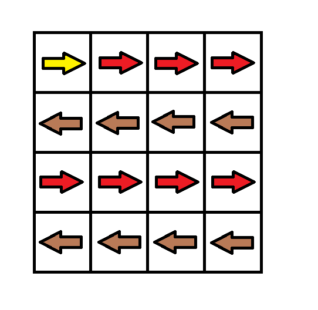
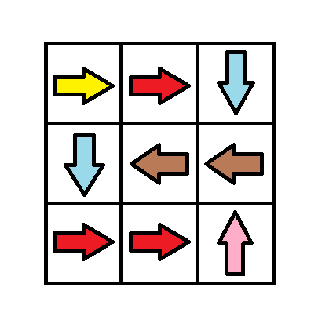
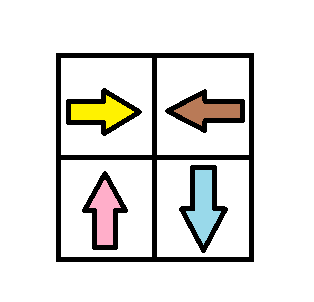

# [1368. Minimum Cost to Make at Least One Valid Path in a Grid](https://leetcode.com/problems/minimum-cost-to-make-at-least-one-valid-path-in-a-grid/)

| Category | Difficulty | Likes | Dislikes |
| :------: | :--------: | :---: | :------: |
| Algorithms | Hard | 2564 | 35 |

**Tags:** [`array`](https://leetcode.com/tag/array), [`breadth-first-search`](https://leetcode.com/tag/breadth-first-search), [`graph`](https://leetcode.com/tag/graph), [`heap-priority-queue`](https://leetcode.com/tag/heap-priority-queue), [`matrix`](https://leetcode.com/tag/matrix), [`shortest-path`](https://leetcode.com/tag/shortest-path)

**Companies:** `google`, `uber`, `docusign`

## Description

Given an `m x n` grid. Each cell of the grid has a sign pointing to the next cell you should visit if you are currently in this cell. The sign of `grid[i][j]` can be:

	- `1` which means go to the cell to the right. (i.e go from `grid[i][j]` to `grid[i][j + 1]`)

	- `2` which means go to the cell to the left. (i.e go from `grid[i][j]` to `grid[i][j - 1]`)

	- `3` which means go to the lower cell. (i.e go from `grid[i][j]` to `grid[i + 1][j]`)

	- `4` which means go to the upper cell. (i.e go from `grid[i][j]` to `grid[i - 1][j]`)

Notice that there could be some signs on the cells of the grid that point outside the grid.

You will initially start at the upper left cell `(0, 0)`. A valid path in the grid is a path that starts from the upper left cell `(0, 0)` and ends at the bottom-right cell `(m - 1, n - 1)` following the signs on the grid. The valid path does not have to be the shortest.

You can modify the sign on a cell with `cost = 1`. You can modify the sign on a cell **one time only**.

Return *the minimum cost to make the grid have at least one valid path*.

 

**Example 1:**


```

Input: grid = [[1,1,1,1],[2,2,2,2],[1,1,1,1],[2,2,2,2]]
Output: 3
Explanation: You will start at point (0, 0).
The path to (3, 3) is as follows. (0, 0) --&gt; (0, 1) --&gt; (0, 2) --&gt; (0, 3) change the arrow to down with cost = 1 --&gt; (1, 3) --&gt; (1, 2) --&gt; (1, 1) --&gt; (1, 0) change the arrow to down with cost = 1 --&gt; (2, 0) --&gt; (2, 1) --&gt; (2, 2) --&gt; (2, 3) change the arrow to down with cost = 1 --&gt; (3, 3)
The total cost = 3.

```

**Example 2:**


```

Input: grid = [[1,1,3],[3,2,2],[1,1,4]]
Output: 0
Explanation: You can follow the path from (0, 0) to (2, 2).

```

**Example 3:**


```

Input: grid = [[1,2],[4,3]]
Output: 1

```

 

**Constraints:**

	- `m == grid.length`

	- `n == grid[i].length`

	- `1 <= m, n <= 100`

	- `1 <= grid[i][j] <= 4`

---

**Links:** [Submissions](https://leetcode.com/problems/minimum-cost-to-make-at-least-one-valid-path-in-a-grid/) | [Solutions](https://leetcode.com/problems/minimum-cost-to-make-at-least-one-valid-path-in-a-grid/)
