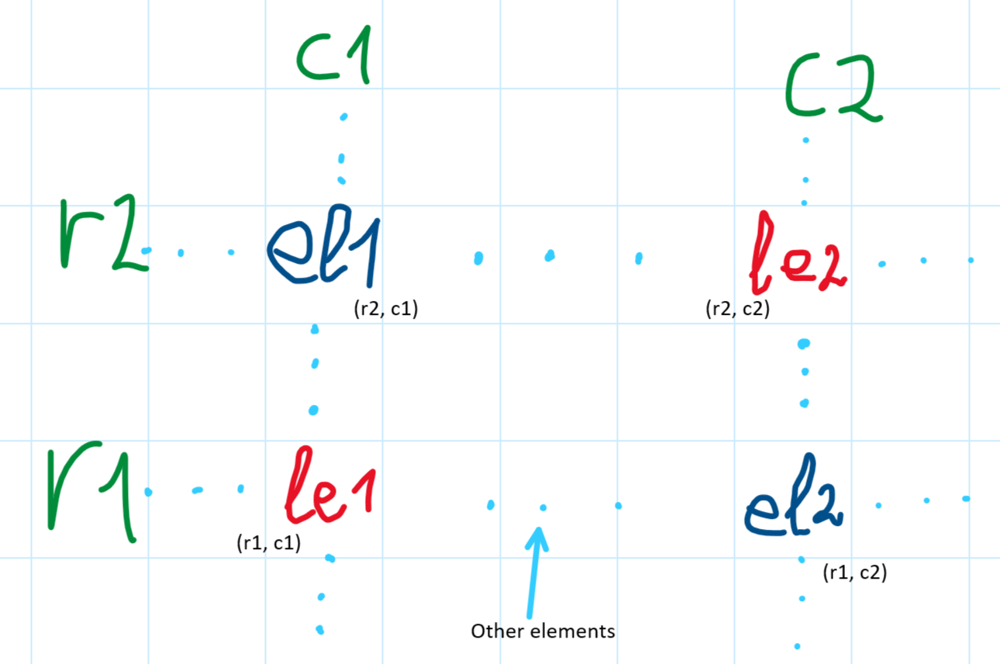
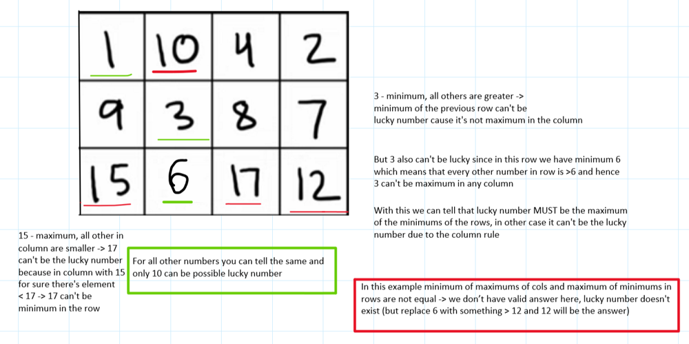

# ✅💯🔥Explanations No One Will Give You🎓🧠2 Detailed Approaches🎯🔥Extremely Simple And Effective🔥

**Author:** heir-of-god
**Votes:** 115
**Link:** [https://leetcode.com/problems/lucky-numbers-in-a-matrix/solutions/5499307/](https://leetcode.com/problems/lucky-numbers-in-a-matrix/solutions/5499307/)

---

<blockquote>
        <p>
            <b>
                Learn as if you will live forever, live like you will die tomorrow.
            </b>        
        </p>
        <p>
            --- Mahatma Gandhi ---
        </p>
</blockquote>

# \uD83D\uDC51Problem Explanation and Understanding:

## \uD83C\uDFAF Problem Description
You are given a matrix with `n` rows and `m` columns with **distinct** integers. You want to find all lucky numbers which are both minimums in their rows and maximums in their columns.

## \uD83D\uDCE5\u2935\uFE0F Input:
- 2d Integer array `matrix`

## \uD83D\uDCE4\u2934\uFE0F Output:
Array which contains lucky numbers in any order

---

# 1\uFE0F\u20E3\uD83E\uDDE0 Approach 1: Storing Maximums And Minimums

# \uD83E\uDD14 Intuition
First and very easy approach - just store every minimum for every row and maximum for every column and then for every element in matrix check whether it's lucky number. This approach is very easy to implement, so let's instead think about very interesting observation in this problem.
- In fact, there can be **UP TO** 1 lucky number - so it's only one or there no at all. Why? Let's consider the case with, for example, two lucky number (look at the picture)



- Here le1 and le2 - two lucky elements (numbers) in this matrix and el1 and el2 - elements on cross of their rows and columns. What can we say from this picture?
    - If le1 and le2 is lucky numbers then `le1 < el2 and le2 < el1` (row rule) and `le1 > el1 and le2 > el2` (column rule)
    - From this we can get `el1 > le2 > el2` and `el2 > le1 > el1` -> `el1 > el2` and `el2 > el1` - we got a contradiction, which proves that there can be only one lucky number.
    - `P.S. obviously r1 != r2 and c1 != c2 since all numbers are distinct and so there can't be two maximums in col or two minimums in row`
- Let's write first solution based on this knowledge (this fact is not neccesary to solve problem this way, but this is more optimized in average)

# \uD83D\uDC69\uD83C\uDFFB\u200D\uD83D\uDCBB Coding 
- **Initialize `rows` and `cols`**: Determine the number of rows and columns in the matrix.
- **Initialize `row_minimums` and `col_maximums`**: Arrays to store the minimums of rows and maximums of columns.
- **Find row minimums and column maximums**: Loop through matrix to update `row_minimums` and `col_maximums`.
- **Identify lucky number**: Loop through matrix to find elements that are both row minimums and column maximums.
- **Return result**: Return the lucky number if found, otherwise return an empty list.

# \uD83D\uDCD5 Complexity Analysis
- \u23F0 Time complexity: O(n * m), since we visit each element twice which is O(2 * n * m) -> O(n * m)
- \uD83E\uDDFA Space complexity: O(n), since we use to auxiliary arrays for storing rows' minimums and columns' maximums

# \uD83D\uDCBB Code
``` python []
class Solution:
    def luckyNumbers(self, matrix: list[list[int]]) -> list[int]:
        rows: int = len(matrix)
        cols: int = len(matrix[0])

        row_minimums: list[int] = [10**5 + 1 for _ in range(rows)]
        col_maximums: list[int] = [0 for _ in range(cols)]

        for row_ind in range(rows):
            for col_ind in range(cols):
                el: int = matrix[row_ind][col_ind]
                row_minimums[row_ind] = min(row_minimums[row_ind], el)
                col_maximums[col_ind] = max(col_maximums[col_ind], el)

        for row_ind in range(rows):
            for col_ind in range(cols):
                el: int = matrix[row_ind][col_ind]
                if el == row_minimums[row_ind] == col_maximums[col_ind]:
                    return [el]
        return []
```
``` C++ []
class Solution {
public:
    vector<int> luckyNumbers (vector<vector<int>>& matrix) {
        int rows = matrix.size();
        int cols = matrix[0].size();
        
        vector<int> row_minimums(rows, INT_MAX);
        vector<int> col_maximums(cols, 0);
        
        for (int row_ind = 0; row_ind < rows; ++row_ind) {
            for (int col_ind = 0; col_ind < cols; ++col_ind) {
                int el = matrix[row_ind][col_ind];
                row_minimums[row_ind] = min(row_minimums[row_ind], el);
                col_maximums[col_ind] = max(col_maximums[col_ind], el);
            }
        }
        
        for (int row_ind = 0; row_ind < rows; ++row_ind) {
            for (int col_ind = 0; col_ind < cols; ++col_ind) {
                int el = matrix[row_ind][col_ind];
                if (el == row_minimums[row_ind] && el == col_maximums[col_ind]) {
                    return {el};
                }
            }
        }
        
        return {};
    }
};
```
``` JavaScript []
var luckyNumbers = function(matrix) {
    let rows = matrix.length;
    let cols = matrix[0].length;
    
    let row_minimums = new Array(rows).fill(Infinity);
    let col_maximums = new Array(cols).fill(0);
    
    for (let row_ind = 0; row_ind < rows; ++row_ind) {
        for (let col_ind = 0; col_ind < cols; ++col_ind) {
            let el = matrix[row_ind][col_ind];
            row_minimums[row_ind] = Math.min(row_minimums[row_ind], el);
            col_maximums[col_ind] = Math.max(col_maximums[col_ind], el);
        }
    }
    
    for (let row_ind = 0; row_ind < rows; ++row_ind) {
        for (let col_ind = 0; col_ind < cols; ++col_ind) {
            let el = matrix[row_ind][col_ind];
            if (el == row_minimums[row_ind] && el == col_maximums[col_ind]) {
                return [el];
            }
        }
    }
    
    return [];
};
```
``` Java []
class Solution {
    public List<Integer> luckyNumbers (int[][] matrix) {
        int rows = matrix.length;
        int cols = matrix[0].length;
        
        int[] row_minimums = new int[rows];
        Arrays.fill(row_minimums, Integer.MAX_VALUE);
        int[] col_maximums = new int[cols];
        
        for (int row_ind = 0; row_ind < rows; ++row_ind) {
            for (int col_ind = 0; col_ind < cols; ++col_ind) {
                int el = matrix[row_ind][col_ind];
                row_minimums[row_ind] = Math.min(row_minimums[row_ind], el);
                col_maximums[col_ind] = Math.max(col_maximums[col_ind], el);
            }
        }
        
        for (int row_ind = 0; row_ind < rows; ++row_ind) {
            for (int col_ind = 0; col_ind < cols; ++col_ind) {
                int el = matrix[row_ind][col_ind];
                if (el == row_minimums[row_ind] && el == col_maximums[col_ind]) {
                    return Collections.singletonList(el);
                }
            }
        }
        
        return Collections.emptyList();
    }
}
```
``` C []
int* luckyNumbers(int** matrix, int matrixSize, int* matrixColSize, int* returnSize) {
    int rows = matrixSize;
    int cols = matrixColSize[0];
    
    int* row_minimums = (int*)malloc(rows * sizeof(int));
    int* col_maximums = (int*)malloc(cols * sizeof(int));
    
    for (int i = 0; i < rows; ++i) row_minimums[i] = INT_MAX;
    for (int i = 0; i < cols; ++i) col_maximums[i] = 0;
    
    for (int row_ind = 0; row_ind < rows; ++row_ind) {
        for (int col_ind = 0; col_ind < cols; ++col_ind) {
            int el = matrix[row_ind][col_ind];
            if (el < row_minimums[row_ind]) row_minimums[row_ind] = el;
            if (el > col_maximums[col_ind]) col_maximums[col_ind] = el;
        }
    }
    
    int* result = (int*)malloc(sizeof(int));
    
    for (int row_ind = 0; row_ind < rows; ++row_ind) {
        for (int col_ind = 0; col_ind < cols; ++col_ind) {
            int el = matrix[row_ind][col_ind];
            if (el == row_minimums[row_ind] && el == col_maximums[col_ind]) {
                result[0] = el;
                *returnSize = 1;
                free(row_minimums);
                free(col_maximums);
                return result;
            }
        }
    }
    
    *returnSize = 0;
    free(row_minimums);
    free(col_maximums);
    free(result);
    return NULL;
}
```


# 2\uFE0F\u20E3\uD83C\uDFC6 Approach 2: Find The Only Lucky Number With Math

# \uD83E\uDD14 Intuition
Now let's think about the way we can find this lucky number if is exists without additional memory
- In fact, lucky number MUST be the `MAXIMUM of minimums of the rows` and `MINIMUM of maximum of the columns`. Why? Let's look at the example with my explanations:



This prove our observation and gives the main point of this approach - if `MAXIMUM of minimums of the rows` and `MINIMUM of maximum of the columns` are equal return any of them, this is valid lucky number, otherwise return empty list since answer doesn't exist.

# \uD83D\uDC69\uD83C\uDFFB\u200D\uD83D\uDCBB Coding 
- **Initialize `rows` and `cols`**: Determine the number of rows and columns in the matrix.
- **Compute `row_maximum_of_minimums`**: Iterate through each row, find the minimum element of each row, and track the maximum of these minimums.
- **Compute `col_minimum_of_maximums`**: Iterate through each column, find the maximum element of each column, and track the minimum of these maximums.
- **Check for lucky number**: If `row_maximum_of_minimums` equals `col_minimum_of_maximums`, return it as the lucky number; otherwise, return an empty list.

# \uD83D\uDCDA Complexity Analysis
- \u23F0 Time complexity: O(n * m), since we visit each element twice (to find minimums in rows and maximum in columns)
- \uD83E\uDDFA Space complexity: O(1), since no extra space is used

# \uD83D\uDCBB Code
``` python []
class Solution:
    def luckyNumbers(self, matrix: list[list[int]]) -> list[int]:
        rows: int = len(matrix)
        cols: int = len(matrix[0])

        row_maximum_of_minimums: int = 0
        for row in matrix:
            row_maximum_of_minimums = max(min(row), row_maximum_of_minimums)

        col_minimum_of_maximums: int = 10**5 + 1
        for col_ind in range(cols):
            col_maximum = max([matrix[row_ind][col_ind] for row_ind in range(rows)])
            col_minimum_of_maximums = min(col_maximum, col_minimum_of_maximums)

        return [col_minimum_of_maximums] if row_maximum_of_minimums == col_minimum_of_maximums else []
```
``` C++ []
class Solution {
public:
    vector<int> luckyNumbers (vector<vector<int>>& matrix) {
        int rows = matrix.size();
        int cols = matrix[0].size();

        int row_maximum_of_minimums = 0;
        for (const auto& row : matrix) {
            row_maximum_of_minimums = max(*min_element(row.begin(), row.end()), row_maximum_of_minimums);
        }

        int col_minimum_of_maximums = INT_MAX;
        for (int col_ind = 0; col_ind < cols; ++col_ind) {
            int col_maximum = 0;
            for (int row_ind = 0; row_ind < rows; ++row_ind) {
                col_maximum = max(col_maximum, matrix[row_ind][col_ind]);
            }
            col_minimum_of_maximums = min(col_maximum, col_minimum_of_maximums);
        }

        return row_maximum_of_minimums == col_minimum_of_maximums ? vector<int>{col_minimum_of_maximums} : vector<int>{};
    }
};
```
``` JavaScript []
var luckyNumbers = function(matrix) {
    let rows = matrix.length;
    let cols = matrix[0].length;

    let row_maximum_of_minimums = 0;
    for (let row of matrix) {
        let row_minimum = Math.min(...row);
        row_maximum_of_minimums = Math.max(row_maximum_of_minimums, row_minimum);
    }

    let col_minimum_of_maximums = Infinity;
    for (let col_ind = 0; col_ind < cols; ++col_ind) {
        let col_maximum = 0;
        for (let row_ind = 0; row_ind < rows; ++row_ind) {
            col_maximum = Math.max(col_maximum, matrix[row_ind][col_ind]);
        }
        col_minimum_of_maximums = Math.min(col_minimum_of_maximums, col_maximum);
    }

    return row_maximum_of_minimums === col_minimum_of_maximums ? [col_minimum_of_maximums] : [];
};
```
``` Java []
class Solution {
    public List<Integer> luckyNumbers (int[][] matrix) {
        int rows = matrix.length;
        int cols = matrix[0].length;

        int row_maximum_of_minimums = 0;
        for (int[] row : matrix) {
            int row_minimum = Arrays.stream(row).min().getAsInt();
            row_maximum_of_minimums = Math.max(row_maximum_of_minimums, row_minimum);
        }

        int col_minimum_of_maximums = Integer.MAX_VALUE;
        for (int col_ind = 0; col_ind < cols; ++col_ind) {
            int col_maximum = 0;
            for (int row_ind = 0; row_ind < rows; ++row_ind) {
                col_maximum = Math.max(col_maximum, matrix[row_ind][col_ind]);
            }
            col_minimum_of_maximums = Math.min(col_minimum_of_maximums, col_maximum);
        }

        return row_maximum_of_minimums == col_minimum_of_maximums ? Collections.singletonList(col_minimum_of_maximums) : Collections.emptyList();
    }
}
```
``` C []
int* luckyNumbers(int** matrix, int matrixSize, int* matrixColSize, int* returnSize) {
    int rows = matrixSize;
    int cols = matrixColSize[0];

    int row_maximum_of_minimums = 0;
    for (int i = 0; i < rows; ++i) {
        int row_minimum = INT_MAX;
        for (int j = 0; j < cols; ++j) {
            if (matrix[i][j] < row_minimum) {
                row_minimum = matrix[i][j];
            }
        }
        if (row_minimum > row_maximum_of_minimums) {
            row_maximum_of_minimums = row_minimum;
        }
    }

    int col_minimum_of_maximums = INT_MAX;
    for (int col_ind = 0; col_ind < cols; ++col_ind) {
        int col_maximum = 0;
        for (int row_ind = 0; row_ind < rows; ++row_ind) {
            if (matrix[row_ind][col_ind] > col_maximum) {
                col_maximum = matrix[row_ind][col_ind];
            }
        }
        if (col_maximum < col_minimum_of_maximums) {
            col_minimum_of_maximums = col_maximum;
        }
    }

    int* result = (int*)malloc(sizeof(int));
    if (row_maximum_of_minimums == col_minimum_of_maximums) {
        result[0] = col_minimum_of_maximums;
        *returnSize = 1;
    } else {
        *returnSize = 0;
    }
    return result;
}
```

## \uD83D\uDCA1\uD83D\uDCA1\uD83D\uDCA1I encourage you to check out [my profile](https://leetcode.com/heir-of-god/) and [Project-S](https://github.com/Heir-of-God/Project-S) project for detailed explanations and code for different problems (not only Leetcode). Happy coding and learning!\uD83D\uDCDA

### Please consider *upvote*\u2B06\uFE0F\u2B06\uFE0F\u2B06\uFE0F because I try really hard not just to put here my code and rewrite testcase to show that it works but explain you WHY it works and HOW. Thank you\u2764\uFE0F

## If you have any doubts or questions feel free to ask them in comments. I will be glad to help you with understanding\u2764\uFE0F\u2764\uFE0F\u2764\uFE0F


