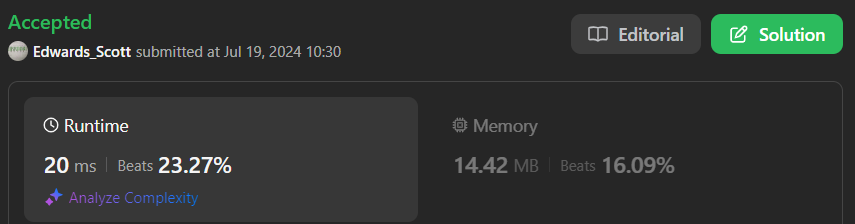

# 💢☠💫Easiest👾Faster✅💯 Lesser🧠 🎯 C++✅Python3🐍✅Java✅C✅Python🐍✅C#✅💥🔥💫Explained☠💥🔥 Beats 💯

**Author:** Edwards310
**Votes:** 2
**Link:** [https://leetcode.com/problems/lucky-numbers-in-a-matrix/solutions/5500579/](https://leetcode.com/problems/lucky-numbers-in-a-matrix/solutions/5500579/)

---

# Intuition


```C++ []
// Start Of Anuj Bhati aka Edwards310's Template...
#pragma GCC optimize("O2")
#include <bits/stdc++.h>
#include <ext/pb_ds/assoc_container.hpp>
#include <ext/pb_ds/tree_policy.hpp>
using namespace std;
using namespace __gnu_pbds;
typedef long long LL;
typedef vector<int> vi;
#define FOR(a, b, c) for (int a = b; a < c; a++)
#define Rep(i, n) FOR (i, 0, n)
#define mp make_pair
#define pb push_back

// end of Anuj Bhati's aka Edwards310's Template
class Solution {
public:
    vi luckyNumbers (vvi& matrix) {
        vi ans;
        vi minrows;
        vi maxcols;
        Rep(i, matrix.size()){
            int ele = 100001;
            Rep(j, matrix[0].size()){
                if(matrix[i][j] < ele)
                    ele = matrix[i][j];
            }
            minrows.pb(ele);
        }
        Rep(i, matrix[0].size()){
            int ele = -1;
            Rep(j, matrix.size()){
                if(matrix[j][i] > ele)
                    ele = matrix[j][i];
            }
            maxcols.pb(ele);
        }
        Rep(i, minrows.size()){
            Rep(j, maxcols.size()){
                if(minrows[i] == maxcols[j]){
                    ans.pb(maxcols[j]);
                    break;
                }
            }
        }
        return ans;
    }
};
```
```python3 []
class Solution:
    def luckyNumbers (self, matrix: List[List[int]]) -> List[int]:
        for i in range(len(matrix)):
            k = min(matrix[i])
            k1 = matrix[i].index(k)
            m = 0
            for i2 in range(len(matrix)):
                m = max(m, matrix[i2][k1])
            if k == m:
                return [m]
```
```Java []
class Solution {
    public List<Integer> luckyNumbers (int[][] matrix) {
        List<Integer> res = new ArrayList<>();
        HashMap<Integer, Integer> count = new HashMap<>();
        for(int i = 0; i < matrix.length; ++i){
            int min = 1000001;
            for(int j = 0; j < matrix[0].length; ++j){
                if(min > matrix[i][j])
                    min = matrix[i][j];
            }
            count.put(min, count.getOrDefault(min, 0) + 1);
        }
        for(int j = 0; j < matrix[0].length; ++j){
            int max = -1;
            for(int i = 0; i < matrix.length; ++i){
                if(max < matrix[i][j])
                    max = matrix[i][j];
            }
            count.put(max, count.getOrDefault(max, 0) + 1);
        }
        for(Map.Entry<Integer, Integer> set : count.entrySet()){
            if(set.getValue() == 2)
                res.add(set.getKey());
        }
        return res;           
    }
}
```
```C []
/**
 * Note: The returned array must be malloced, assume caller calls free().
 */
int* luckyNumbers (int** matrix, int matrixSize, int* matrixColSize, int* returnSize) {
    int countMap[100001] = {};
    int *ans = (int*)malloc(sizeof(int) * 100001);
    *returnSize = 0;
    for(int i = 0; i < matrixSize; ++i){
        int min = 1000001;
        for(int j = 0; j < (*matrixColSize); ++j){
           if(min > matrix[i][j])
               min = matrix[i][j];
        }
        countMap[min]++;
    }
    for(int j = 0; j < (*matrixColSize); ++j){
        int ele = -1;
        for(int i = 0; i < matrixSize; ++i){
            if(ele < matrix[i][j])
                ele = matrix[i][j];
        }
        countMap[ele]++;
    }
    for(int i = 0; i < 100001; ++i){
        if(countMap[i] == 2)
            ans[(*returnSize)++] = i;
    }
    return ans;
}
```
```python []
class Solution(object):
    def luckyNumbers (self, matrix):
        """
        :type matrix: List[List[int]]
        :rtype: List[int]
        """
        res = []
        minrows = []
        maxcols = []

        for i in range(len(matrix)):
            ele = 1000000
            for j in range(len(matrix[0])):
                if matrix[i][j] < ele:
                    ele = matrix[i][j]

            minrows.append(ele)

        for i in range(len(matrix[0])):
            ele = -1
            for j in range(len(matrix)):
                if matrix[j][i] > ele:
                    ele = matrix[j][i]
                
            maxcols.append(ele)
        
        for i in range(len(minrows)):
            for j in range(len(maxcols)):
                if minrows[i] == maxcols[j]:
                    res.append(minrows[i])
                    break
        return res
```

<!-- Describe your first thoughts on how to solve this problem. -->

# Approach
<!-- Describe your approach to solving the problem. -->

# Complexity
- Time complexity:
<!-- Add your time complexity here, e.g. $$O(n)$$ -->
     O(n * m) //-> C solution
- Space complexity:
<!-- Add your space complexity here, e.g. $$O(n)$$ -->
     O(1) //-> C solution
# Code

