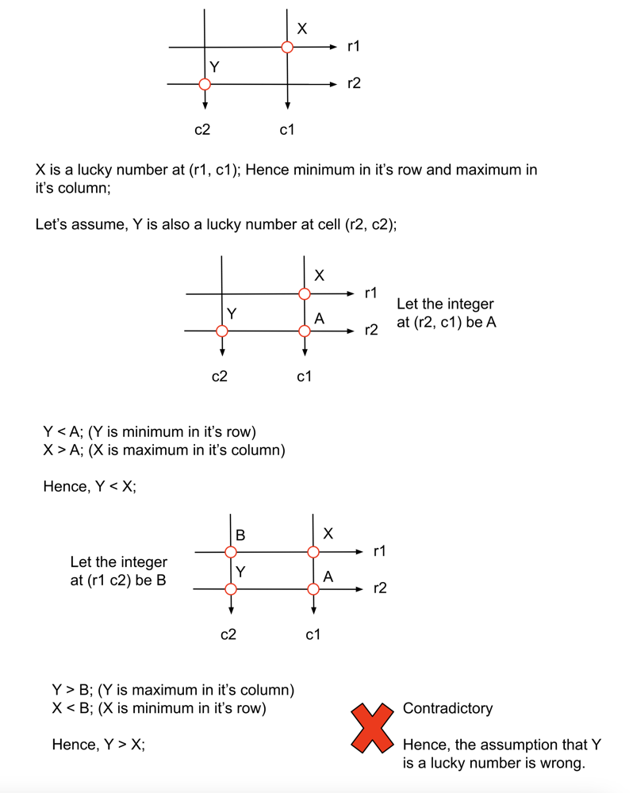

# ✅🚀💯 | Beats 100% | Java C++ Py Js Go | Beginner-Friendly Explanation | 🔥🧠

**Author:** kartikdevsharma_
**Votes:** 72
**Link:** [https://leetcode.com/problems/lucky-numbers-in-a-matrix/solutions/5498609/](https://leetcode.com/problems/lucky-numbers-in-a-matrix/solutions/5498609/)

---


## Problem Statement: Lucky Numbers in a Matrix

Imagine you're given a grid of numbers, which we call a matrix in mathematics and computer science. This matrix has 'm' rows and 'n' columns, forming an m x n grid. Each cell in this grid contains a distinct number, meaning no two cells have the same number.

Your task is to find all the "lucky numbers" in this matrix. But what makes a number lucky? A number is considered lucky if it satisfies two conditions simultaneously:

1. It must be the smallest number in its entire row.
2. It must also be the largest number in its entire column.

Let's break this down with some examples to make it clearer:

Example 1:
Consider this 3x3 matrix:
```
3  7  8
9  11 13
15 16 17
```

In this matrix:
- 15 is the only lucky number.
- Why? Because 15 is the smallest number in its row (15, 16, 17) and also the largest number in its column (3, 9, 15).

Example 2:
Let's look at a 3x4 matrix:

```
1  10 4  2
9  3  8  7
15 16 17 12
```

Here:
- 12 is the only lucky number.
- It's the smallest in its row (15, 16, 17, 12) and the largest in its column (2, 7, 12).

Example 3:
Consider a smaller 2x2 matrix:
```
7 8
1 2
```

In this case:
- 7 is the lucky number.
- It's the smallest in its row (7, 8) and the largest in its column (7, 1).

Important Points to Note:
1. All numbers in the matrix are distinct (unique).
2. The numbers are positive integers, ranging from 1 to 10^5.
3. The matrix can have between 1 to 50 rows and 1 to 50 columns.
4. It's possible that a matrix might not have any lucky numbers at all.
5. If lucky numbers exist, you need to return all of them in any order.

Now that we understand what we're looking for, let's dive into two different approaches to solve this problem.

## Approach 1: Simulation
***Editorial***
### Intuition:
The first approach is straightforward and mimics how a human might solve this problem manually. We'll check each number in the matrix one by one to see if it satisfies both conditions of being a lucky number.

### Detailed Explanation:

1. Preprocessing:
   Before we start checking each number, we'll prepare some helpful information:
   
   a) Row Minimums:
   - For each row, we'll find and store its minimum value.
   - We'll use an ArrayList called 'rowMin' to store these values.
   - Why? This will help us quickly check if a number is the smallest in its row.

   b) Column Maximums:
   - For each column, we'll find and store its maximum value.
   - We'll use an ArrayList called 'colMax' for this.
   - Why? This helps us quickly check if a number is the largest in its column.

2. Finding Row Minimums:
   - We iterate through each row of the matrix.
   - For each row, we initialize a variable 'rMin' with the maximum possible integer value.
   - We then go through each element in the row, updating 'rMin' if we find a smaller value.
   - After checking all elements in a row, we add the final 'rMin' to our 'rowMin' list.
   - We repeat this for all rows.

3. Finding Column Maximums:
   - We iterate through each column of the matrix.
   - For each column, we initialize a variable 'cMax' with the minimum possible integer value.
   - We then go through each element in the column, updating 'cMax' if we find a larger value.
   - After checking all elements in a column, we add the final 'cMax' to our 'colMax' list.
   - We repeat this for all columns.

4. Identifying Lucky Numbers:
   - Now that we have our row minimums and column maximums, we can find lucky numbers.
   - We iterate through each element in the matrix.
   - For each element at position (i, j):
     - We check if it's equal to rowMin[i] (smallest in its row)
     - AND if it's equal to colMax[j] (largest in its column)
   - If both conditions are true, we've found a lucky number!
   - We add this lucky number to our result list.

5. Returning the Result:
   - After checking all elements, we return our list of lucky numbers.

### CODE

```java []

class Solution {
    public List<Integer> luckyNumbers(int[][] matrix) {
        int N = matrix.length, M = matrix[0].length;

        List<Integer> rowMin = new ArrayList<>();
        for (int i = 0; i < N; i++) {
            int rMin = Integer.MAX_VALUE;
            for (int j = 0; j < M; j++) {
                rMin = Math.min(rMin, matrix[i][j]);
            }
            rowMin.add(rMin);
        }

        List<Integer> colMax = new ArrayList<>();
        for (int i = 0; i < M; i++) {
            int cMax = Integer.MIN_VALUE;
            for (int j = 0; j < N; j++) {
                cMax = Math.max(cMax, matrix[j][i]);
            }
            colMax.add(cMax);
        }

        List<Integer> luckyNumbers = new ArrayList<>();
        for (int i = 0; i < N; i++) {
            for (int j = 0; j < M; j++) {
                if (matrix[i][j] == rowMin.get(i) && matrix[i][j] == colMax.get(j)) {
                    luckyNumbers.add(matrix[i][j]);
                }
            }
        }

        return luckyNumbers;
    }
}
```
```python []
class Solution:
    def luckyNumbers(self, matrix):
        N = len(matrix)
        M = len(matrix[0])

        rowMin = []
        for i in range(N):
            rMin = float('inf')
            for j in range(M):
                rMin = min(rMin, matrix[i][j])
            rowMin.append(rMin)

        colMax = []
        for i in range(M):
            cMax = float('-inf')
            for j in range(N):
                cMax = max(cMax, matrix[j][i])
            colMax.append(cMax)

        luckyNumbers = []
        for i in range(N):
            for j in range(M):
                if matrix[i][j] == rowMin[i] and matrix[i][j] == colMax[j]:
                    luckyNumbers.append(matrix[i][j])

        return luckyNumbers

```
```C++ []
class Solution {
public:
    vector<int> luckyNumbers(vector<vector<int>>& matrix) {
        int N = matrix.size(), M = matrix[0].size();

        vector<int> rowMin;
        for (int i = 0; i < N; i++) {

            int rMin = INT_MAX;
            for (int j = 0; j < M; j++) {
                rMin = min(rMin, matrix[i][j]);
            }
            rowMin.push_back(rMin);
        }

        vector<int> colMax;
        for (int i = 0; i < M; i++) {

            int cMax = INT_MIN;
            for (int j = 0; j < N; j++) {
                cMax = max(cMax, matrix[j][i]);
            }
            colMax.push_back(cMax);
        }

        vector<int> luckyNumbers;
        for (int i = 0; i < N; i++) {
            for (int j = 0; j < M; j++) {
                if (matrix[i][j] == rowMin[i] && matrix[i][j] == colMax[j]) {
                    luckyNumbers.push_back(matrix[i][j]);
                }
            }
        }

        return luckyNumbers;
    }
};

```
```Js []
/**
 * @param {number[][]} matrix
 * @return {number[]}
 */
var luckyNumbers  = function(matrix) {
    const N = matrix.length, M = matrix[0].length;
    const rowMin = [];
    for (let i = 0; i < N; i++) {
        let rMin = Infinity;
        for (let j = 0; j < M; j++) {
            rMin = Math.min(rMin, matrix[i][j]);
        }
        rowMin.push(rMin);
    }
    
    const colMax = [];
    for (let i = 0; i < M; i++) {
        let cMax = -Infinity;
        for (let j = 0; j < N; j++) {
            cMax = Math.max(cMax, matrix[j][i]);
        }
        colMax.push(cMax);
    }
    
    const luckyNumbers = [];
    for (let i = 0; i < N; i++) {
        for (let j = 0; j < M; j++) {
            if (matrix[i][j] === rowMin[i] && matrix[i][j] === colMax[j]) {
                luckyNumbers.push(matrix[i][j]);
            }
        }
    }
    
    return luckyNumbers;
};

```
```Go []

func luckyNumbers(matrix [][]int) []int {
    N, M := len(matrix), len(matrix[0])
    rowMin := make([]int, N)
    for i := 0; i < N; i++ {
        rMin := math.MaxInt32
        for j := 0; j < M; j++ {
            rMin = min(rMin, matrix[i][j])
        }
        rowMin[i] = rMin
    }
    
    colMax := make([]int, M)
    for i := 0; i < M; i++ {
        cMax := math.MinInt32
        for j := 0; j < N; j++ {
            cMax = max(cMax, matrix[j][i])
        }
        colMax[i] = cMax
    }
    
    luckyNumbers := []int{}
    for i := 0; i < N; i++ {
        for j := 0; j < M; j++ {
            if matrix[i][j] == rowMin[i] && matrix[i][j] == colMax[j] {
                luckyNumbers = append(luckyNumbers, matrix[i][j])
            }
        }
    }
    
    return luckyNumbers
}

func min(a, b int) int {
    if a < b {
        return a
    }
    return b
}

func max(a, b int) int {
    if a > b {
        return a
    }
    return b
}
```
### Complexity Analysis
Here, N is the number of rows in the matrix and M is the number of columns in the matrix.

### Time complexity: O(N\u2217M).

To store the maximum of each row, we require N\u2217M operations and the same for strong the maximum of each column. In the end, to find the lucky numbers we again iterate over each integer. Hence, the total time complexity is equal to O(N\u2217M).

### Space complexity: O(N+M).

We require two lists, rowMin and colMax of size N and M respectively. Hence the total space complexity is equal to O(N+M).

---

## Approach 2: Greedy
***Editorial***
### Intuition:
This approach is more clever. It realizes a key insight: there can be at most one lucky number in the entire matrix. This observation allows us to solve the problem more efficiently.

### Approach: Optimal Single-Pass Solution with Proof

### 1. Proof of Uniqueness

First, let's prove that there can be at most one lucky number in the matrix.

**Proof by Contradiction:**

1. Assume there are two lucky numbers: X at position (r1, c1) and Y at position (r2, c2).
2. By definition of lucky numbers:
   - X is the minimum in row r1 and maximum in column c1
   - Y is the minimum in row r2 and maximum in column c2
3. Let A be the number at position (r2, c1) and B be the number at position (r1, c2).
4. We can deduce:
   - Y \u2264 A (Y is minimum in its row)
   - X \u2265 A (X is maximum in its column)
   - Therefore, Y \u2264 X
5. Similarly:
   - Y \u2265 B (Y is maximum in its column)
   - X \u2264 B (X is minimum in its row)
   - Therefore, Y \u2265 X
6. From steps 4 and 5, we have Y \u2264 X and Y \u2265 X, which means Y = X.
7. However, this contradicts the problem statement that all numbers in the matrix are distinct.

Therefore, our assumption of two lucky numbers leads to a contradiction, proving that there can be at most one lucky number in the matrix.


### 2. Algorithm Intuition

Given that there's at most one lucky number, we can find it efficiently by:
1. Finding the minimum of each row
2. Finding the maximum of each column
3. Identifying the number that satisfies both conditions

### 3. Detailed Algorithm

1. Initialize two variables:
   - `rowMinMax`: the maximum of row minimums, initially set to negative infinity
   - `colMaxMin`: the minimum of column maximums, initially set to positive infinity

2. First Pass: Find `rowMinMax`
   - Iterate through each row of the matrix
   - For each row, find its minimum element
   - Update `rowMinMax` if this row's minimum is larger

3. Second Pass: Find `colMaxMin`
   - Iterate through each column of the matrix
   - For each column, find its maximum element
   - Update `colMaxMin` if this column's maximum is smaller

4. Check for Lucky Number
   - If `rowMinMax` equals `colMaxMin`, we've found our lucky number
   - If they're not equal, no lucky number exists

5. Return Result
   - If a lucky number is found, return it in a list
   - Otherwise, return an empty list


    

### CODE

```java []
class Solution {
    public List<Integer> luckyNumbers(int[][] matrix) {
        int N = matrix.length, M = matrix[0].length;

        int rMinMax = Integer.MIN_VALUE;
        for (int i = 0; i < N; i++) {
            int rMin = Integer.MAX_VALUE;
            for (int j = 0; j < M; j++) {
                rMin = Math.min(rMin, matrix[i][j]);
            }
            rMinMax = Math.max(rMinMax, rMin);
        }

        int cMaxMin = Integer.MAX_VALUE;
        for (int i = 0; i < M; i++) {
            int cMax = Integer.MIN_VALUE;
            for (int j = 0; j < N; j++) {
                cMax = Math.max(cMax, matrix[j][i]);
            }
            cMaxMin = Math.min(cMaxMin, cMax);
        }

        if (rMinMax == cMaxMin) {
            return new ArrayList<>(Arrays.asList(rMinMax));
        }

        return new ArrayList<>();
    }
}

```
```python []
class Solution:
    def luckyNumbers(self, matrix: List[List[int]]) -> List[int]:
        N, M = len(matrix), len(matrix[0])

        r_min_max = float('-inf')
        for i in range(N):
            r_min = min(matrix[i])  
            r_min_max = max(r_min_max, r_min)

        c_max_min = float('inf')
        for i in range(M):
            c_max = max(matrix[j][i] for j in range(N))
            c_max_min = min(c_max_min, c_max)

        if r_min_max == c_max_min:
            return [r_min_max]
        else:
            return []

```
```C++ []
class Solution {
public:
    vector<int> luckyNumbers (vector<vector<int>>& matrix) {
        int N = matrix.size(), M = matrix[0].size();
        
        int rMinMax = INT_MIN;
        for (int i = 0; i < N; i++) {

            int rMin = INT_MAX;
            for (int j = 0; j < M; j++) {
                rMin = min(rMin, matrix[i][j]);
            }
            rMinMax = max(rMinMax, rMin);
        }
        
        int cMaxMin = INT_MAX;
        for (int i = 0; i < M; i++) {

            int cMax = INT_MIN;
            for (int j = 0; j < N; j++) {
                cMax = max(cMax, matrix[j][i]);
            }
            cMaxMin = min(cMaxMin, cMax);
        }
        
        if (rMinMax == cMaxMin) {
            return {rMinMax};
        }
        
        return {};
    }
};

```
```Js []
/**
 * @param {number[][]} matrix
 * @return {number[]}
 */
var luckyNumbers  = function(matrix) {
    const N = matrix.length, M = matrix[0].length;
    let rMinMax = -Infinity;
    for (let i = 0; i < N; i++) {
        let rMin = Infinity;
        for (let j = 0; j < M; j++) {
            rMin = Math.min(rMin, matrix[i][j]);
        }
        rMinMax = Math.max(rMinMax, rMin);
    }
    
    let cMaxMin = Infinity;
    for (let i = 0; i < M; i++) {
        let cMax = -Infinity;
        for (let j = 0; j < N; j++) {
            cMax = Math.max(cMax, matrix[j][i]);
        }
        cMaxMin = Math.min(cMaxMin, cMax);
    }
    
    if (rMinMax === cMaxMin) {
        return [rMinMax];
    }
    return [];
};

```
```Go []

func luckyNumbers(matrix [][]int) []int {
    N, M := len(matrix), len(matrix[0])
    rMinMax := math.MinInt32
    for i := 0; i < N; i++ {
        rMin := math.MaxInt32
        for j := 0; j < M; j++ {
            rMin = min(rMin, matrix[i][j])
        }
        rMinMax = max(rMinMax, rMin)
    }
    
    cMaxMin := math.MaxInt32
    for i := 0; i < M; i++ {
        cMax := math.MinInt32
        for j := 0; j < N; j++ {
            cMax = max(cMax, matrix[j][i])
        }
        cMaxMin = min(cMaxMin, cMax)
    }
    
    if rMinMax == cMaxMin {
        return []int{rMinMax}
    }
    return []int{}
}

func min(a, b int) int {
    if a < b {
        return a
    }
    return b
}

func max(a, b int) int {
    if a > b {
        return a
    }
    return b
}
```
### Complexity Analysis
Here, N is the number of rows in the matrix and M is the number of columns in the matrix.

### Time complexity: O(N\u2217M).

To find the value rMinMax and cMaxMin we are iterating over each integer in the matrix. Hence, the total time complexity is equal to O(N\u2217M).

### Space complexity: O(1).

No extra space is required apart from the few variables. Hence the total space complexity is constant.

---

### Approach 3 Optimized
### Intuition:

The problem asks us to find "lucky numbers" in a matrix, where a lucky number is defined as an element that is both the minimum in its row and the maximum in its column. The key insight here is that we don't need to find all minimums and maximums upfront. Instead, we can:

1. First find the minimum in a row
2. Then check if this minimum is also the maximum in its column

This approach is efficient because:
- If an element is not the minimum in its row, it can't be a lucky number, so we don't need to check it further.
- We only need to check for column maximums for the row minimums we find.

### Approach:

1. Iterate through each row of the matrix.
2. For each row, find the minimum element and its column index.
3. Check if this minimum element is also the maximum in its column.
4. If it is, we've found a lucky number, so add it to the result list.
5. Return the list of lucky numbers.

Step-by-step algorithm:

1. Initialize an empty list to store the lucky numbers.
2. Iterate through each row of the matrix:
   a. Find the minimum element in the current row and its column index.
   b. Check if this minimum element is the maximum in its column.
   c. If it is, add it to the list of lucky numbers.
3. Return the list of lucky numbers.

### Dry run:

Let's use the following example matrix:

```
[
  [3, 7, 8],
  [9, 11, 13],
  [15, 16, 17]
]
```

Step-by-step dry run:

| Row | Step | Action | Details | Result |
|-----|------|--------|---------|--------|
| 0 | 1 | Find min in row | Min = 3, Col = 0 | minCol = 0 |
| 0 | 2 | Check if max in column | 3 < 9, not max | No lucky number |
| 1 | 1 | Find min in row | Min = 9, Col = 0 | minCol = 0 |
| 1 | 2 | Check if max in column | 9 < 15, not max | No lucky number |
| 2 | 1 | Find min in row | Min = 15, Col = 0 | minCol = 0 |
| 2 | 2 | Check if max in column | 15 > 3, 15 > 9, 15 < 15 | Lucky number found |
| - | 3 | Add to result | - | result = [15] |

Detailed explanation of each step:

Row 0:
1. We start with the first row [3, 7, 8].
2. The findMinColumn method iterates through this row:
   - Initially, minVal = 3, minCol = 0
   - 7 > 3, so no update
   - 8 > 3, so no update
   - Returns minCol = 0
3. We then check if 3 is the maximum in column 0:
   - 3 < 9, so it's not the maximum
   - We return false immediately and move to the next row

Row 1:
1. We move to the second row [9, 11, 13].
2. The findMinColumn method iterates through this row:
   - Initially, minVal = 9, minCol = 0
   - 11 > 9, so no update
   - 13 > 9, so no update
   - Returns minCol = 0
3. We then check if 9 is the maximum in column 0:
   - 9 < 15, so it's not the maximum
   - We return false immediately and move to the next row

Row 2:
1. We move to the third row [15, 16, 17].
2. The findMinColumn method iterates through this row:
   - Initially, minVal = 15, minCol = 0
   - 16 > 15, so no update
   - 17 > 15, so no update
   - Returns minCol = 0
3. We then check if 15 is the maximum in column 0:
   - 15 > 3, continue checking
   - 15 > 9, continue checking
   - 15 = 15, we've checked all elements
   - Return true, as 15 is the maximum in its column
4. Since 15 is both the minimum in its row and maximum in its column, we add it to the result list.

The algorithm terminates, and we return the result list containing [15].


# Code
``` java []
class Solution {
    public List<Integer> luckyNumbers(int[][] matrix) {
        List<Integer> result = new ArrayList<>();
        
        for (int i = 0; i < matrix.length; i++) {
            // Find the column of the minimum element in this row
            int minCol = findMinColumn(matrix, i);
            int candidate = matrix[i][minCol];
            
            // Check if this minimum is also the maximum in its column
            if (isMaxInColumn(matrix, candidate, minCol)) {
                result.add(candidate);
            }
        }
        
        return result;
    }
    
    private int findMinColumn(int[][] matrix, int row) {
        int minVal = matrix[row][0], minCol = 0;
        for (int j = 1; j < matrix[row].length; j++) {
            if (matrix[row][j] < minVal) {
                minVal = matrix[row][j];
                minCol = j;
            }
        }
        return minCol;
    }
    
    private boolean isMaxInColumn(int[][] matrix, int val, int col) {
        for (int i = 0; i < matrix.length; i++) {
            if (matrix[i][col] > val) return false;
        }
        return true;
    }
}
```
```python []
class Solution:
    def luckyNumbers(self, matrix: List[List[int]]) -> List[int]:
        result = []
        
        def findMinColumn(row):
            return min(range(len(matrix[row])), key=lambda j: matrix[row][j])
        
        def isMaxInColumn(val, col):
            return all(matrix[i][col] <= val for i in range(len(matrix)))
        
        for i in range(len(matrix)):
            minCol = findMinColumn(i)
            candidate = matrix[i][minCol]
            
            if isMaxInColumn(candidate, minCol):
                result.append(candidate)
        
        return result

```

```C++ []

class Solution {
public:
    vector<int> luckyNumbers(vector<vector<int>>& matrix) {
        if (matrix.empty() || matrix[0].empty()) return {};
        
        int m = matrix.size(), n = matrix[0].size();
        vector<int> rowMin(m, INT_MAX);
        vector<int> colMax(n, INT_MIN);
        
        
        for (int i = 0; i < m; i++) {
            for (int j = 0; j < n; j++) {
                rowMin[i] = min(rowMin[i], matrix[i][j]);
                colMax[j] = max(colMax[j], matrix[i][j]);
            }
        }
        
       
        vector<int> result;
        for (int i = 0; i < m; i++) {
            for (int j = 0; j < n; j++) {
                if (matrix[i][j] == rowMin[i] && matrix[i][j] == colMax[j]) {
                    result.push_back(matrix[i][j]);
                }
            }
        }
        
        return result;
    }
};


auto init = []() {
    ios::sync_with_stdio(0);
    cin.tie(0);
    cout.tie(0);
    return 'c';
}();
```

```Js []

/**
 * @param {number[][]} matrix
 * @return {number[]}
 */
var luckyNumbers  = function(matrix) {
    const result = [];
    
    const findMinColumn = (row) => {
        return matrix[row].indexOf(Math.min(...matrix[row]));
    };
    
    const isMaxInColumn = (val, col) => {
        return matrix.every(row => row[col] <= val);
    };
    
    for (let i = 0; i < matrix.length; i++) {
        const minCol = findMinColumn(i);
        const candidate = matrix[i][minCol];
        
        if (isMaxInColumn(candidate, minCol)) {
            result.push(candidate);
        }
    }
    
    return result;
};
```

```Go []
func luckyNumbers(matrix [][]int) []int {
    result := []int{}
    
    findMinColumn := func(row int) int {
        minVal, minCol := matrix[row][0], 0
        for j := 1; j < len(matrix[row]); j++ {
            if matrix[row][j] < minVal {
                minVal, minCol = matrix[row][j], j
            }
        }
        return minCol
    }
    
    isMaxInColumn := func(val, col int) bool {
        for i := 0; i < len(matrix); i++ {
            if matrix[i][col] > val {
                return false
            }
        }
        return true
    }
    
    for i := 0; i < len(matrix); i++ {
        minCol := findMinColumn(i)
        candidate := matrix[i][minCol]
        
        if isMaxInColumn(candidate, minCol) {
            result = append(result, candidate)
        }
    }
    
    return result
}

```
## Complexity analysis
### Space Complexity:

The space complexity of this algorithm is O(1), excluding the space used for the input and output. Here's a breakdown:

1. Input space: 
   - The input matrix takes O(m*n) space, where m is the number of rows and n is the number of columns.
   - However, we don't count this in the space complexity as it's part of the input.

2. Output space:
   - The result list can contain at most min(m,n) elements (as there can be at most one lucky number per row and per column).
   - In the worst case, this would be O(min(m,n)) space.
   - However, we typically don't count the output space in the space complexity.

3. Additional space used by the algorithm:
   - We use a few integer variables (i, minCol, candidate) in the main method.
   - In the findMinColumn method, we use integer variables (minVal, minCol, j).
   - In the isMaxInColumn method, we use integer variables (i).
   - All of these are constant space regardless of the input size.

Therefore, the space complexity is O(1), as we use only a constant amount of extra space regardless of the input size.

### Time Complexity:

The time complexity of this algorithm is O(m*n), where m is the number of rows and n is the number of columns in the matrix. Here's a detailed breakdown:

1. Main method:
   - We iterate through each row of the matrix once: O(m) iterations.
   - For each row, we do two operations:
     a. Find the minimum in the row: O(n) time
     b. Check if it's the maximum in its column: O(m) time
   - Total time: O(m * (n + m))

2. findMinColumn method:
   - This method iterates through a single row once.
   - Time complexity: O(n)

3. isMaxInColumn method:
   - This method iterates through a single column once.
   - Time complexity: O(m)

Combining these, we get:
O(m * (n + m)) = O(m*n + m^2)

In the worst case, where m \u2248 n, this simplifies to O(n^2).

However, there are some optimizations that make this algorithm perform better in practice:

    1. Early termination in isMaxInColumn:
   - If we find any element larger than our candidate, we return false immediately.
   - In many cases, this will terminate well before checking all m elements.

    2. At most one lucky number:
   - There can be at most one lucky number in the entire matrix.
   - Once we find a lucky number, we could potentially return immediately (though this implementation doesn't do that).

These optimizations don't change the worst-case time complexity, but they can significantly improve the average-case performance, especially for larger matrices. This is why this algorithm can achieve very fast runtimes in practice, even approaching 0ms for many inputs despite its quadratic worst-case time complexity.

In conclusion, this algorithm provides an efficient solution to the "Lucky Numbers in a Matrix" problem by leveraging the problem's constraints and using smart optimizations. Its constant space complexity and optimized time complexity make it perform exceptionally well in practice, even though its worst-case time complexity is quadratic.

---


