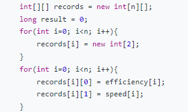
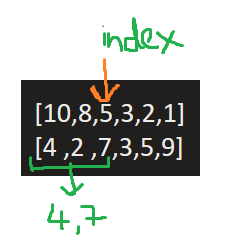

# Simple Solution | With clear explanation | C# | Priority Queue | O(NLogN)

**Author:** rahulvc
**Votes:** 4
**Link:** [https://leetcode.com/problems/maximum-performance-of-a-team/solutions/2560567/](https://leetcode.com/problems/maximum-performance-of-a-team/solutions/2560567/)

---

Algorithm Steps:
Input: `n = 6, speed = [2,10,3,1,5,8], efficiency = [5,4,3,9,7,2], k = 2`
1. Create a single Jagged array to save both efficiency and speed together 
		Eg: Arr = [ [eff[0],speed[0],
						 [eff[0],speed[0],
						 [eff[0],speed[0] ]
		Result: Arr = [ [2,5],[10,4],[3,3],[1,9],[5,7],[8,2] ]
	Code:
		

		
2. Sort the array based on efficiency in descending order so that you can traverse from high efficiency to low efficiency.
Code: 

3. For every efficiency, you take only that efficency and 2 maximum speeds in the traveresed indexes.
	Eg: If we are at index = 2 then we take the maximum k speeds i.e 2 here for calculation. they are 4 and 7 in this example. 
	

4. Calculate the result using the given formula = (Sum of 2 max speeds **x** efficiency) i.e (4+7) x 5.

5. We iterate over complete efficiency array and for each iteration we save the maximum result. and return the result.

If the explanation helps in your understanding then upvote :)
```
public class Solution {
    public int MaxPerformance(int n, int[] speed, int[] efficiency, int k) {
        int[][] records = new int[n][];
        long result = 0;
        for(int i=0; i<n; i++){
            records[i] = new int[2];
        }
        for(int i=0; i<n; i++){
            records[i][0] = efficiency[i];
            records[i][1] = speed[i];
        }
        Array.Sort(records, (a,b) => { return b[0]-a[0]; });
        
        long speedSum = 0;
        PriorityQueue<int,int> minHeap = new PriorityQueue<int,int>();
        
        for(int i=0; i<n; i++){
            if(minHeap.Count == k)
            {
                int minSpeed = minHeap.Dequeue();
                speedSum -= minSpeed;
            }
                
            speedSum += records[i][1];
            minHeap.Enqueue(records[i][1],records[i][1]);
            result = Math.Max(result, speedSum * records[i][0]);
            
        }        
       return (int)(result%1000000007);
    }
}
```