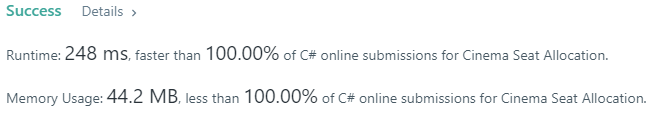

# [C#] 100%/100% Easy Ungrouped Dictionary and Booleans

**Author:** laprade
**Votes:** 5
**Link:** [https://leetcode.com/problems/cinema-seat-allocation/solutions/551579/](https://leetcode.com/problems/cinema-seat-allocation/solutions/551579/)

---

Proof
-


Reasoning
-
We use a ```Dictionary<int,bool[]>``` to keep track of which seats are reserved. Every ```bool[]``` is exactly 4 entries long, because a single occupied seat from any of our four pairs - (2,3), (4,5), (6,7), (8,9) will render both seats useless. We don't care if 1 or 10 are occupied, because the families can't sit there anyway, so we treat those rows as if they are empty.
Once we have the seats stored efficiently in our Dictionary, we know that any unoccupied row will fit two families. For the occupied rows, we can fit either 1 or 0 families, depending on the spacing of the occupied seats.

Algorithm
-
```
public class Solution {
    public int MaxNumberOfFamilies(int n, int[][] reservedSeats) {
        var reservedDictionary = new Dictionary<int,bool[]>();
        foreach (var reservedSeat in reservedSeats) {
            var seat = reservedSeat[1];
            if (seat != 1 && seat != 10) {
                var row = reservedSeat[0];
                if (!reservedDictionary.ContainsKey(row))
                    reservedDictionary[row] = new bool[4];
                reservedDictionary[row][seat/2-1] = true;
            }
        }
        return reservedDictionary.Values.Count(RoomForOneFamily) + 2*(n-reservedDictionary.Count());
        
        bool RoomForOneFamily(bool[] occupied) {
            return occupied[1] ? !(occupied[2] || occupied[3]) : !(occupied[2] && occupied[0]);
        }
    }
}
```