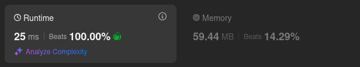

# Kotlin. Beats 100% (25 ms). HashMap + precalculated cache of masks.

**Author:** mobdev778
**Votes:** 0
**Link:** [https://leetcode.com/problems/cinema-seat-allocation/solutions/5441631/](https://leetcode.com/problems/cinema-seat-allocation/solutions/5441631/)

---



# Code
```
class Solution {
    fun maxNumberOfFamilies(n: Int, reservedSeats: Array<IntArray>): Int {
        val reserved = HashMap<Int, Int>()
        for ((y, x) in reservedSeats) {
            reserved[y] = reserved.getOrDefault(y, 0) or (1 shl x)
        }

        var result = 0
        for (e in reserved.values) result += cache[e]
        result += (n - reserved.size) shl 1

        return result
    }

    companion object {
        val cache = IntArray(2048) {
            when {
                it and 0x3FC == 0 -> 2
                it and 0x3C0 == 0 -> 1
                it and 0x3C == 0 -> 1
                it and 0xF0 == 0 -> 1
                else -> 0 
            }
        }
    }
}
```

# Approach

If we imagine each place in a row as a bit, we will get a situation where we have only 1024 possible variants of spectator distribution (exactly as many combinations give 10 bits).

We can calculate all these combinations in advance and for each variant derive the number of groups that can be placed in a row.

After the cache of 1024 combinations is pre-calculated, we can make the main algorithm - collect all the rows where spectators sit in a hash map (the task includes test cases with a million rows), having designed each spectator as a bit.

And then analyze using the cache how many groups can be placed on the specified rows.

Exactly 2 groups can be placed on all empty rows, so we can calculate the remainder as follows:

```
result += (n - reserved.size) * 2
```
or
```
result += (n - reserved.size) shl 1
```