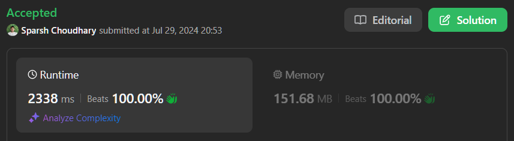

# 🔥BEATS 💯 % 🎯 |✨SUPER EASY BEGINNERS 👏| DART | JAVA | JAVASCRIPT | PYTHON |C++| SWIFT | 🍭

**Author:** CodeWithSparsh
**Votes:** 1
**Link:** [https://leetcode.com/problems/count-number-of-teams/solutions/5554069/](https://leetcode.com/problems/count-number-of-teams/solutions/5554069/)

---



###### NOTE: BEATS 100% in  Dart

# Intuition
To solve this problem, we need to identify all possible triplets `(i, j, k)` such that the ratings form either an increasing or decreasing sequence. Given the constraints, a brute force approach will be inefficient, especially for large inputs. 

# Approach
1. **Brute Force (Inefficient)**: 
   - Iterate over all possible triplets `(i, j, k)` where `i < j < k`.
   - Check if `rating[i] < rating[j] < rating[k]` or `rating[i] > rating[j] > rating[k]` holds true.
   - Count such valid triplets.

2. **Optimized Approach**:
   - Use two arrays to keep track of counts of ratings less than and greater than each soldier's rating at each index.
   - For each soldier at index `j`, use these counts to calculate the number of valid triplets where `j` is the middle soldier in the team.

# Complexity
- **Time Complexity**: The brute force approach has a time complexity of \\(O(n^3)\\), where \\(n\\) is the number of soldiers. The optimized approach improves this to \\(O(n^2)\\).
- **Space Complexity**: Both approaches have a space complexity of \\(O(n)\\) for auxiliary arrays.

# Code

```dart []
class Solution {
  int numTeams(List<int> rating) {
    int n = rating.length;
    int count = 0;

    for (int i = 0; i < n - 2; i++) {
      for (int j = i + 1; j < n - 1; j++) {
        for (int k = j + 1; k < n; k++) {
          if ((rating[i] < rating[j] && rating[j] < rating[k]) ||
              (rating[i] > rating[j] && rating[j] > rating[k])) {
            count++;
          }
        }
      }
    }

    return count;
  }
}
```
```java []
public class Solution {
    public int numTeams(int[] rating) {
        int n = rating.length;
        int count = 0;
        
        for (int i = 0; i < n - 2; i++) {
            for (int j = i + 1; j < n - 1; j++) {
                for (int k = j + 1; k < n; k++) {
                    if ((rating[i] < rating[j] && rating[j] < rating[k]) ||
                        (rating[i] > rating[j] && rating[j] > rating[k])) {
                        count++;
                    }
                }
            }
        }
        
        return count;
    }
}
```
```javascript []
class Solution {
    numTeams(rating) {
        let count = 0;
        let n = rating.length;
        
        for (let i = 0; i < n - 2; i++) {
            for (let j = i + 1; j < n - 1; j++) {
                for (let k = j + 1; k < n; k++) {
                    if ((rating[i] < rating[j] && rating[j] < rating[k]) ||
                        (rating[i] > rating[j] && rating[j] > rating[k])) {
                        count++;
                    }
                }
            }
        }
        
        return count;
    }
}
```
```python []
class Solution:
    def numTeams(self, rating: List[int]) -> int:
        n = len(rating)
        count = 0
        
        for i in range(n - 2):
            for j in range(i + 1, n - 1):
                for k in range(j + 1, n):
                    if (rating[i] < rating[j] < rating[k]) or (rating[i] > rating[j] > rating[k]):
                        count += 1
        
        return count
```
```cpp []
#include <vector>
using namespace std;

class Solution {
public:
    int numTeams(vector<int>& rating) {
        int n = rating.size();
        int count = 0;
        
        for (int i = 0; i < n - 2; ++i) {
            for (int j = i + 1; j < n - 1; ++j) {
                for (int k = j + 1; k < n; ++k) {
                    if ((rating[i] < rating[j] && rating[j] < rating[k]) ||
                        (rating[i] > rating[j] && rating[j] > rating[k])) {
                        ++count;
                    }
                }
            }
        }
        
        return count;
    }
};
```


```swift []
class Solution {
    func numTeams(_ rating: [Int]) -> Int {
        let n = rating.count
        var count = 0
        
        for i in 0..<n-2 {
            for j in i+1..<n-1 {
                for k in j+1..<n {
                    if (rating[i] < rating[j] && rating[j] < rating[k]) ||
                       (rating[i] > rating[j] && rating[j] > rating[k]) {
                        count += 1
                    }
                }
            }
        }
        
        return count
    }
}
```


These implementations cover a brute-force approach. If you need more efficient solutions, consider optimizing with auxiliary arrays or data structures.

 {:style='width:250px'}
