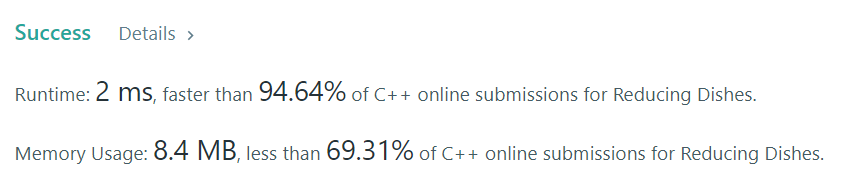

# ✅✅C++ || Easiest Solution || 💯💯Prefix Sum and Sorting Approach || 94% faster

**Author:** Conquistador17
**Votes:** 33
**Link:** [https://leetcode.com/problems/reducing-dishes/solutions/3353613/](https://leetcode.com/problems/reducing-dishes/solutions/3353613/)

---

## **\u2705\u2705C++ || Easiest Solution || \uD83D\uDCAF\uD83D\uDCAFPrefix Sum and Sorting Approach || 94% faster**
# **Please Upvote as it really motivates me**
**Approach:**
First observation is that we will have to assign maximum previous dish count to some positive number
so we will first sort it in desending order because we are going to take the max positive in our consideration always

Lets we have array now [5,2,-1,-2] now we have to basically find max of `(5*1,5*2+2*1,5*3+2*2+-1*1,5*4+2*3+-1*2+-2*1)` we can rewrite it as 
```
prefixSum[0],prefixSum[1]+prefixSum[0],prefixSum[2]+prefixSum[1]+prefixSum[0]
,prefixSum[4]+prefixSum[2]+prefixSum[1]+prefixSum[0]
```
```
class Solution {
public:
    int maxSatisfaction(vector<int>& sat) {
        int n=sat.size();
        sort(sat.begin(),sat.end(),greater<int>());
        vector<int>sum=sat;
        for(int i=1;i<n;i++){
            sum[i]+=sum[i-1];
        }
        int mx=0,cur=0;
        for(int i=0;i<n;i++){
            cur+=sum[i];
            mx=max(cur,mx);
        }
        return mx;
    }
};
```



