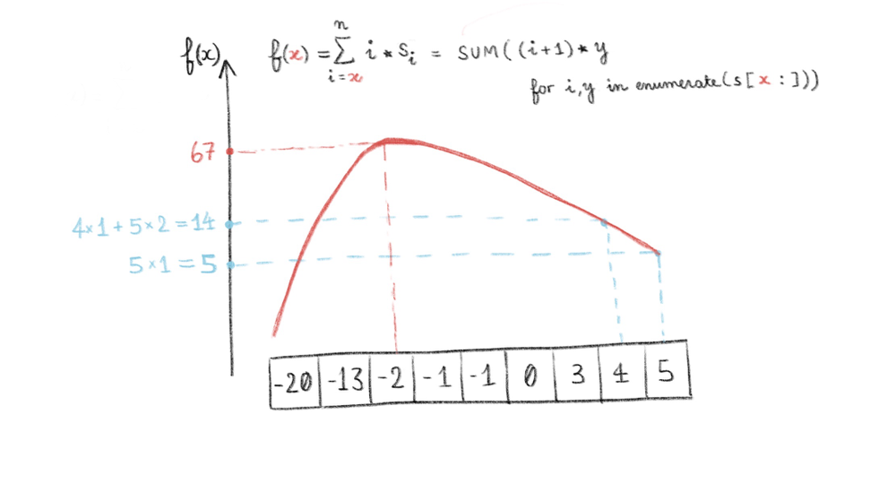

# Python O(n*lg(n)), Peak Finding, with drawing explanation

**Author:** 9nM3
**Votes:** 19
**Link:** [https://leetcode.com/problems/reducing-dishes/solutions/563911/](https://leetcode.com/problems/reducing-dishes/solutions/563911/)

---

Just notice that positive numbers can only make the sum bigger, and if a negative number is making the sum smaller, any negative number smaller than it can only make the sum smaller.

I'm very bad at explaining so here's a drawing.
TLDR is "There can only be 1 peak, so let's do a basic peak finding over the sorted array"
Time complexity: O(nlgn) because of the sorting


```
def get_coef_sum(s, i):
    return sum((a+1)*b for a,b in enumerate(s[i:]))

class Solution:
    # Just a basic 1D peak finding algortihm
    def maxSatisfaction(self, satisfaction) -> int:
        n = len(satisfaction)
        s = sorted(satisfaction)
        
        l, r = 0, n
        while l < r:
            middle = l + (r-l)//2
            cur_sum = get_coef_sum(s, middle)
            left_bigger = middle == 0 or get_coef_sum(s, middle-1) >= cur_sum
            right_bigger = middle == n-1 or get_coef_sum(s, middle+1) >= cur_sum

            if not left_bigger and not right_bigger:
                return get_coef_sum(s, middle)

            elif left_bigger:
                r = middle
            else:
                l = middle+1

        return get_coef_sum(s, l)
```
	
Please let me know if that makes sense, and how it could be explained better, thanks!