# Image Explanation🏆- [Recursion->Memo->Bottom Up-> O(1) Space] - C++/Java/Python

**Author:** aryan_0077
**Votes:** 46
**Link:** [https://leetcode.com/problems/stone-game-iii/solutions/3566457/](https://leetcode.com/problems/stone-game-iii/solutions/3566457/)

---

# Video Solution (`Aryan Mittal`) - Link in LeetCode Profile
`Stone Game III` by `Aryan Mittal`


# Approach & Intution
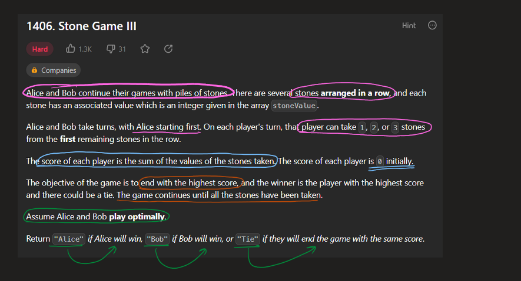
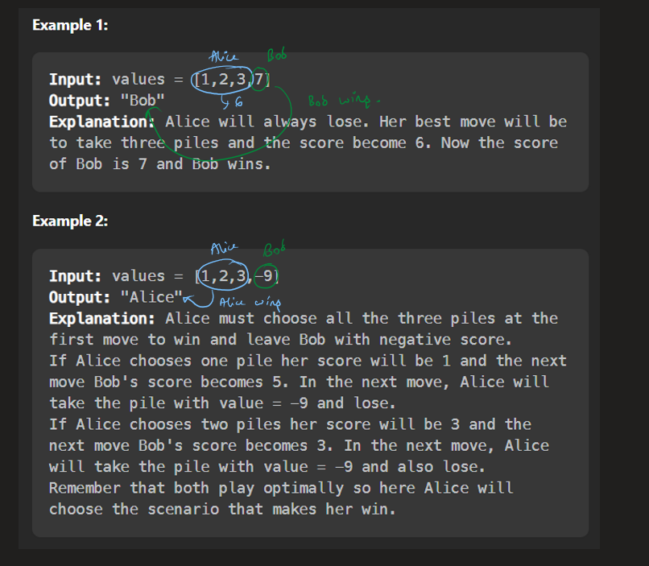
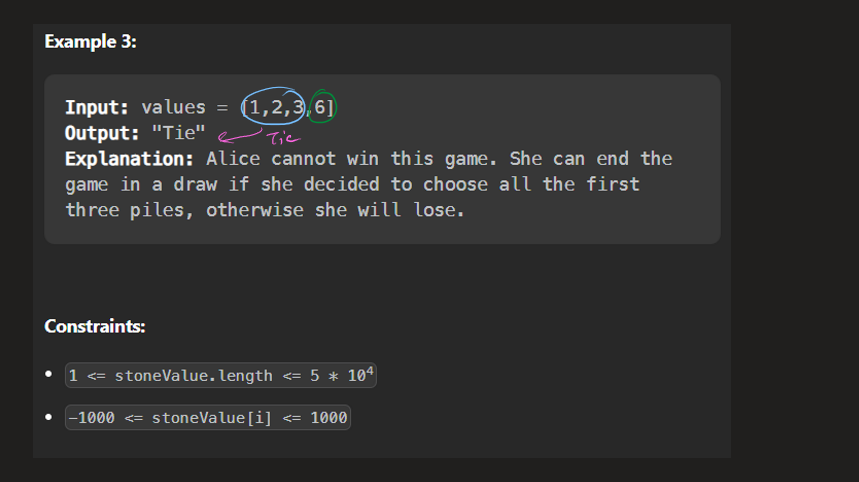
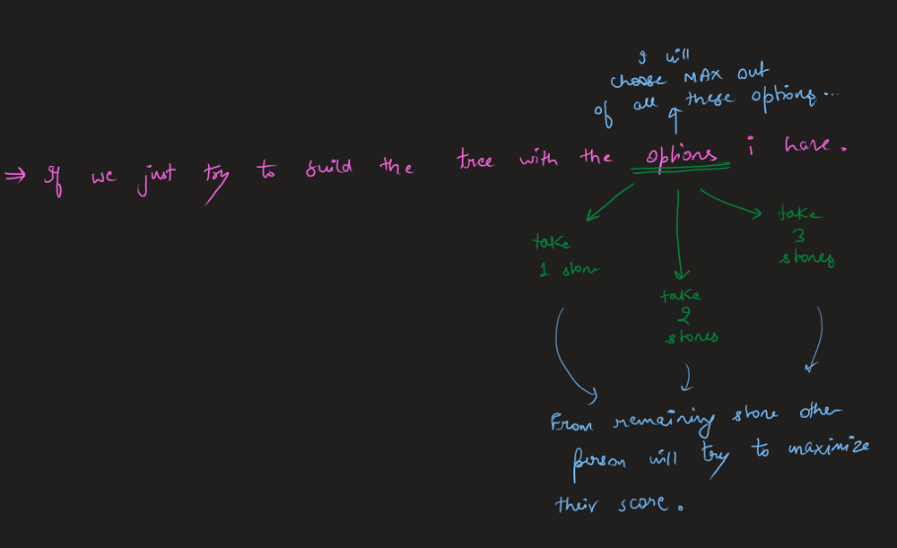
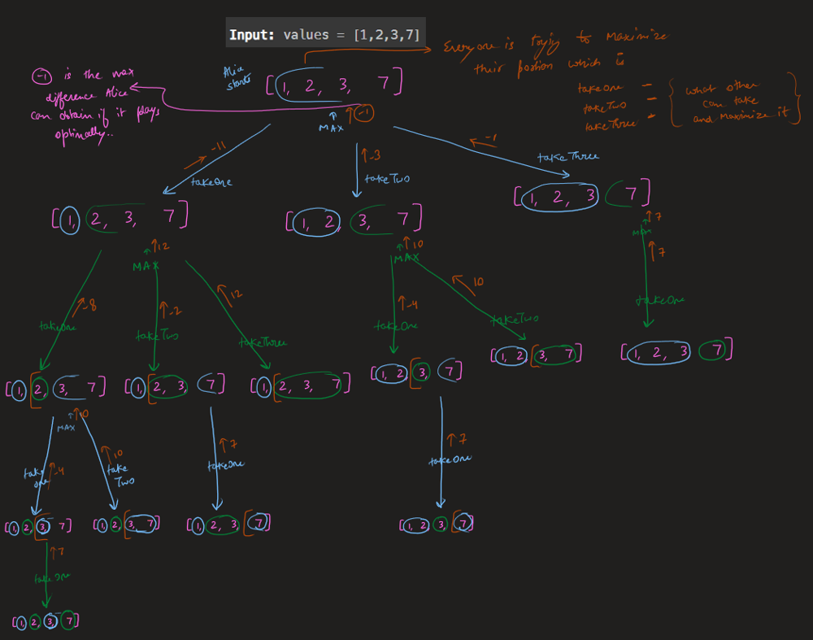
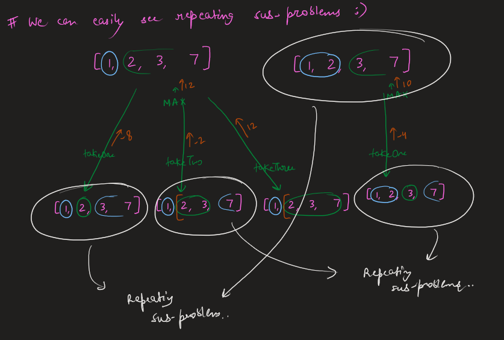
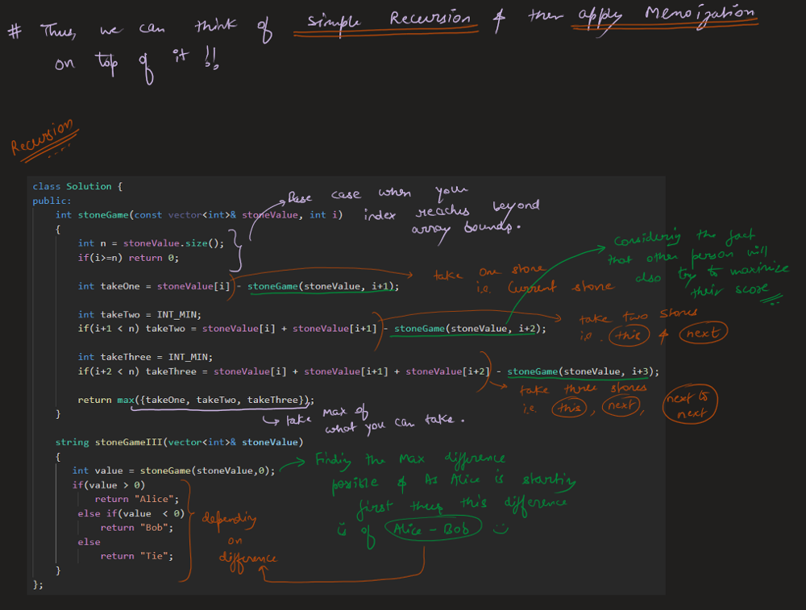
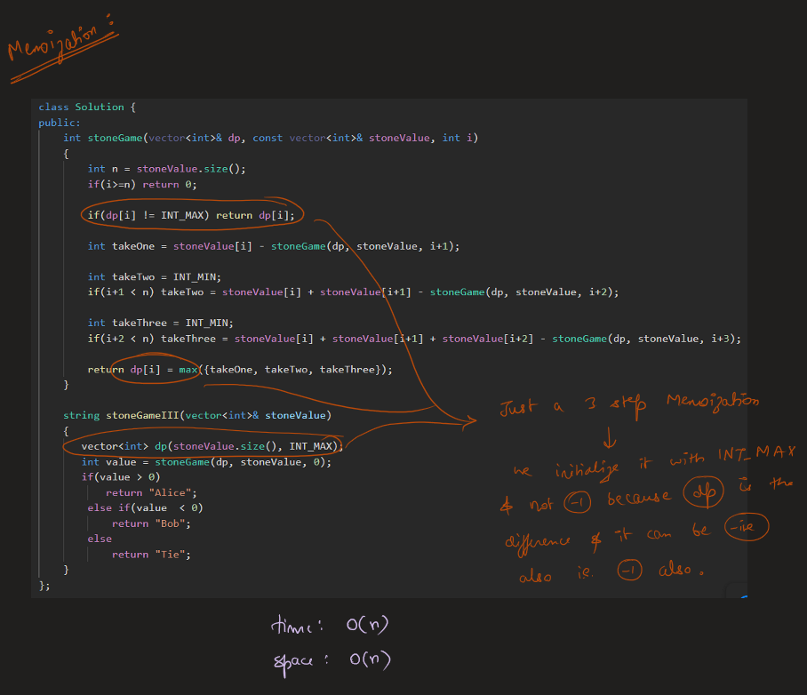
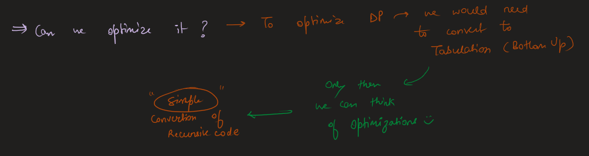
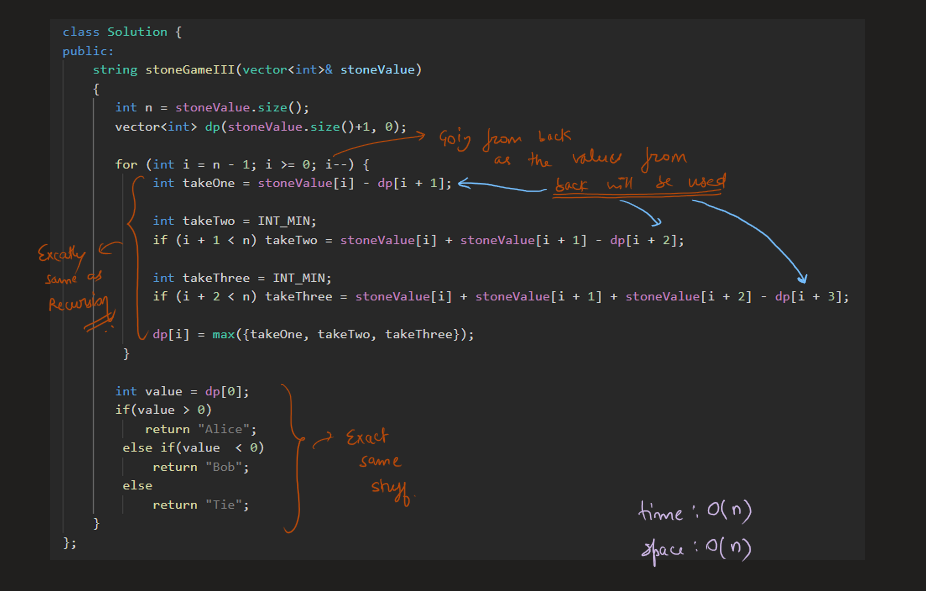
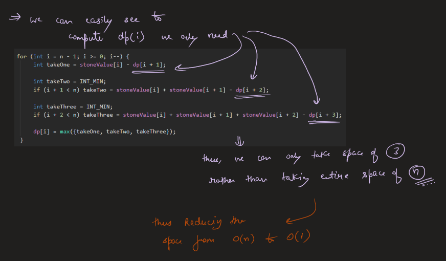
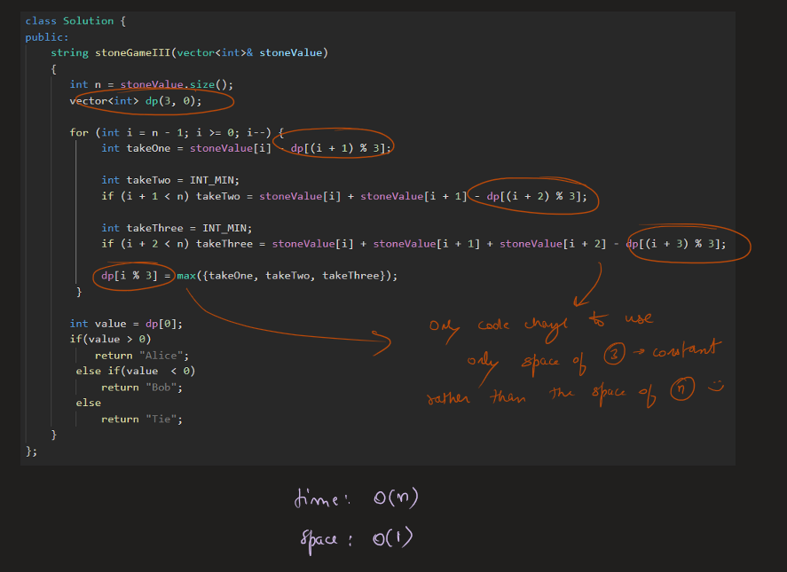


# Code
```C++ []
class Solution {
public:
    string stoneGameIII(vector<int>& stoneValue) 
    {
       int n = stoneValue.size(); 
       vector<int> dp(3, 0); 

       for (int i = n - 1; i >= 0; i--) {
            int takeOne = stoneValue[i] - dp[(i + 1) % 3];

            int takeTwo = INT_MIN;
            if (i + 1 < n) takeTwo = stoneValue[i] + stoneValue[i + 1] - dp[(i + 2) % 3];

            int takeThree = INT_MIN;
            if (i + 2 < n) takeThree = stoneValue[i] + stoneValue[i + 1] + stoneValue[i + 2] - dp[(i + 3) % 3];

            dp[i % 3] = max({takeOne, takeTwo, takeThree});
        } 

       int value = dp[0]; 
       if(value > 0)
           return "Alice";
        else if(value  < 0)
            return "Bob";
        else
            return "Tie";
    }
};
```
```Java []
class Solution {
    public String stoneGameIII(int[] stoneValue) {
        int n = stoneValue.length;
        int[] dp = new int[3];

        for (int i = n - 1; i >= 0; i--) {
            int takeOne = stoneValue[i] - dp[(i + 1) % 3];

            int takeTwo = Integer.MIN_VALUE;
            if (i + 1 < n)
                takeTwo = stoneValue[i] + stoneValue[i + 1] - dp[(i + 2) % 3];

            int takeThree = Integer.MIN_VALUE;
            if (i + 2 < n)
                takeThree = stoneValue[i] + stoneValue[i + 1] + stoneValue[i + 2] - dp[(i + 3) % 3];

            dp[i % 3] = Math.max(Math.max(takeOne, takeTwo), takeThree);
        }

        int value = dp[0];
        if (value > 0)
            return "Alice";
        else if (value < 0)
            return "Bob";
        else
            return "Tie";
    }
}
```
```Python []
class Solution:
    def stoneGameIII(self, stoneValue):
        n = len(stoneValue)
        dp = [0] * 3

        for i in range(n - 1, -1, -1):
            takeOne = stoneValue[i] - dp[(i + 1) % 3]

            takeTwo = float('-inf')
            if i + 1 < n:
                takeTwo = stoneValue[i] + stoneValue[i + 1] - dp[(i + 2) % 3]

            takeThree = float('-inf')
            if i + 2 < n:
                takeThree = stoneValue[i] + stoneValue[i + 1] + stoneValue[i + 2] - dp[(i + 3) % 3]

            dp[i % 3] = max(takeOne, takeTwo, takeThree)

        value = dp[0]
        if value > 0:
            return "Alice"
        elif value < 0:
            return "Bob"
        else:
            return "Tie"
```