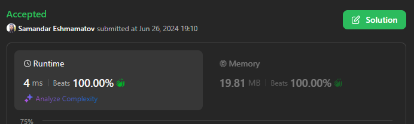

# 🥷🏻 Easy Typescript, Easy JavaScript, Easy PHP 🥷🏻 100% beats 🔥🔥🔥

**Author:** samandareshmamatov
**Votes:** 2
**Link:** [https://leetcode.com/problems/string-matching-in-an-array/solutions/5372816/](https://leetcode.com/problems/string-matching-in-an-array/solutions/5372816/)

---




# Code
```Typescript []
function stringMatching(words: string[]): string[] {
    words.sort((a, b) => a.length - b.length);

    const result = new Set<string>();

    for (let i = 0; i < words.length - 1; i += 1) 
        for (let j = i + 1; j < words.length; j += 1)
            if (words[j].includes(words[i])) result.add(words[i]);

    return Array.from(result);
};
```
```Javascript []
var stringMatching = function(words) {
    words.sort((a, b) => a.length - b.length);

    const result = new Set();

    for (let i = 0; i < words.length - 1; i += 1) 
        for (let j = i + 1; j < words.length; j += 1)
            if (words[j].includes(words[i])) result.add(words[i]);

    return Array.from(result);
};
```
```PHP []
class Solution {

    /**
     * @param String[] $words
     * @return String[]
     */
    function stringMatching($words) {
        usort($words, function($a, $b){
            return strlen($a) > strlen($b);
        });

        $result = array();

        for ($i = 0; $i < count($words); $i++) {
            for ($j = $i + 1; $j < count($words); $j++) {
                if (str_contains($words[$j], $words[$i])){
                    array_push($result, $words[$i]);
                }
            }
        }
        return array_unique($result);
    }
}
```
