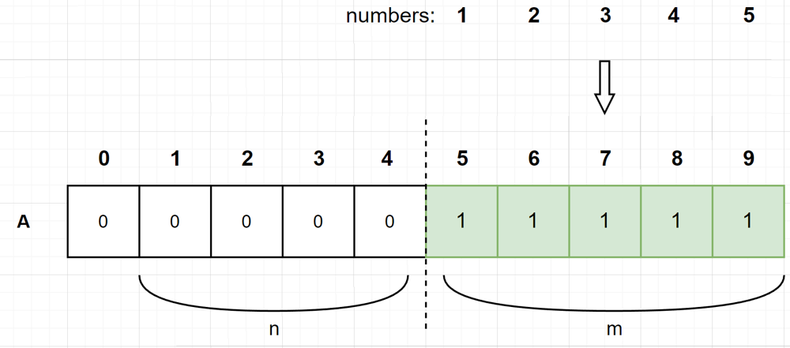
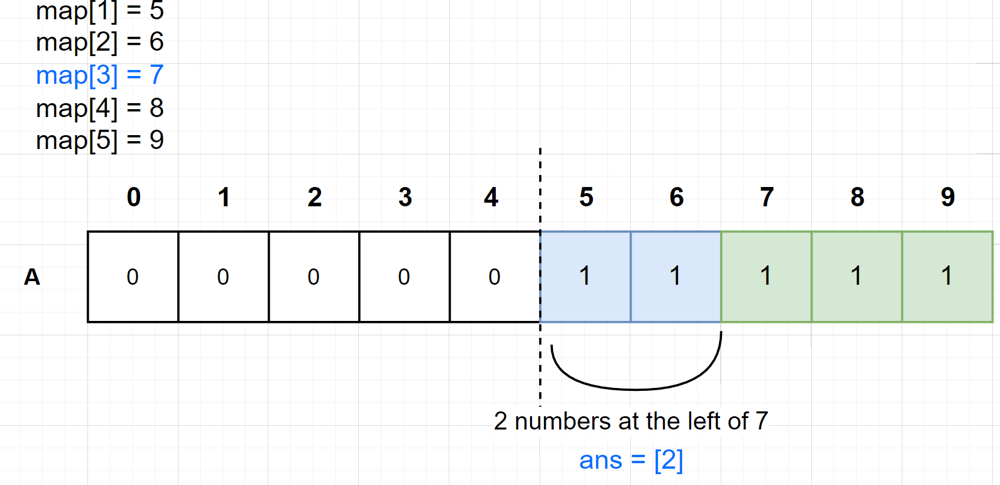
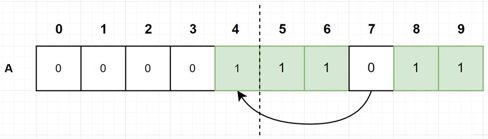
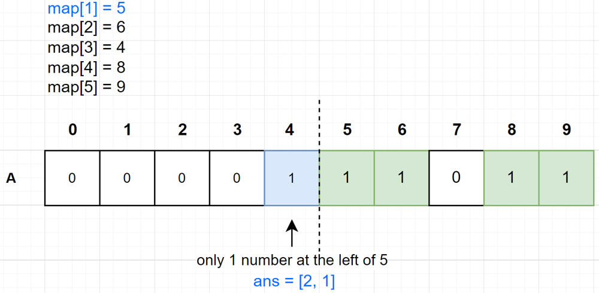
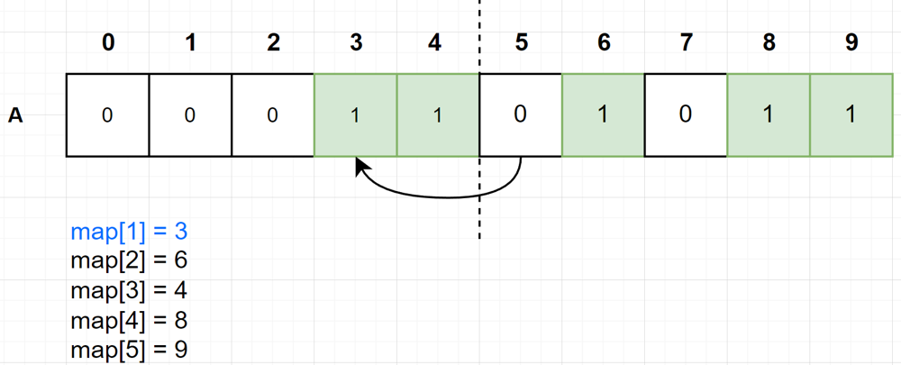
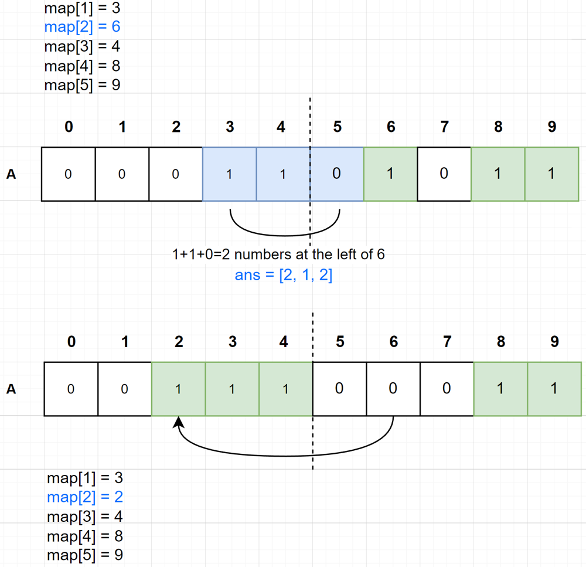
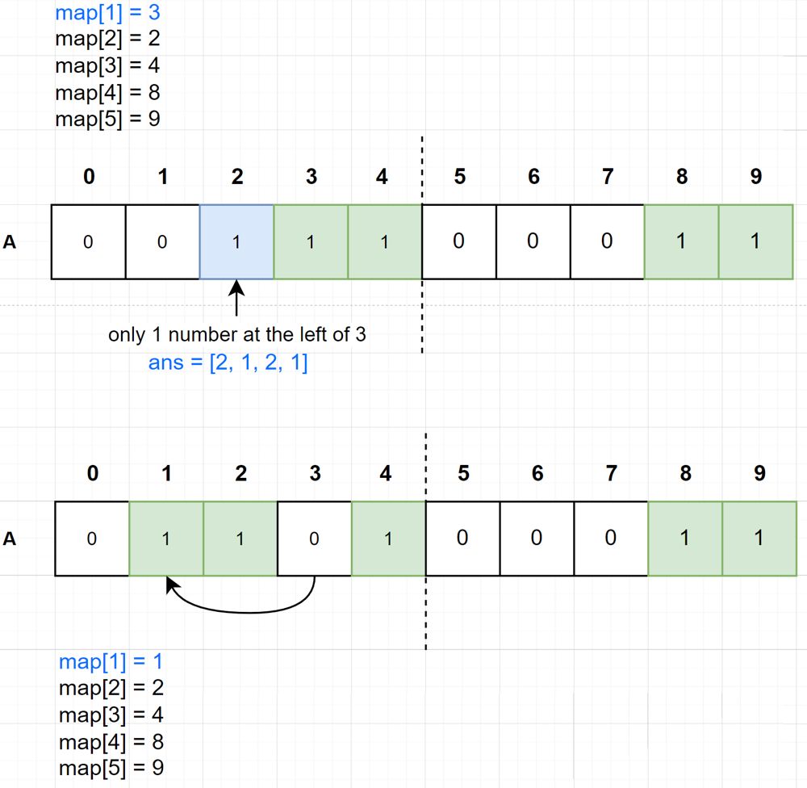

# Binary Indexed Tree with detailed pictures explanations

**Author:** xiyu0612
**Votes:** 7
**Link:** [https://leetcode.com/problems/queries-on-a-permutation-with-key/solutions/2751953/](https://leetcode.com/problems/queries-on-a-permutation-with-key/solutions/2751953/)

---

# Intuition
<!-- Describe your first thoughts on how to solve this problem. -->

Using binary indexed tree to achieve $$O(N * log(N + M))$$ .

Thanks to [@FrenkieDeJong's post](https://leetcode.com/problems/queries-on-a-permutation-with-key/solutions/575208/java-binary-indexed-tree-solution/), I drew some pictures for better understanding.

Hope it helps.

# Approach
<!-- Describe your approach to solving the problem. -->

At first glance it's a bit hard to recognize the BIT character of this problem.

But with following explanations step by step, you would realize that it's really clear to come up with BIT.

Example:
```
numbers = [1, 2, 3, 4, 5]
queries = [3, 1, 2, 1]
m = 5, n = 4
```

### 1. Create an array **A** with size of `n+m+1`
let numbers map to index `[n, n+m-1]`, initialize them to 1 as follows.
`A[i]`: whether there's a number at index `i`.


### 2. Use `map[number]=index` to record current index of number in **A**.
At the beginning, we have:
```
map[1] = 5
map[2] = 6
map[3] = 7
map[4] = 8
map[5] = 9
```

### 3. Let's go through the example
Recall the example:
```
numbers = [1, 2, 3, 4, 5]
queries = [3, 1, 2, 1]
m = 5, n = 4
ans = [ ]
```

for the first query number `3`, it's index is `map[3]=7`, the index in the original array is identical to ***how many numbers are there at its left***.
since there are `2` numbers at its left(marked as blue), so the result is `2`.



Then we **relocate** number 3 from index 7 to index 4, leaves 7 as an ***empty hole***(`A[7]` is set to `0`), which means
the number has gone to another place.



And don't forget to update map:
<image src='https://assets.leetcode.com/users/images/6a30b834-c983-4c75-8d9d-03aff3b03f83_1666949244.5922039.png' width=80 >

### 4. For 2nd query number 1, we do the same thing as above:

we relocate number 1 from index 5 to index 3, leaves 5 as ***an empty hole***.


### 5. So on so forth, for 3rd query number 2:


### 6. For 4th query number 1:


Finally, we have `ans = [2, 1, 2, 1]`.

### Conclusion

Once you have gone through the process, it should be pretty clear that we need to
calculate **how many numbers are there on the left of `i` in A**, which is the sum of `A[0: i)`.

It's now very intuitive to come up with binary indexed tree to do these calculations.


# Complexity
- Time complexity: $$O(N * log(N + M))$$
<!-- Add your time complexity here, e.g. $$O(n)$$ -->

- Space complexity: $$O(N + 2M)$$
<!-- Add your space complexity here, e.g. $$O(n)$$ -->

# Code
```
function processQueries(queries: number[], m: number): number[] {
  const n = queries.length;
  const size = n + m;
  const bt = new Array(size + 1).fill(0);
  const map = new Map();
  for (let i = 1; i <= m; i++) {
    map[i] = n + i;
    update(bt, size, n + i, 1);
  }

  const ans: number[] = [];
  for (let i = 0; i < n; i++) {
    const num = queries[i];
    const idx = map[num];
    const leftCnt = query(bt, idx);
    ans.push(leftCnt);
    update(bt, size, idx, -1);
    update(bt, size, n - i, 1);
    map[num] = n - i;
  }

  return ans;
};

function query(bt: number[], i: number) {
  let sum = 0;
  while (0 < i) {
    sum += bt[i];
    i -= i & -i;
  }
  return sum;
}

function update(bt: number[], n: number, p: number, diff: number) {
  p++;
  while (p <= n) {
    bt[p] += diff;
    p += p & -p;
  }
}
```