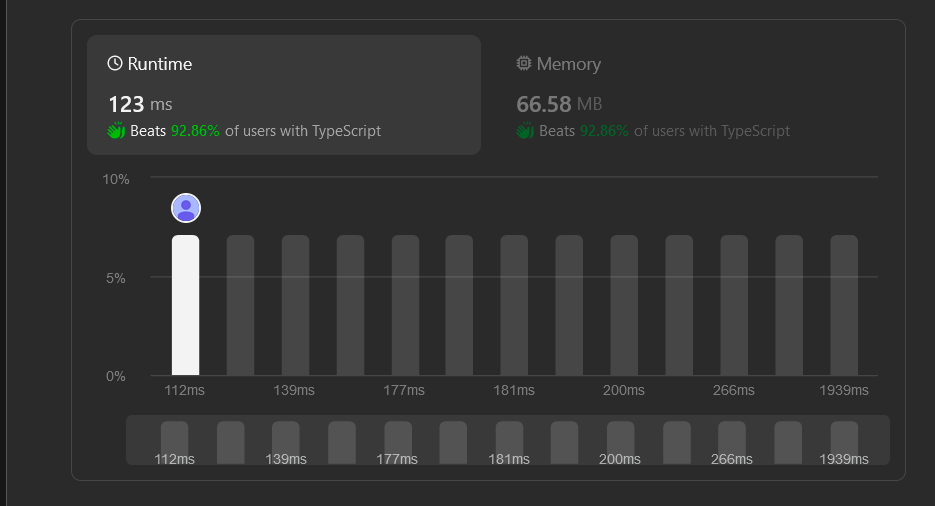

# Simple TypeScript solution using Maps (with comments) || Beats 93%

**Author:** JCeccarelli
**Votes:** 0
**Link:** [https://leetcode.com/problems/display-table-of-food-orders-in-a-restaurant/solutions/4954226/](https://leetcode.com/problems/display-table-of-food-orders-in-a-restaurant/solutions/4954226/)

---

# Intuition\r
<!-- Describe your first thoughts on how to solve this problem. -->\r
\r
# Approach\r
<!-- Describe your approach to solving the problem. -->\r
\r
# Complexity\r
- Time complexity:\r
<!-- Add your time complexity here, e.g. $$O(n)$$ -->\r
\r
- Space complexity:\r
<!-- Add your space complexity here, e.g. $$O(n)$$ -->\r
\r
\r
\r
# Code\r
```\r
function displayTable(orders: string[][]): string[][] {\r
    const ordersLength = orders.length;\r
    let columnNames: string[] = [];\r
\r
    for(let i = 0; i < ordersLength; i++) {\r
        columnNames.push(orders[i][2]);\r
    }\r
\r
    // Removing duplicates and ordering columns\r
    columnNames = Array.from(new Set(columnNames));\r
    columnNames.sort();\r
\r
    const columnNamesMap: Record<string, number> = {};\r
\r
    // Map tables index\r
    columnNames.forEach((column, index) => columnNamesMap[column] = index + 1);\r
    columnNames.unshift("Table");\r
\r
    const columnNamesLength = columnNames.length;\r
\r
    const tablesMap: Record<string, string[]> = {};\r
\r
    // Creating table arrays\r
    for(let i = 0; i < ordersLength; i++) {\r
        const tableNumber = orders[i][1];\r
        const index = columnNamesMap[orders[i][2]];\r
\r
        if (!!tablesMap[tableNumber]) {\r
            tablesMap[tableNumber][index] = (Number(tablesMap[tableNumber][index]) + 1).toString();\r
        } else {\r
            tablesMap[tableNumber] = new Array(columnNamesLength).fill("0");\r
            tablesMap[tableNumber][0] = tableNumber;\r
            tablesMap[tableNumber][index] = (Number(tablesMap[tableNumber][index]) + 1).toString();\r
        }\r
    }\r
\r
    // Sort table by number\r
    const tableOrders = Object.values(tablesMap).map(x => x).sort((a, b) => Number(a[0]) - Number(b[0]));\r
\r
    return [columnNames, ...tableOrders]\r
};\r
```