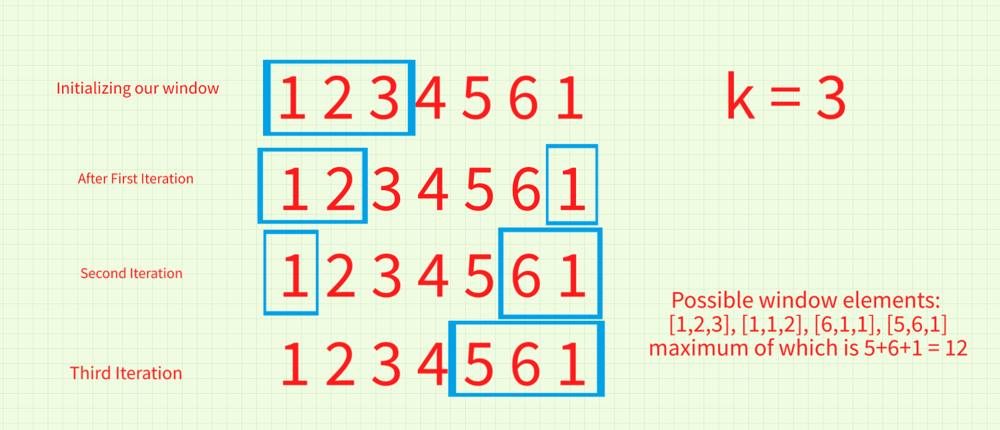

# C++ Solution Using Sliding Window

**Author:** harshit7962
**Votes:** 343
**Link:** [https://leetcode.com/problems/maximum-points-you-can-obtain-from-cards/solutions/2198002/](https://leetcode.com/problems/maximum-points-you-can-obtain-from-cards/solutions/2198002/)

---

**Intuition**
The idea here is pretty tricky to guess...
- What we do is we initialize a window of size k...
- Now, since we can select either from the start or from the end, we only have access to either the first k items or last k items, and hence we are trying to limit our access using this window...
- So, we include all the elements from start in our window, till its full...
- The sum of elements at each instance in our window will be kept track of using another variable that will store our result.
- Now, we remove the last element from our window, and add the last unvisited element of our cardPoints array... Similarly we keep on removing 1 element from our window and start adding the last unvisited element of our cardPoints array...
- We keep doing this until we reach the start of our array, in this way we have covered all our possible picks...

**Example**

In our possible windows, we can see that we are covering all the possible picks in our given array using 3 cards...

**Pls upvote this thread if you found the solution helpful.**

```
class Solution {
public:
    int maxScore(vector<int>& cardPoints, int k) {
        int res = 0;
		
		//First k elements in our window
        for(int i=0;i<k;i++) res+=cardPoints[i];
        
        int curr=res;
        for(int i=k-1;i>=0;i--) {
			//We remove the last visited element and add the non-visited element from the last
            curr-=cardPoints[i];
            curr+=cardPoints[cardPoints.size()-k+i];
			
            //We check the maximum value any possible combination can give
			res = max(res, curr);
        }
        
        return res;
    }
};
```