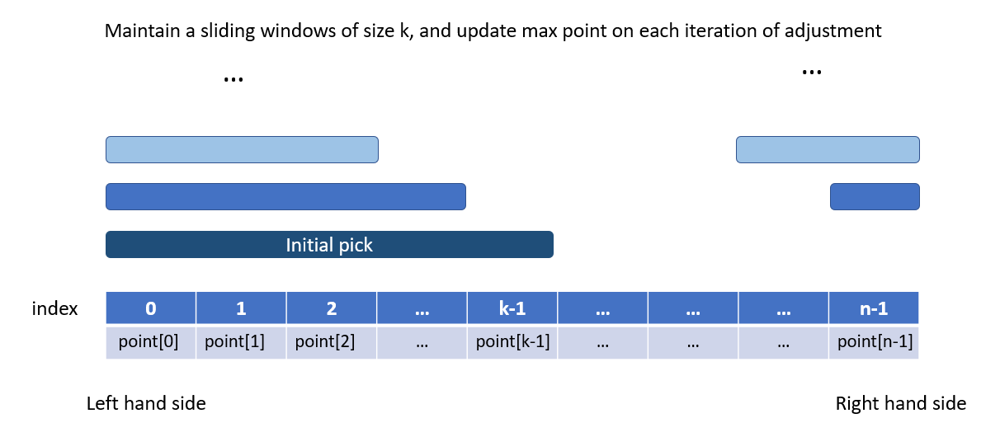

# Python/JS/Java/Go/C++ O( k ) sliding window. [w/ Visualization]

**Author:** brianchiang_tw
**Votes:** 55
**Link:** [https://leetcode.com/problems/maximum-points-you-can-obtain-from-cards/solutions/598055/](https://leetcode.com/problems/maximum-points-you-can-obtain-from-cards/solutions/598055/)

---

O( k ) sliding window solution

---

**Diagram & Visualization**:



---

**Implementation**:

Python

```
class Solution:
    def maxScore(self, cardPoints: List[int], k: int) -> int:
        
        size = len(cardPoints)
        left, right = k-1, size-1
        
        # Initial pick: take all k card from left hand side
        current_pick = sum(cardPoints[:k])
        max_point = current_pick
        
        # adjustment
        for _ in range(k):
            
            # left hand side discards one, and right hand side picks one more 
            current_pick += ( cardPoints[right] - cardPoints[left] )
            
            # update max point
            max_point = max(max_point, current_pick)
            
            # update card index for both sides in adjustment
            left, right = left-1, right-1
            
        return max_point
```

---

Java:

```
class Solution {
    public int maxScore(int[] cardPoints, int k) {
        
        int size = cardPoints.length;
        int left = k-1, right=size-1;
        
        // Initial pick: pick all k crad from left hand side
        int currentPick = 0;
        
        for( int i = 0; i < k ; i++){
            currentPick += cardPoints[i];
        }
        
        int maxPoint = currentPick;
        
        // adjustment
        for( int i=0 ; i<k ; i++){
            
            //left hand side discards one, and right hand side picks on more
            currentPick += ( cardPoints[right] - cardPoints[left] );
            
            //update max point
            maxPoint = Math.max( maxPoint, currentPick);
            
            // update card index for both sides in adjustment
            left -= 1;
            right -= 1;
        }
        
        return maxPoint;
    }
}
```

---

Javascript:

```
var maxScore = function(cardPoints, k) {
    let size = cardPoints.length;
    let [left, right] = [k-1, size-1];
    
    // Initial pick: take all k cards from left hand side
    let currentPick = cardPoints.slice(0,k).reduce( (x, y) => x+y, 0);
    let maxPoint = currentPick;
    
    // adjustment
    for(let i = 0 ; i < k ; i++ ){
        
        // left hand side discards one, and right hand side picks one more
        currentPick += ( cardPoints[right] - cardPoints[left] );
        
        // update max point
        maxPoint = Math.max( maxPoint, currentPick );
        
        // update card index for both sides in adjustment
        [left, right] = [left-1, right-1];
        
    }
    
    return maxPoint;
};
```

---

Go:

```
func max( x, y int) int {
    
    if x > y{
        return x
    
    }else{
        return y
    }
}

func maxScore(cardPoints []int, k int) int {

    size := len(cardPoints)
    left, right := k-1, size-1
    
    // Initial pick: take all k cards from left hand side
    currentPick := 0
    for _, card := range cardPoints[0:k]{
        currentPick += card
    }
    
    maxPoint := currentPick
    
    // Adjustment
    for i:=0 ; i < k ; i++{
        
        // left hand side discards one, and right hand side picks one more
        currentPick += ( cardPoints[right] - cardPoints[left] )
        
        // update max point
        maxPoint = max( maxPoint, currentPick)
        
        // update card index from both side in adjustment
        left, right = left-1, right-1
        
    }
    
    return maxPoint
}
```

---

C++

```
class Solution {
public:
    int maxScore(vector<int>& cardPoints, int k) {
        
        size_t size = cardPoints.size();
        int left = k-1, right=size-1;
        
        // Initial pick: pick all k crad from left hand side
        int currentPick = accumulate( cardPoints.begin(), cardPoints.begin()+k, 0);
        int maxPoint = currentPick;
        
        // adjustment
        for( int i=0 ; i<k ; i++){
            
            //left hand side discards one, and right hand side picks on more
            currentPick += ( cardPoints[right] - cardPoints[left] );
            
            //update max point
            maxPoint = max( maxPoint, currentPick);
            
            // update card index for both sides in adjustment
            left -= 1;
            right -= 1;
        }
        
        return maxPoint;
        
    }
};
```