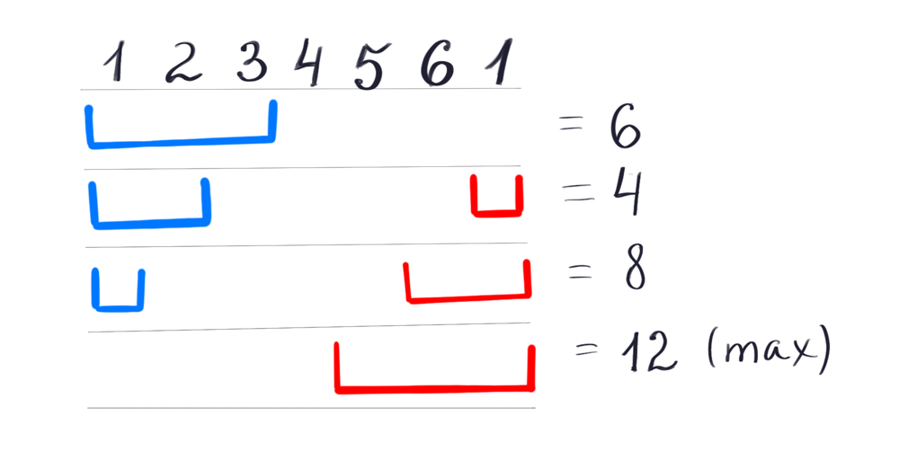

# Ruby Solution with explanation, comments and visualization (two sliding windows)

**Author:** kirillshevch
**Votes:** 2
**Link:** [https://leetcode.com/problems/maximum-points-you-can-obtain-from-cards/solutions/622167/](https://leetcode.com/problems/maximum-points-you-can-obtain-from-cards/solutions/622167/)

---

The main idea of this solution is to create two sliding windows with a dynamic size and search for the sum of their maximum values:



Steps to solve:

1. Start with calculation max left window 
2. Iterate windows size changing untill right window size wil be == k
3. Save result of left and right window pick have max value

```ruby
# @param {Integer[]} card_points
# @param {Integer} k
# @return {Integer}
def max_score(card_points, k)
    left_w = k-1 # init left window
    cards_size = card_points.length
    left_sum = card_points[0..left_w].reduce(:+) # calculate left side window 
    
    max_sum = left_sum
    
    right_w = cards_size-1 # init right window
    right_sum = 0 # init value of empty window
    
    while left_w >= 0 do 
        left_sum -= card_points[left_w]
        right_sum += card_points[right_w]

        left_w = left_w-1 # reduce left window size 
        right_w = right_w-1 # increase right window size
    
        max_sum = [max_sum, left_sum + right_sum].max # save result if left and right window have max value
    end
        
    max_sum
end
```