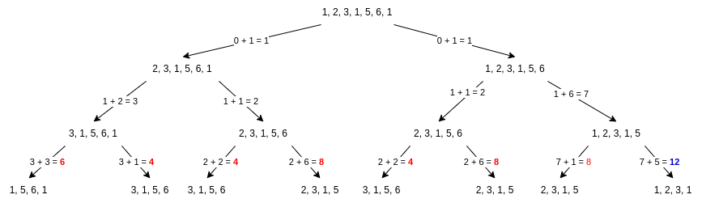

# Sharing my solution(s) in Scala

**Author:** valentarmo
**Votes:** 0
**Link:** [https://leetcode.com/problems/maximum-points-you-can-obtain-from-cards/solutions/2202105/](https://leetcode.com/problems/maximum-points-you-can-obtain-from-cards/solutions/2202105/)

---

### Brute Force
The brute force solution is very straightforward. You just compare what you'd get by taking the left or right value at every step, and pick the largest result.

#### Example
* [1, 2, 3, 1, 5, 6],  k = 3



#### Implementation
```
def maxScore(cardPoints: Array[Int], k: Int): Int = {
  def go(i: Int, j: Int, k: Int): Int = {
    if (k == 0) 0
      else {
        val takeLeft  = cardPoints(i) + go(i + 1, j, k - 1)
        val takeRight = cardPoints(j) + go(i, j - 1, k - 1)
        takeLeft max takeRight
      }
    }
    go(0, cardPoints.length - 1, k)
}
```
Though simple, it's very inneficient. It has exponential performance.


### Sliding Window
Here, the idea is that we can look at the problem the other way around, i.e. instead of taking from the sides, take from within the array. We'd go from left to right keeping a window of size `arr.length - k`, and at every step we'd get number of points by subtracting the total number points with the points in the window.

#### Example
* [1, 2, 3, 1, 5, 6, 1],  k = 3 (The numbers in bold represent the window.)
	total = 19
	windowWidth =  7 - 3 = 4
	
	*  **1, 2, 3, 1**, 5, 6, 1 --- inWindow = 7, points = 19 - 7 = **12**
	*  1, **2, 3, 1, 5**, 6, 1 --- inWindow = 11, points = 19 - 11 = 8
	*  1, 2, **3, 1, 5, 6**, 1 --- inWindow = 15, points = 19 - 15 = 4
	*  1, 2, 3, **1, 5, 6, 1** --- inWindow = 13, points = 19 - 13 = 6

#### Implementation
```
def maxScore(cardPoints: Array[Int], k: Int): Int = {
  val len   = cardPoints.length
  val total = cardPoints.sum
        
  @annotation.tailrec
  def go(i: Int, j: Int, sum: Int, max: Int): Int = {
    if (j == len) max
    else {
      val newSum = sum - cardPoints(i) + cardPoints(j)
      val newMax = max.max(total - newSum)
      go(i + 1, j + 1, newSum, newMax)
    }
  }
	
  val initSum = cardPoints.take(len - k).sum
  go(0, len - k, initSum, total - initSum)
}
```

Now we've achieved linear worst case performance, and linear memory consumption due to the call to `cardPoints.take` (the recursive calls are tail recursive, so no additional memory there). We can easily improve to constant memory by replacing said line with something like this:

```
@annotation.tailrec
def growWindow(i: Int, w: Int, sum: Int): Int = {
  if (w == 0) sum
  else growWindow(i + 1, w - 1, sum + cardPoints(i))
}
val initSum = growWindow(0, len - k, 0)
```