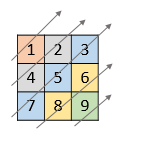
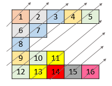

# [1424. Diagonal Traverse II](https://leetcode.com/problems/diagonal-traverse-ii/)

| Category | Difficulty | Likes | Dislikes |
| :------: | :--------: | :---: | :------: |
| Algorithms | Medium | 2295 | 158 |

**Tags:** [`array`](https://leetcode.com/tag/array), [`sorting`](https://leetcode.com/tag/sorting), [`heap-priority-queue`](https://leetcode.com/tag/heap-priority-queue)

**Companies:** `facebook`, `google`

## Description

Given a 2D integer array `nums`, return *all elements of *`nums`* in diagonal order as shown in the below images*.

 

**Example 1:**


```

Input: nums = [[1,2,3],[4,5,6],[7,8,9]]
Output: [1,4,2,7,5,3,8,6,9]

```

**Example 2:**


```

Input: nums = [[1,2,3,4,5],[6,7],[8],[9,10,11],[12,13,14,15,16]]
Output: [1,6,2,8,7,3,9,4,12,10,5,13,11,14,15,16]

```

 

**Constraints:**

	- `1 <= nums.length <= 10^5`

	- `1 <= nums[i].length <= 10^5`

	- `1 <= sum(nums[i].length) <= 10^5`

	- `1 <= nums[i][j] <= 10^5`

---

**Links:** [Submissions](https://leetcode.com/problems/diagonal-traverse-ii/) | [Solutions](https://leetcode.com/problems/diagonal-traverse-ii/)
